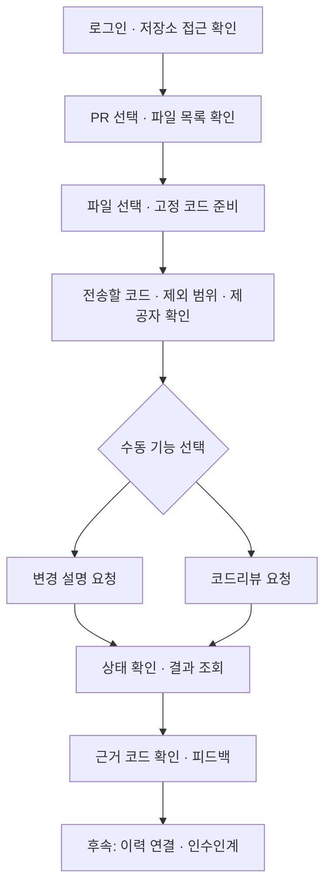
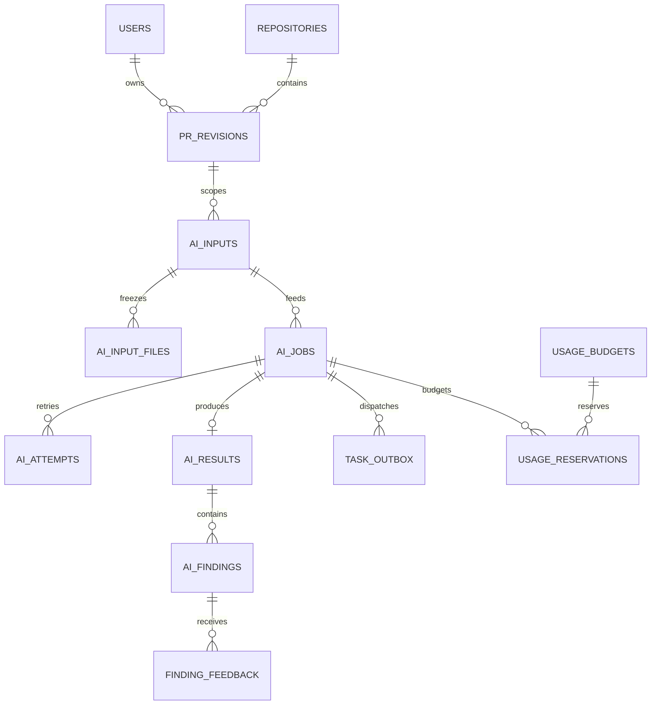
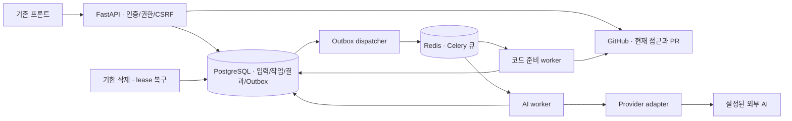

# GitViz AI 요구사항 분석 및 시스템 설계 v0.4

- 작성일: 2026-10-07
- 입력 기획: [AI 활용 기획 v0.3](GitViz_AI_활용_기획_v0.3.md)
- 산출물: MVP, 사용자 흐름, 기능 명세, DB/API/아키텍처, 예외·보안·확장 설계
- 상태: 구현 전 설계안. 테이블·API·수치 기준은 제안이며 운영에 적용된 상태가 아닙니다.

## 1. 결론과 설계 기준

**MVP는 로그인한 사용자가 PR 하나의 코드를 고정해서 변경 설명과 코드리뷰를 수동 실행하는 개인 작업 공간입니다.** 두 결과는 독립적으로 생성합니다. 리뷰 입력은 원본 코드이며, 먼저 생성한 AI 요약을 사실 근거로 재사용하지 않습니다.

GitViz 이력 연결은 다음 단계의 차별화 기능입니다. 인수인계와 팀 자동화는 별도 확장입니다. 지금부터 다섯 기능을 모두 같은 MVP로 묶으면 코드 수집, 모델 평가, 문서 편집, 팀 권한, 이벤트 운영을 동시에 만들어야 합니다.

### 1.1 실제 코드 기준의 차이

이번 설계 시 작업 폴더는 `main`, `d59f1e7`입니다. 앞선 기획의 기준인 `0ecbca7`과 다릅니다. 두 버전을 읽어 확인했으며 브랜치와 코드는 변경하지 않았습니다.

| 항목 | 현재 작업 폴더에서 확인 | `0ecbca7`에서 확인 | 설계 영향 |
|---|---|---|---|
| 분석 스냅샷·접근 검증 | 관련 소스 없음 | 불변 스냅샷 및 GitHub 접근 검증 있음 | 구현 기준 브랜치 확정 필요 |
| 앱 시작 시 DB 처리 | `create_all` 실행 | Alembic 사전 적용, 시작 시 DDL 제거 | migration 기반을 먼저 갖출 것 |
| 세션 비밀키 | 기본 문자열 허용, Secure 꺼짐 | 기본 비밀키 차단, Secure 환경 설정 | 배포 전 인증 설정 점검 |
| PR 수집 | closed 중 merged만 보관 | 기획에서 참조한 상세 완전성 기록 있음 | 열린 PR을 위한 별도 수집 필요 |
| PR 파일 정보 | 경로·통계만 저장 | 통계·수집 상태 확장 | diff·코드 스냅샷은 새 기능 |
| 저장소 로컬 경로 | 저장소 이름 사용 | ID 기반 격리 개선 있음 | 이름 충돌·경로 격리 해결 필요 |

현재 폴더의 `__pycache__`는 이전 소스의 구현 증거로 사용하지 않습니다. 구현 시작 전 팀이 사용할 기준 커밋을 확정하고, 접근 제어·스냅샷·마이그레이션 선행 기능을 확보합니다. 이 문서는 해당 기반이 마련된 목표 구조를 설계합니다.

### 1.2 요구사항에서 바꿔야 할 가정

| 가정·빠진 부분 | 문제 | 설계 결정 |
|---|---|---|
| PR 통계가 있으니 리뷰 가능 | 코드·diff·기준 SHA가 없음 | 별도 PR 입력 스냅샷 수집 |
| 기존 PR 목록을 그대로 사용 | 현재 수집은 병합 PR 중심 | 열린 PR 조회·선택을 전체 분석과 분리 |
| 요약을 먼저 만들면 리뷰가 정확해짐 | 요약 오류가 리뷰로 전파 가능 | UI 순서만 연결, 사실 입력은 원본 코드 |
| head SHA만 같으면 동일 변경 | base 변경으로 비교 결과가 달라질 수 있음 | base·head·merge-base와 실제 입력 해시 고정 |
| 스냅샷 ID만으로 결과 재현 | 모델 출력은 달라질 수 있음 | 입력·버전 추적과 원본 결과 보존, 재생성 동일성 보장하지 않음 |
| JSON 형식과 줄 검증이면 정확한 리뷰 | 형식·위치는 사실성 검증이 아님 | 구조 검증과 사람의 의미 검토를 구분 |
| 미변경 공동 파일은 수정 누락 | 공동 변경은 상관 기록 | 이력 확인 후보로만 표시 |
| 단계 5는 기능 하나 | 팀 보고서와 이벤트 자동화의 권한·운영이 다름 | 5A 팀 보고서 / 5B 자동 리뷰 분리 |
| 개인 OAuth 토큰으로 무인 자동화 | 사용자 권한·토큰 변경에 종속 | 자동화는 GitHub App 설치 권한 기반 |
| 취소·재시도로 과금이 사라짐 | 호출 후 취소나 응답 유실에도 비용 가능 | 호출 시도별 사용량·불확실 결과 관리 |
| 정상 종료면 전체 검토 완료 | 제외·실패 파일이 존재할 수 있음 | 작업 상태와 검토 커버리지 분리 |
| 개인 공간으로 팀 협업 가능 | 공유·역할이 없으면 팀 제품 요구 충족 안 됨 | MVP 개인형을 명시, 팀 필수라면 범위 재조정 |

## 2. MVP 정의

### 2.1 사용자와 범위

로그인한 개발자가 본인이 접근 가능한 **공개 GitHub 저장소의 PR**을 선택합니다. 첫 출시·시연은 Python과 JavaScript/TypeScript의 텍스트 변경을 대상으로 합니다. 열린 PR을 기본 목록으로 제공하고 병합·닫힌 PR도 상태 필터로 선택할 수 있습니다.

비공개 저장소는 외부 AI 전송 정책과 제공자 조건을 확정한 후 활성화합니다. 특정 제공자·모델은 이 설계에서 고정하지 않습니다. 한 제공자의 버전이 지정된 모델 프로필 하나로 MVP를 검증합니다.

### 2.2 포함 / 제외

| MVP 포함 | 후속 범위 |
|---|---|
| PR 목록·고정 입력 수집·전송 미리보기 | 전체 저장소 자동 스캔 |
| 수동 변경 설명·수동 코드리뷰 | 자동 리뷰·GitHub 댓글 |
| 코드 위치·근거·수집 부족 표시 | 코드 실행·테스트 실행·자동 수정 |
| 피드백: 유효 / 오탐 / 판단 보류 | 승인·병합·사람 평가 |
| 개인 결과 조회·삭제·재생성 | 팀 공유·보고서 |
| 실패·취소·중복·요청량 제한 | 인수인계 체크폼·편집·내보내기 |

GitViz 분석이 없어도 MVP 설명·리뷰를 사용할 수 있습니다. 한 PR을 리뷰하기 위해 저장소 전체 수집을 기다리지 않습니다.

### 2.3 초기 운영 한도 — 검증 후 조정할 제안값

| 항목 | 초기값 |
|---|---|
| 선택 파일 | 실행당 최대 20개 |
| 텍스트 | 파일당 100 KiB, 실행당 500 KiB 이하 |
| 토큰 | 입력 24,000 이하, 출력 최대 4,000; 모델 컨텍스트 여유도 별도 검사 |
| 입력 준비 | 120초 제한, 준비된 입력의 신규 실행 유효 기간 24시간 |
| 모델 호출 | 90초 제한, 전체 작업 180초 제한 |
| 동시 실행 | 사용자당 모델 호출 1개, 서버 전체 기본 4개 |
| 요청량 | 사용자당 신규 모델 작업 하루 10개; 준비 작업도 별도 요청 제한 |
| 자동 재시도 | 확실히 처리되지 않은 일시 오류만 최대 2회, 지수 지연과 jitter |
| 보관 | 원문 코드·diff 최대 7일, 결과·피드백 최대 30일 |

바이트 한도와 토큰 한도를 모두 검사합니다. 제공자가 더 작은 한도를 요구하면 더 작은 값을 적용합니다. 선택하지 않은 파일을 몰래 제외해 ‘전체 PR 검토’라고 표시하지 않습니다. 금액 한도는 제공자 선정 뒤 관리자 설정으로 필수 지정합니다.

### 2.4 MVP 수용 기준

1. PR 선택부터 고정 코드 확보, 설명·리뷰 생성, 재조회, 피드백까지 연결됩니다.
2. 결과의 파일·SHA·줄 참조가 입력과 일치하며 제외 범위가 표시됩니다.
3. 다른 사용자의 결과 접근, 외부 전송 범위 변경, 중복 클릭의 중복 작업 생성이 차단됩니다.
4. 모델 오류·작업 중단·새 커밋에도 입력·상태가 명확하며 기존 분석 조회가 유지됩니다.
5. 고정 평가 세트로 결함 발견·오탐을 측정합니다. 구조 검증을 정확도 평가로 대체하지 않습니다.

## 3. 사용자 플로우

### 3.1 정상 흐름



1. GitHub 로그인 후 저장소를 고릅니다. PR 목록은 최신 상태를 조회하며 전체 분석 DB만을 목록 원천으로 삼지 않습니다.
2. PR 파일 목록에서 검토 대상을 선택합니다. 변경 파일 총수와 선택한 수를 함께 표시합니다.
3. 서버가 고정된 입력을 준비합니다. 수집 중 PR이 바뀌면 입력을 확정하지 않고 다시 준비하도록 안내합니다.
4. 사용자는 실제 전송 자료와 제공자·모델 프로필을 확인합니다. 새로운 파일이나 주변 코드가 추가되면 새 입력과 미리보기가 필요합니다.
5. 설명 또는 리뷰를 요청합니다. 둘 중 하나의 실패가 다른 기능을 막지 않습니다.
6. 완료 결과에서 원본 코드, 포함·제외 범위와 기준을 확인합니다. 지적이 없으면 ‘검토 범위에서 지적 없음’으로 표시합니다.
7. 지적에 유효·오탐·판단 보류와 메모를 기록합니다. 이 피드백은 해당 생성 결과에 적용됩니다.

### 3.2 실패·변경 흐름

| 상황 | 사용자 동작 |
|---|---|
| 수집 실패 | 실패 사유와 제외 파일 확인 → 입력 다시 준비 |
| 선택 일부만 읽힘 | 부분 범위 명시 → 사용자가 그 범위로 실행하거나 재수집 |
| 새 커밋·base 변경 | 이전 결과 유지 → 최신 입력으로 새 실행 |
| AI 실패 | 재시도 가능 여부 표시 → 같은 입력의 새 시도 요청 |
| 응답 유실 | 결과와 호출 상태 확인; 즉시 중복 호출하지 않음 |
| 취소 | 취소 요청 표시 → 워커 확인 후 취소; 이미 발생한 비용 안내 |
| 권한 확인 API 장애 | 코드·결과를 반환하지 않고 일시 오류·재시도 표시 |
| 로그아웃·권한 상실 | 조회 차단. 권한을 복구한 뒤 다시 접근 |

## 4. 기능 명세

| ID | 기능 | 처리 규칙 | 완료 조건 |
|---|---|---|---|
| F01 | 인증·접근 제어 | 사용자 세션, GitHub 현재 접근, 객체 작성자 확인 | 모든 코드·결과 경로에 적용 |
| F02 | PR 목록·파일 목록 | open/closed/merged 필터, 페이지·한도·현재 SHA 반환 | 열린 PR도 선택 가능 |
| F03 | 입력 준비 | base/head/merge-base, 파일 버전·diff·줄 맵 고정 | 고정 자료와 품질 manifest 저장 |
| F04 | 전송 미리보기 | 실제 전송 원문·제외·추정 토큰·프로필·정책 버전 | 실행 입력 해시와 미리보기 일치 |
| F05 | 변경 설명 | 파일별 사실·작성자 의도·미확인 구분 | 근거 참조를 가진 구조 결과 |
| F06 | 코드리뷰 | 조건·영향·근거·확인 방법, 코드 자동 실행 없음 | 검증된 위치와 검토 후보 |
| F07 | 피드백 | 작성자만 결과별 최신 피드백 변경, 변경 버전 확인 | 오탐·유효·보류와 사유 저장 |
| F08 | 결과·이력 | 원본 불변, 이전 SHA·보관 만료·범위 표시 | 다른 사용자의 자료가 섞이지 않음 |
| F09 | 취소·재시도 | CAS 상태 전이, 작업 lease, 제한된 시도 | 취소 뒤 정상 결과로 덮어쓰기 없음 |
| F10 | 비용·한도 | 호출 전 예산 예약, 호출별 비용 기록 | 동시 요청도 예산 우회 불가 |
| F11 | 이력 연결 | 같은 repo의 불변 분석 자료, 기준 차이 표시 | 코드 지적과 확인 후보 구분 |
| F12 | 인수인계 | 대상·준비 버전, 생성본·편집본 분리 | 재생성·동시 편집에서 내용 보존 |
| F13 | 팀 점검 | 팀 역할+원본 저장소+자료 공유 권한의 교집합 | 권한 밖 요약 누출 방지 |
| F14 | 자동 리뷰 | 설치 설정·서명·중복 이벤트·SHA 재검증 | 중복 호출·오래된 댓글 방지 |

### 4.1 입력·출력 데이터 계약

PR 입력은 전체 파일 목록과 실제 선택·전송 manifest를 구분합니다. 파일마다 `path`, `old_path`, `change_type`, `old_blob_oid`, `new_blob_oid`, `content_hash`, `language`, `content_state`, `exclusion_reason`, `hunks`를 기록합니다. 삭제 파일은 LEFT만, 새 파일은 RIGHT만 존재할 수 있습니다.

줄 위치는 `path + side(LEFT/RIGHT) + start_line + end_line + revision_id`로 표현합니다. diff의 화면상 순번이나 모델이 만든 줄 번호를 그대로 사용하지 않습니다. 주변 코드도 실제 commit의 줄 맵을 가집니다. 참조는 수집한 범위 안에 있어야 하며, 향후 GitHub 댓글은 별도로 댓글 가능한 diff 위치를 확인합니다.

설명 결과는 `overview`, `file_changes`, `unknowns`, `evidence_ids`를 가집니다. 리뷰 지적은 `title`, `category`, `priority`, `condition`, `impact`, `evidence_ids`, `verification`, `suggestion`, `limitations`를 가집니다. priority는 검토 순서이며 장애 등급이 아닙니다.

모델이 존재하지 않는 파일·범위를 참조하면 해당 shard 결과를 정상 결과로 확정하지 않습니다. 구조가 유효한 결과에도 `human_validation=unverified`를 붙입니다. 올바른 줄을 참조했다고 지적 내용이 검증된 것은 아닙니다.

### 4.2 상태 모델

작업 상태: `queued → running → succeeded | failed | cancelled`. 일시 오류는 `running → retry_wait → queued`, 취소 요청은 `queued/running/retry_wait → cancel_requested → cancelled`입니다. 종료 상태는 되돌리지 않으며 재시도는 새 attempt 또는 새 job으로 구분합니다.

수집 입력 상태: `building → ready | failed`, 보관 만료 후 `expired`. `ready`는 입력이 고정됐다는 뜻입니다. 커버리지는 별도입니다.

품질은 한 가지 boolean 대신 다음을 저장합니다.

| 필드 | 의미 |
|---|---|
| `inventory_coverage` | PR 전체 파일 목록: complete / partial / unknown |
| `selected_content_coverage` | 선택한 파일의 코드 확보: complete / partial / none |
| `analysis_coverage` | 해당 기능이 실제 다룬 선택 범위: complete / partial / none |
| `limitations` | 미선택, 지원 외, 잘림, 보안 제외, 코드 실패, 분석 실패 사유 |
| `structure_validation` | 출력 구조·위치·참조 검증 결과 |
| `human_validation` | 사람의 검토 상태. 자동으로 valid로 전환하지 않음 |

PR 100개 파일 중 선택한 5개를 완전히 검토한 경우 ‘선택 범위 5/5, PR 전체 5/100’을 표시합니다. 전체 목록이 불명확하면 분모는 unknown입니다.

## 5. DB 설계

### 5.1 기본 원칙과 기존 테이블

PostgreSQL을 유지합니다. 기존 `users.id`는 UUID, `repositories.id`와 기존 분석 테이블 ID는 integer입니다. 새 AI 테이블 ID는 UUID, 외부 GitHub 숫자 ID는 bigint, 시간은 timestamptz, 비용은 numeric을 사용합니다.

기존 `analysis_jobs`는 저장소 수집·분석 작업으로 유지합니다. AI 작업을 같은 행의 status/parameters에 섞지 않습니다. 사용자 자료는 owner 기준으로 격리하고 결과 캐시도 다른 사용자 간 공유하지 않습니다.

기존 users 모델이 별도 async Base에 있으므로 FK 대상 테이블을 Alembic migration에서 명시합니다. sync/async DB URL은 같은 물리 DB를 가리키도록 시작 시 검증합니다. ORM Base를 합치는 리팩터링은 AI 구현과 분리하되, 자동 `create_all`로 스키마를 설치하지 않습니다.

repositories는 GitHub 영구 ID의 UNIQUE, canonical URL, visibility 정보를 갖추어야 합니다. 이전 행에 GitHub ID가 없으면 조회로 확인하여 연결하며 동명 저장소를 이름으로 합치지 않습니다.

### 5.2 MVP 신규 테이블

아래 `!`는 NOT NULL입니다. 공통 생성 시간은 `created_at! timestamptz`, 변경 가능한 행은 `updated_at!`도 둡니다.

| 테이블 | 주요 컬럼 | 관계·제약·인덱스 |
| `pr_revisions` | `id! uuid PK`, `owner_user_id! uuid`, `repository_id! int`, `pr_number! int`, `github_pr_id! bigint`, `base_sha! text`, `head_sha! text`, `merge_base_sha text`, `revision_fingerprint! char(64)`, `state_at_capture! text`, `metadata! jsonb` | users/repo FK, UNIQUE(owner,repo,fingerprint), INDEX(owner,repo,created_at,id), PR 번호>0 |
| `ai_inputs` | `id! uuid PK`, `owner_user_id!`, `repository_id!`, `revision_id!`, `status!`, `manifest jsonb`, `manifest_hash char(64)`, `input_hash char(64)`, `coverage! jsonb`, `valid_until`, `expires_at!`, `policy_version!`, `finalized_at` | revision과 같은 owner/repo를 복합 FK로 제한. ready일 때 hash/manifest 필수 |
| `ai_input_files` | `id! uuid PK`, `input_id! uuid`, `path! text`, `old_path`, `side_availability!`, `language`, `content_state!`, `reason`, `blob_oids jsonb`, `content_hash`, `encrypted_payload bytea`, `key_version`, `line_map! jsonb`, `byte_count! bigint` | FK inputs CASCADE, UNIQUE(input,path), 크기>=0. payload는 diff와 선택한 주변 코드 |
| `ai_jobs` | `id! uuid PK`, `owner_user_id!`, `repository_id!`, `input_id!`, `kind!`, `status!`, `fingerprint!`, `generation! int`, `request_options! jsonb`, `consent_manifest_hash`, `provider_profile`, `prompt_version`, `schema_version`, `attempt_count!`, `cancel_requested_at`, `lease_token uuid`, `lease_until`, `heartbeat_at`, `next_attempt_at`, `error_code`, `started_at`, `finished_at`, `deleted_at` | kind=prepare/summary/review. 생성 종류는 profile/prompt/schema 필수. UNIQUE(owner,kind,fingerprint,generation), INDEX(status,next_attempt_at), INDEX(owner,created_at,id) |
| `ai_attempts` | `id! uuid PK`, `job_id!`, `attempt_no! int`, `lease_token!`, `status!`, `provider_request_id`, `input_tokens`, `output_tokens`, `provider_reported_cost numeric`, `estimated_cost numeric`, `outcome_uncertain! bool`, `error_code`, `started_at!`, `finished_at` | UNIQUE(job,attempt_no), token/cost>=0. prepare는 제공자 비용 없음 |
| `ai_results` | `id! uuid PK`, `job_id! uuid`, `owner_user_id!`, `repository_id!`, `payload! jsonb`, `payload_hash!`, `coverage! jsonb`, `structure_validation!`, `human_validation!`, `expires_at!` | UNIQUE(job_id), job과 같은 owner/repo 복합 FK. 원본 불변 |
| `ai_findings` | `id! uuid PK`, `result_id! uuid`, `ordinal! int`, `fingerprint!`, `category!`, `priority!`, `title!`, `detail! jsonb`, `source_file_id! uuid`, `side!`, `start_line! int`, `end_line! int` | UNIQUE(result,ordinal), CHECK(0<start<=end), result와 file의 입력 일치를 저장 시 검증 |
| `finding_feedback` | `id! uuid PK`, `finding_id!`, `author_user_id!`, `verdict!`, `note`, `version! int` | UNIQUE(finding,author), verdict=valid/false_positive/uncertain, version>0 |
| `request_idempotency` | `id! uuid PK`, `owner_user_id!`, `route! text`, `key! text`, `request_hash!`, `resource_id uuid`, `status!`, `expires_at!` | UNIQUE(owner,route,key), 24시간 유효. 같은 key의 다른 body는409 |
| `task_outbox` | `id! uuid PK`, `job_id!`, `dispatch_generation! int`, `event_type!`, `available_at!`, `published_at`, `retry_count!` | UNIQUE(job,dispatch_generation,event_type), 미발행 행의 partial index |
| `usage_budgets` | `id! uuid PK`, `owner_user_id!`, `period_start! date`, `currency!`, `amount_limit! numeric`, `reserved_amount! numeric`, `spent_amount! numeric`, `version!` | UNIQUE(owner,period,currency), 비음수, 예산 확인·예약 시 행 잠금. 서버 총예산도 동일 방식으로 관리 |
| `usage_reservations` | `id! uuid PK`, `job_id!`, `attempt_no!`, `budget_id!`, `reserved_amount! numeric`, `settled_amount numeric`, `status!` | UNIQUE(job,attempt_no,budget), reserve/settled/uncertain/released. 호출마다 별도 기록 |
| `audit_events` | `id! uuid PK`, `actor_user_id`, `repository_id`, `action!`, `object_type!`, `object_id`, `request_id!`, `details! jsonb` | INDEX(actor,created_at). 코드/토큰/메모 본문 금지 |

ID 외 FK의 타입은 부모와 같습니다. 상태 컬럼은 CHECK 또는 버전 관리되는 enum으로 제한하며, JSONB에는 객체 형태·필수 키의 서비스 검증을 적용합니다. 피드백 작성자는 해당 결과 owner와 일치해야 합니다. 모델/프롬프트 프로필은 서버의 버전 관리 설정을 참조하며 이용자가 임의 URL을 저장하지 않습니다.

`ai_inputs`는 building으로 생성하며 prepare job과 함께 commit합니다. 준비 완료 시 파일과 manifest를 확정합니다. prepare의 fingerprint는 요청한 비교 SHA·선택·수집 정책으로 계산하고, 생성 job은 확정된 실제 input hash를 사용합니다. 같은 비교 SHA라도 문맥·선택·PR 설명이 달라지면 다른 입력입니다. metadata는 PR 설명 등 실제 확보 자료의 버전을 반영합니다.

복합 FK에 쓰는 부모의 `(id, owner_user_id, repository_id)`는 UNIQUE를 정의합니다. owner/repo는 서버가 설정하며 클라이언트 owner를 받지 않습니다. 입력 확정 이후의 변경은 새 행으로 저장합니다.

### 5.3 식별·일관성·비용

- revision fingerprint: GitHub repo/PR ID, base/head/merge-base, 비교 방식.
- input hash: 실제 코드·PR 설명·문맥·순서·선택·제외를 canonical화한 해시.
- job fingerprint: owner, kind, input hash, provider/model/prompt/schema/policy 버전과 설정. 후속 기능에는 분석 스냅샷·준비 버전·피드백 기준도 포함.
- generation=0은 일반 실행. 명시 재생성/종료 후 수동 재시도는 서버가 새 번호를 채번합니다. 동일 key는 같은 generation을 돌려줍니다.

결과 생성과 job 종료는 같은 transaction으로 확정합니다. 종료는 `WHERE id=:id AND lease_token=:token AND status='running'`처럼 상태와 처리권을 검사합니다. provider HTTP 중에는 DB transaction을 유지하지 않습니다.

비용은 통화·프로필 가격 버전을 기록해 추정액과 제공자 확정액을 구분합니다. 호출 전 최대 입력/출력에 따른 비용을 예약하고 종료 후 정산합니다. timeout으로 결과가 불명확하면 예약을 즉시 해제하지 않고 uncertain으로 둡니다. 실패·출력 재생성도 호출했다면 비용을 기록합니다. 일별 횟수도 DB의 원자적 카운터로 관리해 동시 요청 우회를 막습니다.

### 5.4 후속 테이블

| 단계 | 테이블과 제약 |
|---|---|
| 3 | `ai_evidence_links(result_id, analysis_snapshot_id, evidence_key, value_hash, basis_sha, window)`. 동일 repo 검사, 스냅샷 불변 |
| 4 | `handover_targets(id,owner,repo,revision_id,snapshot_id?,name,selected_paths,version)`; `handover_preparation_versions(id,target_id,version,items,author,created_at)`. UNIQUE(target,version), 준비 변경은 추가 저장 |
| 4 | `handover_documents(id,target_id,source_result_id,edited_markdown,version)`; `handover_document_versions(document_id,version,body,author)`. 원본 결과와 편집본 분리 |
| 5A | `teams`, `team_members(team,user,role,status)`, `team_repositories`, `team_resource_shares`. UNIQUE(team,user), admin/member/viewer 구분 |
| 5A | `team_reports(id,team_id,source_manifest,payload,visibility_epoch,created_at)`. 모든 원본 자료 목록·기준 보관 |
| 5B | `github_installations`, `automation_settings(repo,installation,enabled,publish_comments,version,limits)`, `webhook_deliveries(delivery_id UNIQUE,status,payload_hash)` |
| 5B | `review_publications(id,result_id,installation_id,repo_id,head_sha,status,external_id,publication_key UNIQUE)`, `publication_outbox` |

팀 도입 시 개인 행을 자동 공유하지 않습니다. 명시 공유와 migration이 필요합니다. 자동 실행은 개인 owner를 가짜 사용자로 바꾸지 않고 team/installation의 실행 주체를 표현하도록 schema를 확장합니다.

### 5.5 ER 다이어그램(MVP)



### 5.6 삭제와 보관

job 삭제 시 먼저 deleted_at을 확정해 조회를 차단하고 실행 중이면 취소 요청합니다. 종료 확인 후 result/finding/feedback을 cascade 삭제합니다. 비용·감사 기록은 원문을 제거하고 운영 목적의 최소 기록만 정책에 따라 유지합니다.

여러 job이 쓰는 input은 참조가 남아 있으면 특정 job 삭제로 다른 결과를 깨뜨리지 않습니다. 별도 ‘원문 입력 삭제’ 기능에서는 연결 job의 재생성·원문 조회를 모두 막습니다. 최대7일 원문 보관은 참조 여부와 관계없이 우선합니다. 원문이 만료되면 결과에서 코드 만료를 표시하고 재생성은 새 입력 준비·전송 확인을 요구합니다.

백업에서도 삭제 자료가 다시 공개되지 않도록 삭제 기록과 백업 보관 기한을 운영합니다. 외부 제공자의 저장·삭제 조건은 내부 삭제와 별개로 확인해야 합니다.

## 6. API 설계

신규 prefix는 `/api/ai/v1`입니다. 기존 `/repositories/...`, `/api/auth/...`는 유지합니다. 신규 라우터는 정적 frontend mount 이전에 등록합니다. 아래 경로는 prefix를 생략했습니다.

### 6.1 MVP API

| Method / path | 입력 | 응답 |
|---|---|---|
| GET `/repositories/{rid}/pull-requests` | state=open/closed/merged, cursor, limit<=50 | 200 PR 정보·현재 base/head·페이지 |
| GET `/repositories/{rid}/pull-requests/{number}/files` | cursor, limit<=100 | 200 파일 목록·품질·SHA. 아직 고정 입력 아님 |
| POST `/inputs` | repo, PR, expected base/head, selected_paths | 202 building input+prepare job. AI 미호출 |
| GET `/inputs/{id}` | 없음 | 200 상태·manifest·제외·기한·토큰 예상·profile·policy |
| GET `/inputs/{id}/files/{file_id}` | side, 선택 범위 | 200 보관된 고정 diff/문맥, 작성자만 |
| POST `/jobs` | input, summary/review, manifest hash, profile/policy, force_regenerate | 신규202, 성공 결과 재사용200, 진행 중 재사용202 |
| GET `/jobs/{id}` | 없음 | 200 status/stage/coverage/retry_after/result_id |
| GET `/jobs` | repo/kind, cursor, limit<=50 | 200 본인 이력 |
| GET `/results/{id}` | 없음 | 200 원본·품질·SHA·현재 PR과 기준 차이 |
| GET `/results/{id}/findings` | cursor, limit<=100 | 200 위치·검토 후보·피드백 |
| PUT `/findings/{id}/feedback` | verdict, note, expected_version | 200 새 버전. 첫 기록의 expected_version=0 |
| POST `/jobs/{id}/cancel` | 없음 | 202 취소 요청, 종료된 job은200 현재 상태 |
| POST `/jobs/{id}/retry` | 안전한 재시도 요청 | 새 generation job202 또는409. 기존 입력 보존 |
| DELETE `/jobs/{id}` | 없음 | 202 조회 차단·취소·결과 삭제 접수 |
| DELETE `/inputs/{id}` | 없음 | 202 원문 제거·연결 작업 취소 요청 |
| GET `/usage` | 없음 | 200 횟수·예산·예약·확정/추정/불명 비용 |

모든 변경 요청은 CSRF를 검증합니다. POST inputs/jobs/retry는 `Idempotency-Key` 필수입니다. GET은 AI를 호출하거나 자료 생성 작업을 시작하지 않습니다. 코드/결과는 `Cache-Control: private, no-store`입니다. 스토리지로 옮겨도 영구 공개 URL은 제공하지 않습니다.

### 6.2 생성 요청·응답 예시

```json
{
  "repository_id": 14,
  "pr_number": 27,
  "expected_base_sha": "base_sha_from_metadata",
  "expected_head_sha": "head_sha_from_metadata",
  "selected_paths": ["app/services/session.py"]
}
```

SHA는 설명용 문자열이며 실제 요청에서는 Git 객체 ID로 검증합니다. selected_paths는 해당 PR 목록과 대조하며 서버 파일 시스템의 임의 경로를 읽지 않습니다.

```json
{
  "input_id": "00000000-0000-4000-8000-000000000101",
  "kind": "review",
  "consent_manifest_hash": "sha256_of_previewed_manifest",
  "provider_profile": "review-profile-v1",
  "policy_version": "code-transfer-v1",
  "force_regenerate": false
}
```

manifest hash에는 전송할 PR 메타데이터·코드·언어 설정도 포함합니다. profile/policy와 함께 접수·전송 시 재검사합니다. 변경되거나 허용 범위가 좁아지면409로 새 확인을 요구합니다.

```json
{
  "job_id": "00000000-0000-4000-8000-000000000201",
  "kind": "review",
  "status": "running",
  "stage": "provider_call",
  "coverage": {
    "inventory_coverage": "complete",
    "selected_content_coverage": "complete",
    "selected_files": 3,
    "pr_total_files": 8,
    "analysis_coverage": "none"
  },
  "result_id": null,
  "retry_after_seconds": 3,
  "cancel_requested": false
}
```

stage는 input_preparation/queued/provider_call/output_validation/result_storage입니다. 정확히 알 수 없는 모델 진행률은 백분율로 만들어 표시하지 않습니다.

### 6.3 오류·페이지 규칙

오류 형식은 `{"error":{"code":"PR_CHANGED","message":"PR이 변경됐습니다.","retryable":true,"request_id":"...","details":{}}}`입니다. 비밀·다른 이용자의 존재·제공자 원문 오류를 details에 넣지 않습니다.

| HTTP | 대표 code | 규칙 |
|---|---|---|
| 401 | AUTH_REQUIRED / REAUTH_REQUIRED | 로그인·재인증 |
| 403 | TRANSFER_NOT_ALLOWED / CSRF_FAILED | 외부 전송·요청 검증 거부 |
| 404 | RESOURCE_NOT_FOUND | 다른 작성자·권한 밖 자료는 존재 여부 숨김 |
| 409 | PR_CHANGED / PREVIEW_CHANGED / VERSION_CONFLICT / IDEMPOTENCY_CONFLICT | 비교 기준·미리보기·버전·같은 key의 다른 body 충돌 |
| 410 | INPUT_EXPIRED / RESULT_EXPIRED | 본인의 접근 가능한 자료가 만료됨 |
| 413 | INPUT_TOO_LARGE | 파일/바이트/token 한도 |
| 422 | INVALID_SELECTION / INVALID_STATE | 선택0건·잘못된 상태 |
| 429 | USER_LIMIT / BUDGET_LIMIT / UPSTREAM_RATE_LIMIT | 가능한 경우 Retry-After |
| 502/503 | ACCESS_CHECK_UNAVAILABLE / UPSTREAM_UNAVAILABLE | 외부 장애. 권한을 추정해 허용하지 않음 |

접수 후 실패는 GET jobs의200 안에 status=failed/error_code로 나타냅니다. 이력은 `(created_at,id)` keyset cursor, GitHub 페이지는 서명한 opaque cursor를 사용합니다. status 조회도 권한을 확인하되 GitHub가 현재 검증한 ETag 응답을 재사용할 수 있습니다. 로컬 TTL만으로 접근을 허용하지 않습니다.

### 6.4 후속 API

| 단계 | 제안 |
|---|---|
| 3 | POST `/jobs` kind=history_context, review_result_id+analysis_snapshot_id. 같은 repo/owner 검증 |
| 4 | POST/GET `/handover-targets`, PATCH `/{id}`, PUT `/{id}/preparation` with expected_version |
| 4 | POST `/jobs` kind=handover, target+준비 버전+결과 ID; PUT `/handover-documents/{id}`; GET `/{id}/export?format=markdown` |
| 5A | `/teams`, `/teams/{id}/members`, `/resource-shares`, `/reports`. 관리 작업 admin 전용 |
| 5B | POST `/webhooks/github`, PUT `/repositories/{rid}/automation`, GET `/{rid}/automation/runs`, POST `/results/{id}/publication` |

## 7. 아키텍처

### 7.1 기존 앱을 모듈별로 확장

FastAPI, SQLAlchemy/Alembic, PostgreSQL, Celery/Redis, 기존 정적 frontend를 유지합니다. MVP에서 마이크로서비스와 벡터DB를 추가하지 않습니다. 기존 분석 작업과 코드 준비·모델 생성을 별도 큐/모듈로 나눕니다.



Github 접근과 외부 전송 정책은 API 접수·코드 취득·AI 전송 직전에 확인합니다. 큐에는 생토큰을 전달하지 않고 사용자/설치 ID만 전달합니다. 워커는 필요할 때 암호화된 토큰을 조회합니다.

| 제안 모듈 | 역할 |
|---|---|
| `app/api/ai/` | API, 인증, 크기 제한, owner scope |
| `app/services/ai/access.py` | GitHub 접근·전송 허용 |
| `input_builder.py` | SHA 고정·manifest·제외·기밀 탐지 |
| `job_service.py` | 중복·취소·예산·Outbox |
| `providers/` | 고정 profile HTTP·timeout·사용량·오류 |
| `validators.py` | 구조·참조·줄 맵 검증 |
| `history_context.py` | 불변 분석에서 한정된 근거 구성 |
| `app/tasks/ai_prepare.py`, `ai_generate.py` | lease, 짧은 transaction, 실패 처리 |
| `ai_maintenance.py` | 재발행·lease 복구·기한 삭제·비용 확인 |

로컬 Windows는 solo worker를 사용할 수 있지만 본격 부하 시험·배포는 Linux worker를 가정합니다. 취소는 프로세스 강제 종료보다 DB 상태와 처리권 검사를 우선합니다.

### 7.2 비동기 작업·재시도

job, idempotency mapping, outbox를 같은 transaction으로 commit하고 dispatcher가 큐에 보냅니다. DB 저장 후 단순 delay로 끝내면 전송 실패 시 작업이 누락되므로 outbox 재발행이 필요합니다.

중복 배송을 전제로 종료된 job은 건너뛰고 원자적으로 lease를 취득한 worker만 처리합니다. ack 설정만으로 정확히 한 번 실행이 보장되지 않습니다. [Celery 공식 작업 설계](https://docs.celeryq.dev/en/stable/userguide/tasks.html)

lease token/heartbeat와 종료 조건으로 오래된 worker의 저장을 차단합니다. 호출 중 lease가 만료되면 즉시 다른 worker가 AI를 재호출하지 않고 해당 attempt를 불명확 상태로 확인합니다. 제공자가 상태 조회·멱등 요청을 지원하지 않으면 중복 비용을 완전히 제거할 수 없습니다.

작업의180초 제한은 실행 시도에 적용하며 queue 대기·retry_wait는 별도로 상한을 둡니다. queued 10분, retry_wait 총15분을 초기 제안으로 두고 기한이 넘으면 실패 처리합니다. lease 갱신은 모델 호출 중에도 별도 heartbeat로 유지합니다.

### 7.3 AI 실행 순서

1. 작업 처리권 획득 → 종료·취소·owner/repo·전송 정책·기한 재검사.
2. 고정 입력 hash·모델 token 한도 확인. 새로운 코드 자동 취득 없음.
3. 사용자·서버 예산을 일관된 잠금 순서로 예약하고 attempt 저장.
4. 버전이 지정된 profile로 호출, request ID와 사용량 기록.
5. 구조·위치 검증. 실패 재호출도 비용/시도 제한에 포함.
6. 권한·정책 재검사 후 동일 lease로 result/findings/job 종료를 일괄 저장.
7. 원본 구조 검증과 사람의 피드백 상태를 각각 표시.

권한이 호출 도중 사라지는 경쟁을 완전히 제거할 수는 없습니다. 전송 직전 재검사는 범위를 줄이며, 사후 권한 상실은 결과 반환을 막습니다. 이미 전송한 자료는 내부 취소로 회수되지 않습니다.

## 8. 엣지케이스

| 사례 | 처리 |
|---|---|
| 입력 준비 중 head/base 변경 | 전후 비교, ready 확정 대신 PR_CHANGED |
| force-push로 SHA 취득 불가 | 다른 SHA로 대체하지 않고 실패, 저장 원본 유지 |
| fork/삭제된 head repo | base repo 권한으로 볼 수 있는 고정 참조만 사용, 임의 fork URL 추적 금지 |
| merge-base/역사 부족 | 비교 근거가 확정되지 않으면 재취득/실패 |
| 이름 변경·삭제·신규 | 이전/이후 경로·LEFT/RIGHT를 구분 |
| 바이너리·생성코드·lockfile | 제외 사유·정책 버전 표시 |
| symlink/submodule | 링크·다른 저장소를 자동 따라가지 않음 |
| API 상한·대형 PR | 전체 목록 partial/unknown, MVP는 범위 축소 |
| patch 누락/잘림 | 고정 blob으로 재구성 가능할 때만 복구, 아니면 제외 |
| 다른 인코딩·거대1줄 | 변환 오류를 숨기지 않고 제외/실패 |
| 차이 없거나 전부 제외 | NO_REVIEWABLE_CONTENT, AI 미호출 |
| 다른 repo의 분석snapshot | 동일 repo 검사로 거부 |
| 새 파일의 이력 없음 | 이력 없음 표시, 코드리뷰는 사용 가능 |
| 같은 key의 다른 body | request hash 불일치409 |
| 동시 예산 예약 | DB 행 잠금으로 총 예약+지출 상한 검사 |
| worker 사망·큐 재배송 | lease/attempt 복구, 종료 작업 부활 금지 |
| 취소와 결과 commit 경쟁 | 조건부 상태 갱신, 취소가 먼저면 성공 결과 공개 금지 |
| 모델 JSON/참조 오류 | 검증 실패, 제한된 재시도 또는failed |
| provider timeout·비용 불명 | uncertain, 무제한 재호출 금지 |
| 지적0건 | ‘검토 범위에서 지적 없음’, 안전 보증 금지 |
| 코드 보관 만료 | 코드 만료 표시, 새 준비 없이 재생성 금지 |
| 권한 확인 외부 장애 | 503, 자료를 반환하지 않음 |
| 댓글 이후 새commit | 옛 head를 최신 코드로 옮겨 붙이지 않음 |

PR 파일 목록 API에는 최대3,000파일 제한이 있습니다. 모든 페이지를 받았다고 항상 전체 변경을 확보했다는 가정은 성립하지 않습니다. [GitHub PR files 공식 문서](https://docs.github.com/en/rest/pulls/pulls#list-pull-requests-files)

## 9. 보안 설계

| 문제 | 필수 조치 |
|---|---|
| 다른 사람의 자료를 ID로 접근 | 모든 query에 owner/repo scope, UUID를 권한 대신 사용하지 않음 |
| 기본 secret·불안전 cookie | 기본키 금지, HTTPS Secure/HttpOnly/SameSite, 키 갱신 |
| CSRF | 쓰기 요청 token+Origin, OAuth state와 별개 |
| 접근 권한 캐시 | 현재 GitHub 검증, 저장된 접근 연결만으로 허용하지 않음 |
| 확인 후 외부 전송 범위 변경 | manifest/profile/policy hash 재검사 |
| Prompt injection | 코드·메모를 불신 자료로 분리, 모델에 shell/네트워크/도구 권한 없음 |
| 코드·비밀 송신 | 범위 최소화·탐지·의심 파일 제외, 로그 억제, 제공자 조건 확인 |
| SSRF | 이용자 지정 endpoint 금지, 허용 host·고정profile·redirect 재검사 |
| 경로 탈출·clone 충돌 | repo ID 격리, blob 취득, 링크/임의 shell 보간 금지 |
| 악성 저장소 실행 | build/test/hook/submodule 미실행, Git 외부 diff/filter 금지 |
| XSS·이미지 추적 | raw HTML 금지, URL protocol 제한, 외부 이미지 자동 로드 억제, CSP |
| 과금 DoS | 요청/token/비용/큐 길이·동시수 제한 |
| 토큰·암호키 유출 | at-rest 암호화/key_version, 로그·큐에 token 없음 |
| webhook 위조 | raw body HMAC-SHA256, constant-time 비교, delivery ID·크기·installation 검사 |
| 팀 보고서 유출 | 모든 원본 권한 검증, 권한 축소 시 기존 보고서 비공개/재생성 |

프롬프트 지시만으로 공격을 완전히 방지한다고 약속하지 않습니다. 모델의 실행 권한을 제거하고 입력·출력·전송 범위를 통제합니다. [OWASP 입력 공격 방어](https://cheatsheetseries.owasp.org/cheatsheets/LLM_Prompt_Injection_Prevention_Cheat_Sheet.html)

Cookie 설정만으로 CSRF 대응을 완료하지 않습니다. [OWASP CSRF 지침](https://cheatsheetseries.owasp.org/cheatsheets/Cross-Site_Request_Forgery_Prevention_Cheat_Sheet.html) webhook은 GitHub 서명 검증을 적용합니다. [GitHub webhook 검증](https://docs.github.com/en/webhooks/using-webhooks/validating-webhook-deliveries)

현재 `app/database.py`에서 TLS 인증서 검증을 끄고 있습니다. 본 배포에서는 접속 서버의 CA로 검증하고 무조건 CERT_NONE을 사용하는 설정을 제거해야 합니다. 암호화 키·세션 키 누락도 배포 전에 명확히 실패하도록 설정합니다.

## 10. 확장성·운영

| 병목 | 초기 대응 | 확대 시 |
|---|---|---|
| 기존 분석의 긴 작업 | prepare/generate/analysis 큐 분리 | 독립 worker·사용자별 공정 배분 |
| provider 한도·비용 | 동시수·예산·backoff | 제공자별 큐·circuit breaker·팀 예산 |
| 대형 PR | MVP 범위 축소 | shard+집계, 파일 간 문제 별도 평가 |
| 원문 DB 증가 | 작은 암호화 payload·7일 삭제 | private object storage, DB manifest/hash/pointer |
| polling 부하 | 3초·backoff·비활성tab 억제 | SSE·접속수·재접속cursor |
| 중복·예산 경쟁 | UNIQUE·행 잠금·짧은transaction | tenant별 정책, Redis만으로 회계 관리 금지 |
| 캐시 누출 | owner scope·권한 재검사 | 명시 공유scope에 한정 |
| 이력 증가 | 복합index·keyset | 기간partition·아카이브 |
| Git 취득 경합 | checkout 없이 blob 취득·격리 | read-only mirror와 전용 수집 worker |

벡터DB/RAG는 MVP에 필요하지 않습니다. 고정diff·명시 문맥으로 먼저 평가합니다. 검색 도입 시 검색 자료의 repo/SHA/권한도 manifest에 포함해 다른 저장소·다른 버전의 혼입을 막습니다.

모델·prompt·schema 변경은 새profile로 평가합니다. 제공자 장애 시 다른 회사 모델로 자동 송신하지 않습니다. 외부 송신 대상이 달라져 사용자의 확인 범위도 달라지기 때문입니다.

queue 대기·stage 시간, 실패/불명/재시도, coverage, token·비용, 구조 검증 거절, 피드백, 삭제 지연을 측정합니다. request→job→attempt→provider ID로 추적하고 원문을 로그에 넣지 않습니다. 가용성·지연 SLO는 부하 시험 후 확정합니다.

## 11. 후속 기능의 구체 설계

### 11.1 이력 연결

고정review result와 같은repo의 불변analysis snapshot에서 해당path의 공동 변경·기여 분포·관측 수·품질을 추출합니다. 대상 선택·수치는 서버가 계산하고 AI는 근거 설명만 담당합니다.

PR 비교 SHA와 분석 SHA/기간은 별도 표시합니다. 리뷰 시점보다 미래의 분석은 참고로만 구분하고 과거 평가에 쓰지 않습니다. 평가 시 당시 확보 가능한 자료만 사용해 정보 누출을 막습니다.

### 11.2 인수인계

준비항목은 v0.2의 unknown/needed/ready, 작성자·시점·불변 버전을 유지합니다. 대상 변경 재확인, 링크 존재와 실제 준비 완료의 구분이 필요합니다.

생성 input은 설명·리뷰 원본과 피드백 기준·이력 근거·준비 버전을 고정합니다. 피드백/준비가 바뀌면 옛 문서 기준을 표시합니다. 생성본은ai_results, 편집본은handover_documents이며 expected_version 충돌은409입니다.

### 11.3 팀 보고서

source manifest에 모든 repo/result/공유문서/준비 버전을 기록합니다. 권한이 다른 사람에게 동일 전문 보고서를 사용하지 않습니다. 모든 의존 자료를 볼 수 있는 사람에게만 허용하거나, 조회자 범위에 맞춰 별도 생성합니다.

권한 축소 시 기존 자유문장의 민감 부분만 안전하게 지울 수 있다고 가정하지 않습니다. 기존 보고서는 차단하고 새로운 자료 범위로 재생성합니다. 개인 메모는 자동 팀 공유하지 않습니다. 동일 문제 집계도 fingerprint만으로 확정하지 않고 사람의 검토를 포함합니다.

### 11.4 자동 리뷰

로그인 OAuth와 무인 처리 주체를 분리합니다. GitHub App installation과 선택repo 설정으로 실행하며, 읽기에 필요한 권한과 댓글 쓰기 권한을 별도 설정합니다. [GitHub App 선택 근거](https://docs.github.com/en/apps/creating-github-apps/about-creating-github-apps/deciding-when-to-build-a-github-app)

opened/synchronize/reopened/ready_for_review를 대상으로 하고 draft는 기본skip입니다. webhook은 서명·delivery 저장·outbox 접수만 빠르게 처리합니다. 이벤트 연속 발생은 PR 단위debounce 후 최신SHA를 확인하며, 중복delivery와 동일입력 중복작업을 각각 제한합니다.

게시를 별도job으로 두고 publication key/external ID로 재전송을 관리합니다. 응답 유실은 GitHub 게시 여부를 확인한 후 재시도합니다. 게시 직전head·권한·설정을 확인해도 직후의commit을 완전히 막을 수 없으므로 게시물에 기준head를 명시합니다. 자동승인·병합·수정은 포함하지 않습니다.

## 12. 검증·구현 순서

### 12.1 검증 계획

| 층 | 필수 사례 |
|---|---|
| 단위 | diff 줄 대응·hash·상태·token/크기·구조·피드백 버전 |
| PostgreSQL 통합 | UNIQUE 경쟁·동일repo FK·예산 예약·outbox·lease/fence·원자적 저장 |
| API | 다른owner·CSRF·기한·preview 변경·멱등key·page·no-store |
| 외부 연동 | PR 변경·fork·patch 누락·rate limit·권한 장애·timeout |
| 장애 주입 | commit 후 큐 실패·worker 중단·중복배송·취소 경쟁·불명 비용 |
| 모델 의미 평가 | 정상·알려진 결함·문맥 부족, 잘못된 지적·핵심 변경 누락 |
| 확장 | 미래 이력·편집충돌·팀 권한 축소·역순event·게시경쟁 |

평가 자료는 조정용/최종용을 분리합니다. 제안 평가 세트는 Python 20건과 JS/TS 묶음20건, 총40건이며 각 묶음은 정상10건·알려진 결함10건입니다. TypeScript를 개별 지원 언어로 선언하려면 별도 표본을 추가합니다. 실제/인공 사례·규모·언어 조건을 보고하고 작은 평가를 전반적인 정확도로 일반화하지 않습니다.

precision은 판정된 지적 중 유효 비율, 알려진 결함recall은 정답 집합 중 발견 비율입니다. 보류는 별도 건수로 보고합니다. 실PR의 전체 결함 수는 알 수 없으므로 그 recall을 모든 오류 발견률로 부르지 않습니다. 수치 기준은 예비평가 후 결정하되 가짜참조·권한누출·원본 변경은 수용하지 않습니다.

### 12.2 구현 순서와 담당

1. 기준 브랜치·접근 제어·migration 정리, 새API의 인증·CSRF.
2. 수집 담당과 PR revision/diff/blob/manifest/coverage/줄 맵 계약 확정.
3. 모델 없이 DB·입력준비·API·outbox·처리권·예산 통합 검증.
4. 한profile로 설명·리뷰·검증 구현, 고정 사례 평가.
5. 시각화 담당과 preview·진행·결과·제외·피드백 연결, MVP 수용.
6. 이력 연결 → 준비/문서 → 팀 권한 → 자동화 순으로 확장.

| 담당 | 인계 내용 |
|---|---|
| 데이터 수집 | 열린PR·commit 고정코드·fork/이름변경/누락·coverage/줄맵, 기존 전체수집과 분리 |
| 시각화 | PR선택·좌우코드 위치·전송preview·상태/커버리지·피드백·후속 화면 |
| 백엔드/분석 | DB/API/권한·작업/비용/provider·출력검증·이력근거·문서버전 |

## 13. 빠진 결정과 현재 가정

| 결정할 것 | 현재 가정 | 확정 시점 |
|---|---|---|
| 구현 기준 | 0ecbca7 수준의 접근·snapshot 기반 확보 | 코드 구현 전 |
| 기간·인원 | 미지정, MVP 개인형1~2단계 | 공수 산정 전 |
| 제공자·모델·예산 | 하나의 버전profile, 관리자 금액한도 | AI 연결 전 |
| 외부 저장·학습·region | 제공자 조건 미확인, private 비활성 | private 활성화 전 |
| 지원 언어 | Python과 JS/TS 우선, 별도 평가 후 명시 | 평가 세트 확정 전 |
| 팀 공동편집 필수 여부 | MVP 제외 | 팀 기능 우선순위 확정 전 |
| 보관·삭제 | 원문7일·결과30일 제안 | 공개 전 |
| 무인실행·댓글 | MVP 없음, App 기반opt-in | 단계5B 전 |
| 실행 검증 | 코드/테스트 미실행 | 별도 실행 기능 기획 시 |

이 항목들은 설계를 막는 질문이 아니라 구현·출시 전 합의 목록입니다. 개인형MVP가 팀 과제의 요구에 맞지 않으면 팀 권한을 앞당기고 문서/자동화 등 다른 범위를 줄입니다.

## 14. 이번 산출물의 범위

요구한9개 설계 항목과 잘못된 가정·미정 요구사항을 문서화했습니다. 코드·브랜치 변경, DB migration 적용, AI 제공자 연결, 외부게시·팀메시지는 수행하지 않았습니다. 제안 DB/API/한도는 구현 전 합의를 위한 설계입니다.
