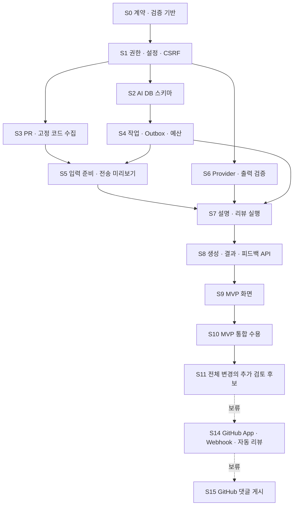

# GitViz AI 의존성 기반 구현 계획 v0.5

- 작성일: 2026-10-07
- 저장소 기준: `0a59b54` — 최신화한 `0ecbca7` 위에 기획 문서를 추가한 상태
- 설계 원본: [요구사항 및 시스템 설계 v0.4](GitViz_AI_요구사항_및_시스템설계_v0.4.md)
- 목적: 실제 저장소에서 작업할 파일·계약·검증·완료 기준을 구현 순서로 정의
- 상태: 최초 구현 계획을 보존한 문서. 현재 진행 범위는 아래 갱신 기록을 따릅니다.

### 진행 범위 갱신 (2026-10-11)

2026-10-11 범위 변경: S0~S10 유지, S11은 **PR 전체의 추가 검토 후보**로 개선합니다. **S12 인수인계·S13 보고서는 폐기**, **S14 — GitHub App·Webhook·자동 리뷰, S15 — GitHub 댓글 게시는 보류**합니다. PR과 커밋 모두 AI 리뷰를 지원합니다. 아래 파일·인터페이스 목록은 최초 계획의 기록이며 현재 구현 여부는 실제 코드와 인터페이스 계약을 기준으로 확인합니다. 이번 범위 결정이 출시 전 실제 인증·운영 스냅샷·모델 평가 확인을 대신하지는 않습니다.

- **S14 — GitHub App·Webhook·자동 리뷰:** 추후 착수합니다. 자동 실행의 키·비용 주체, 공유 자료의 외부 전송 동의, 예산·실행 한도를 먼저 확정해야 합니다.
- **S15 — GitHub PR 댓글 게시:** S14 이후 추후 착수합니다. 게시 허용은 자동 리뷰 활성화와 별도로 정하며, 게시 권한·최신 SHA·중복 게시 방지 정책을 적용합니다.

현재 사용 흐름은 사용자가 실행하는 PR·커밋 리뷰와 GitViz 내부 결과·추가 검토 후보입니다. S14·S15의 아래 명세는 후속 설계 자료로 유지하며 구현 완료로 간주하지 않습니다.

## 1. 범위와 적용 원칙

현재 범위는 **수동 PR·커밋 변경 설명·코드리뷰, 결과 피드백, 전체 변경의 추가 검토 후보**입니다. 인수인계·보고서는 폐기하며 자동 리뷰·게시 단계는 보류합니다. 수집 담당과 시각화 담당의 작업은 해당 단계에 명시하고, 백엔드는 그 인터페이스에 맞춰 구현합니다.

수정 파일은 저장소에 있는 파일 또는 앞 단계에서 만든 파일입니다. 신규 목록의 폴더에는 필요한 `__init__.py`도 함께 추가합니다. 파일명은 작업안이며 migration의 `<revision>`은 실제 생성할 Alembic ID 자리입니다. 기존 migration을 고치지 않고 새로운 revision을 이어 붙입니다.

현재 저장소에 접근 제어·불변 분석 스냅샷·Alembic 기반이 존재하므로 다시 만들지 않습니다. v0.4의 ‘오래된 작업 폴더’ 설명은 당시 관찰 기록이며, 이번 계획은 최신화된 소스를 기준으로 합니다.

## 2. 의존성 DAG와 작업 순서

| 단계 | 반드시 완료할 선행 | 주요 담당 | 결과 |
|---|---|---|---|
| S0 | 없음 | 백엔드·담당자 협의 | 공통 DTO·오류·검증 계약 |
| S1 | S0 | 백엔드 | 안전한 요청·전송 정책 |
| S2 | S1 | 백엔드 | DB와 제약 |
| S3 | S1 | 수집 | 열린 PR·고정 코드 |
| S4 | S2 | 백엔드 | 모델 없이 안정적인 작업 처리 |
| S5 | S3, S4 | 수집·백엔드 | immutable input와 미리보기 API |
| S6 | S1 | 백엔드 | provider adapter·구조 검증 |
| S7 | S4, S5, S6 | 백엔드 | 실제 생성·검증·저장 |
| S8 | S7 | 백엔드 | 결과 API·피드백 |
| S9 | S8 | 시각화 | MVP 사용자 흐름 |
| S10 | S9 | 공동 검증 | MVP 출시/시연 가능 |
| S11 | S10 | 분석·시각화 | 과거 이력 근거 |
| S12 | — | — | 인수인계 폐기 |
| S13 | — | — | 보고서·관련 팀 화면/API 폐기 |
| S14 | 권한 설계 재검토 후 보류 | 수집·백엔드 | 설치 주체·자동 실행 |
| S15 | S14 | 백엔드·시각화 | opt-in 댓글 게시 |

S2·S3·S6은 S1 이후 독립 진행 가능합니다. S9의 화면 시안과 mock은 S0 이후 시작할 수 있지만 완료 판정은 S8의 실제 API 연결 후입니다. S12·S13은 의존성에서 제외합니다. S14·S15 재개 시 설치 주체와 권한 설계를 다시 확정합니다.

MVP 경로는 `S0 → S1 → S2 → S4 → S5 → S7 → S8 → S9 → S10`이며 S3·S6 결과도 필요합니다. 인력·기간이 없으므로 날짜나 공수는 이 문서에서 확정하지 않습니다.

## 3. S0 — 공통 계약과 검증 기반

**수정 파일**

- `docs/GitViz_AI_요구사항_및_시스템설계_v0.4.md`: 변경 합의가 있으면 별도 이력으로 반영.
- `.github/workflows/backend-validation.yml`: AI 검사 실행 자리를 추가하되 생성된 테스트부터 순차 등록.

**새 파일**

- `app/schemas/ai.py`: PRRevision, InputManifest, Coverage, JobState, Finding, ErrorEnvelope DTO.
- `docs/AI_INTERFACE_CONTRACT.md`: 필드 의미·enum·예시·버전 규칙.
- `scripts/ai_test_support.py`, `scripts/test_ai_contracts.py`.
- `scripts/fixtures/ai/`: 고정 diff·좌우 줄 맵·정상/잘못된 출력 fixture.

**인터페이스**

`revision={repo_id,pr_number,base_sha,head_sha,merge_base_sha}`; 코드 위치는 `{path,side,start_line,end_line,revision_id}`입니다. `coverage`는 목록 확보·선택 코드 확보·실제 분석 범위를 분리합니다. `job.status`와 coverage는 별도입니다. 본인만 접근 가능한 개인 scope가 기본입니다.

**테스트**

- DTO의 필수값·enum·0/음수 줄·역순 범위·잘못된 SHA·0개 선택 거부.
- fixture의 rename/delete/add 줄 맵, canonical hash의 필드 순서 안정성.
- DB 테스트 helper는 `gitviz_test` 이름의 별도 DB만 허용하고 앱 import 전에 URL 설정.

**완료 조건**

수집·백엔드·시각화가 같은 DTO를 사용하고, 구조 테스트와 기존 회귀 검사가 독립 실행됩니다. 이후 단계에서 임의로 enum/필드 의미를 바꾸지 않습니다.

## 4. S1 — 권한·배포 설정·CSRF·코드 암호화

**수정 파일**

- `app/main.py`: AI feature flag·보안 설정 연결. AI 비활성 시 기존 앱 실행 유지.
- `app/routers/auth.py`: 공개된 session-user dependency와 CSRF token 발급 endpoint.
- `app/database.py`, `app/core/database.py`: sync/async 동일 물리 DB 검증, 원격 CA 검증 설정.
- `.env.example`: 비밀값 없이 feature flag·profile·한도·키 버전·Secure 설정 예시.

**새 파일**

- `app/core/ai_settings.py`, `app/services/ai/access.py`, `app/services/ai/crypto.py`.
- `app/api/ai/dependencies.py`, `scripts/test_ai_security.py`.

**인터페이스**

- `require_ai_user(request) -> UUID`, `require_csrf(request)`.
- `authorize_ai(db,user_id,repo_id,action,policy_version)`는 기존 `repository_access.verify_repository_access`를 활용하고, 생성에는 외부 송신 허용을 추가합니다.
- `encrypt_input(bytes,key_version)` / `decrypt_input(payload,key_version)`.
- `GET /api/auth/csrf → {token}`; AI의 변경 요청은 `X-CSRF-Token`과 Origin을 검사합니다.

**테스트**

세션 없음·다른 작성자·GitHub 권한 상실·권한 확인 장애, CSRF 누락/오류, 잘못된 remote CA, 암호화 변조·다른 키, feature-off 동작을 검증합니다. URL/비밀값을 로그에 출력하지 않는지도 확인합니다.

**완료 조건**

AI 작업이 로그인·저장소 권한·전송 정책 없이 실행되지 않습니다. 기존 OAuth state를 일반 API CSRF로 대체하지 않습니다. 모델 호출 전에 필요한 보안 설정을 검증할 수 있습니다.

## 5. S2 — AI 전용 DB와 마이그레이션

**수정 파일**

- `app/models/__init__.py`: AI 모델 등록.
- `migrations/env.py`: 분리된 users metadata와 FK를 안전하게 연결; 기존 테이블 삭제 오탐 방지.
- `scripts/test_backend_improvements.py`, `scripts/verify_snapshot_integration.py`: 새 head·기존 schema 기대값과 호환되도록 조정.

**새 파일**

- `app/models/ai_input.py`: pr_revisions/ai_inputs/ai_input_files.
- `app/models/ai_job.py`: ai_jobs/ai_attempts/request_idempotency/task_outbox.
- `app/models/ai_result.py`: ai_results/ai_findings/finding_feedback.
- `app/models/ai_usage.py`: usage_budgets/usage_reservations/audit_events.
- `migrations/versions/<revision>_add_ai_core_schema.py`, `scripts/test_ai_schema.py`.

**인터페이스**

UUID AI ID, integer repo ID, UUID user ID를 유지합니다. owner/repo 복합 FK, 일반 실행 fingerprint UNIQUE, result의job UNIQUE, outbox·attempt UNIQUE, 줄/비용 CHECK를 제공합니다. 기존 analysis_jobs에 AI 상태를 섞지 않습니다.

**테스트**

빈 DB의전체 upgrade, 현재 head에서 upgrade, 실제 users FK, 서로 다른 repo/owner 연결 거부, 중복행·음수비용 거부, 기존 사용자·분석snapshot 보존. 테스트 DB에서만 신규 migration downgrade 범위를 확인합니다.

**완료 조건**

Alembic head가 하나이며 신규·기존 DB 모두 전환됩니다. 앱 시작 중 DDL이 없고 기존 분석 테이블 데이터가 유지됩니다. 불변 입력·원본은 migration과 service 규칙으로 보호할 수 있습니다.

## 6. S3 — 열린 PR과 고정 코드 수집

**수정 파일**

- `app/collectors/github/github_client.py`: 필요 시 pagination·timeout·오류 분류 공통 기능만 확장.
- `docs/DATA_COLLECTION_HANDOFF.md`: 코드 수집 계약과 기존 전체 분석의 경계 추가.

**새 파일**

- `app/collectors/github/ai_pr_collector.py`: state별PR·메타데이터·선택 파일.
- `app/collectors/git/ai_diff_collector.py`: 고정 blob/diff·merge-base·좌우 줄 맵.
- `app/services/ai/content_policy.py`: 언어·크기·생성파일·의심 비밀·링크 제외 규칙.
- `scripts/test_ai_pr_collection.py`, 고정 Git fixture.

**인터페이스**

`list_ai_prs(repo,state,cursor)`; `capture_revision(repo,pr,expected_base,expected_head)`; `collect_selected_code(revision,paths) -> CollectedInput`. 후자는 코드/manifest/coverage/제외 사유를 반환하며 DB나 모델을 호출하지 않습니다.

기존 `pr_collector.collect_pull_requests`의 병합 PR 수집을 열린 PR로 통째로 바꾸지 않습니다. 저장소 전체 수집 없이 PR 단위로 취득합니다. 앞뒤 base/head를 대조하고 임의 fork URL·submodule·symlink를 따라가지 않습니다.

**테스트**

열린/병합/닫힌 PR, pagination/API 상한, 취득 중 head/base 변경, fork·삭제 참조, patch 누락/잘림, merge-base 부재, rename/delete/new/binary, 비정상 인코딩·크기·비밀 탐지. 고정 local Git fixture로 실제 diff와 줄 대응을 검사합니다.

**완료 조건**

확정할 수 없는 비교를 전체 PR 코드처럼 반환하지 않습니다. 모든 파일은 읽음·제외·실패 중 하나의 상태를 가지며 입력에 숨겨진 누락이 없습니다.

## 7. S4 — 모델 없는 작업 처리·Outbox·예산

**수정 파일**

- `app/core/celery_app.py`: AI 준비·생성·유지관리 큐와 task routing.
- `docker-compose.yml`: 선택적인 worker/dispatcher 실행 프로필과 테스트 Redis 연결.
- `.github/workflows/backend-validation.yml`: 실제 Redis가 필요한 AI 통합 job 추가.

**새 파일**

- `app/services/ai/job_service.py`, `app/services/ai/idempotency.py`, `app/services/ai/outbox.py`, `app/services/ai/usage_service.py`.
- `app/tasks/ai_dispatch.py`, `app/tasks/ai_maintenance.py`.
- `scripts/test_ai_job_lifecycle.py`, `scripts/test_ai_queue_integration.py`.

**인터페이스**

`create_job(...,idempotency_key)`가 job/key/outbox를 같은 transaction으로 저장합니다. `claim_job(job_id)->Lease`, `heartbeat(lease)`, `request_cancel`, `finish_job(lease,result)`를 제공합니다. `reserve_attempt`/`settle_attempt`/`mark_uncertain`은 호출마다 예산을 관리합니다.

fingerprint 재사용과 Idempotency-Key 재사용은 다른 규칙입니다. lease 소유자만 상태를 확정합니다. AI 호출 중 죽은 attempt는 즉시 새 호출로 재개하지 않습니다.

**테스트**

PostgreSQL 동시 요청·예산 예약, commit 후 Redis 발행 실패, 중복 배송, worker 중단, lease 만료·오래된 완료, 취소 경쟁, 재시도 한도, 큐 대기 기한. Redis/worker 통합도 수행하고 eager 성공만으로 배송 검증을 대체하지 않습니다.

**완료 조건**

모델 없이 fake handler로 작업의 생성·배송·완료·취소·복구를 확인합니다. 같은 요구의 중복 결과와 취소 뒤 성공 덮어쓰기가 없고 모든 attempt 비용을 추적할 수 있습니다.

## 8. S5 — 입력 준비와 전송 미리보기

**수정 파일**

- `app/main.py`: AI input router를 정적mount 앞에 연결.
- `app/schemas/ai.py`: 입력 준비 요청·미리보기·상태 DTO 확정.
- `app/core/celery_app.py`: prepare task 등록.

**새 파일**

- `app/services/ai/input_builder.py`, `app/services/ai/input_store.py`.
- `app/tasks/ai_prepare.py`, `app/api/ai/inputs.py`, `app/api/ai/__init__.py`.
- `scripts/test_ai_inputs.py`, `scripts/test_ai_input_api.py`.

**인터페이스**

`POST /api/ai/v1/inputs`는 building input과 prepare job을 202로 반환합니다. `GET /inputs/{id}`와 `GET /inputs/{id}/files/{file_id}`는 실제 보관 자료를 제공합니다. `DELETE /inputs/{id}`는 원문 삭제·연결 취소를 접수합니다.

`finalize_input`은 코드 암호화·파일·manifest/hash·coverage를 원자적으로 저장합니다. 확정 후 코드 추가는 새 input입니다. 모델 profile별 토큰 예상은 S6 연결 전 mock으로 두되 최종 전송 검사는 S7에서 다시 수행합니다.

**테스트**

코드 취득 중 모델 미호출, 다른 owner 차단, 입력 hash, 선택 0개·부분 범위·한도, 암호문 변조, 취소 중 준비 완료 경쟁, 24시간 실행 유효기간·7일 원문 만료, 원문 삭제와 공유 input 참조를 검증합니다.

**완료 조건**

사용자가 볼 수 있는 manifest가 실제 AI 전송 후보와 같습니다. 목록·선택·취득의 분모가 구분되고 원문이 평문 로그·큐에 남지 않습니다. AI 없이 입력 API가 작동합니다.

## 9. S6 — Provider adapter·프롬프트·출력 검증

**수정 파일**

- `app/core/ai_settings.py`, `.env.example`: 버전profile·모델·가격·timeout·한도.
- `requirements.txt`: 실제 선택한 제공자 구현에 꼭 필요한 의존성만 추가. 기존 HTTP client로 가능하면 SDK 추가 없음.
- `app/schemas/ai.py`: 기능별 출력 schema 버전.

**새 파일**

- `app/services/ai/providers/base.py`, `app/services/ai/providers/http_provider.py`, `app/services/ai/providers/registry.py`.
- `app/services/ai/prompts/summary_v1.txt`, `app/services/ai/prompts/review_v1.txt`.
- `app/services/ai/validators.py`, `app/services/ai/token_budget.py`.
- `scripts/test_ai_provider.py`, `scripts/test_ai_output_validation.py`.

**인터페이스**

`Provider.generate(GenerationRequest)->ProviderResponse`, `estimate_tokens`, `classify_error`를 제공합니다. response에는 parsed/raw output, request ID, usage, outcome uncertainty가 포함됩니다. provider는 DB·GitHub·추가 코드·shell에 접근하지 않습니다.

`validate_output(kind,output,manifest)->ValidatedResult`가 구조·파일·side·범위를 검사합니다. 사람의 판정은 자동 valid로 바꾸지 않습니다. summary는 작성자 의도와 관측 사실을 분리하며 review는 원본 코드를 입력으로 사용합니다.

**테스트**

HTTP mock의429/5xx/timeout/응답유실, 잘못된JSON·큰출력·가짜파일/줄, Prompt injection fixture, provider 변경·모델 컨텍스트 한도, 사용량 누락. 출력 구조 통과와 의미 정확도를 구분합니다.

**완료 조건**

제공자 프로필 하나의 버전을 고정하고 외부 송신 없이 adapter/validator를 검증합니다. 무단 fallback과 모델의 임의 tool 실행이 없습니다. 실제 모델 평가는 S10에서 별도로 수행합니다.

## 10. S7 — 설명·리뷰 생성 실행

**수정 파일**

- `app/core/celery_app.py`: 생성task와heartbeat 설정.
- `app/services/ai/job_service.py`, `app/services/ai/usage_service.py`, `app/tasks/ai_maintenance.py`: 실제호출attempt·불명결과관리 연결.

**새 파일**

- `app/services/ai/generation_service.py`, `app/services/ai/result_store.py`.
- `app/tasks/ai_generate.py`, `scripts/test_ai_generation.py`.

**인터페이스**

`run_generation(job_id)`는 처리권·권한·정책·만료 검사 → 입력 검사 → 비용 예약 → 호출 → 출력 검증 → 결과·상태 commit 순입니다. summary/review는 독립 kind이며 review에 summary 문장을 코드 사실로 넣지 않습니다.

`result_store.save_validated_result(lease,validated)`는 result/findings/job을 원자적으로 확정합니다. 강제 재생성은 새 generation입니다. 취소·권한 상실 이후 결과를 정상 성공으로 공개하지 않습니다.

**테스트**

정상 설명·리뷰, 가짜위치거부, 호출중취소·권한상실, 검증후DB실패, result와status 원자성, lease만료, uncertain attempt의재호출금지, 실패attempt과 재생성의비용예약.

**완료 조건**

실제 서비스 흐름에서 고정 입력 → provider → 검증 → 불변 결과를 처리합니다. 호출 시간 동안 DB transaction이 열려 있지 않습니다. 모델 결과의 사람 검토 상태는 unverified로 남습니다.

## 11. S8 — 생성·결과·피드백 API

**수정 파일**

- `app/main.py`, `app/api/ai/__init__.py`: router·오류변환·기능flag.
- `app/schemas/ai.py`: 생성·상태·피드백 요청/응답.

**새 파일**

- `app/api/ai/jobs.py`, `app/api/ai/results.py`, `app/api/ai/feedback.py`, `app/api/ai/usage.py`.
- `scripts/test_ai_api.py`.

**인터페이스**

`POST/GET /jobs`, `GET /jobs/{id}`, `POST /jobs/{id}/cancel|retry`, `DELETE /jobs/{id}`, `GET /results/{id}`, `GET /results/{id}/findings`, `PUT /findings/{id}/feedback`, `GET /usage`를제공합니다.

POST는 manifest/profile/policy 확인과 Idempotency-Key, PUT은 expected_version을 요구합니다. ErrorEnvelope, private/no-store, keyset cursor, 200 재사용·202 접수를 계약대로 구분합니다.

**테스트**

본인/타인/비권한, CSRF, manifest변경409, 같은key다른body409, 기한410, 범위413, 비용429, provider장애, 생성후상태실패표현, 피드백버전충돌, 이력페이지중복·누락.

**완료 조건**

프론트는 서비스 내부 함수 호출 없이 HTTP만으로 MVP 전 과정을 수행할 수 있습니다. GET이 생성이나 추가 코드 취득을 시작하지 않습니다.

## 12. S9 — MVP 화면 연결

**수정 파일**

- `frontend/pages/components/navbar.html`, `frontend/js/navbar-loader.js`: AI메뉴와명시적인repo이동.
- `frontend/css/main.css`: 필요시기존공통요소만확장.
- `docs/VISUALIZATION_HANDOFF.md`: AI상태/coverage/오류와원본코드위치 계약.

**새 파일**

- `frontend/pages/ai-review.html`, `frontend/js/ai-review.js`, `frontend/js/ai-api.js`, `frontend/js/ai-state.js`, `frontend/js/ai-poll.js`.
- `frontend/css/ai-review.css`, `scripts/test_ai_frontend.cjs`.

**인터페이스**

주소는 `?repo=<id>&pr=<number>&job=<uuid>`로 현재 결과를 명시합니다. AI 화면은 기존 API의 localStorage/default repo=1 fallback을 사용하지 않습니다. ai-api는 CSRF·멱등 key·오류 규칙을 처리합니다.

ai-poll은 기존 poll의 retry/backoff 원칙을 참고하되 AI endpoint·stage·signature를 별도로 사용합니다. fetch 중복 방지·숨긴 tab 감속·닫기 abort를 적용하고, PR/SHA 변경은 새 범위 선택으로 연결합니다.

**테스트**

순수상태/URL/오류/중복클릭/늦은응답·polling검사. 브라우저에서전송미리보기→생성→근거코드→피드백→재조회,401/404/429/503,HTML/script·외부이미지출력안전성,이전SHA표시를검증합니다.

**완료 조건**

다른 저장소·이전 작업이 뒤섞이지 않고 선택 범위와 PR 전체 범위가 표시됩니다. 테스트 미실행·사람 미검증·지적 0건을 오류 없음으로 표시하지 않습니다.

## 13. S10 — MVP 통합 수용·운영 준비

**수정 파일**

- `.github/workflows/backend-validation.yml`, `docker-compose.yml`, `README.md`, `.env.example`: 단계별검사·worker/dispatcher·설정·복구방법.
- 필요시앞단계구현: 통합검사에서드러난결함만수정하고계약변경기록.

**새 파일**

- `scripts/verify_ai_mvp_integration.py`, `scripts/evaluate_ai_review.py`.
- `scripts/fixtures/ai/evaluation_manifest.json`: 조정/최종세트분리·고정SHA·사람정답.
- `docs/AI_MVP_ACCEPTANCE.md`, `docs/AI_OPERATIONS.md`.

**인터페이스**

검증기는 고정 input·버전·평가 세트로 결과·비용·coverage·유효 지적·오탐·보류를 기록합니다. 실제 호출은 일반 CI와 분리하고 명시 옵션·별도 예산으로 실행합니다. 공개 또는 허용된 자료만 사용합니다.

**테스트**

실제PostgreSQL·Redis·별도worker·HTTP·브라우저흐름,큐발행실패·worker중단·응답유실·취소경쟁·원문삭제,기존analytics/auth회귀. fake provider검사와live모델정확도평가를각각보고합니다.

**완료 조건**

보안·구조·작업 일관성 문제는 수용 불가입니다. 알려진 결함 발견·오탐·범위·언어·비용을 보고하고 예비 평가에서 합의한 기준을 만족해야 합니다. 운영자가 설정·확인·취소·복구·기한 삭제를 수행할 수 있어야 MVP 완료입니다.

## 14. S11 — PR 전체의 추가 검토 후보

입력 준비 시 고정 base/head의 Git 비교에서 전체 변경 경로와 이름 변경 이전 경로를 `InputManifest.changed_files`에 보관합니다. AI에 보내는 코드는 사용자가 선택한 파일만입니다.

AI 지적이 없거나 선택하지 않은 변경 파일도 이력 검토 대상입니다. 검증된 같은 저장소의 불변 snapshot에서 공동 변경 파일·관측 수·기여자 분포·수집 품질을 표시합니다. 후보가 이번 변경에 포함되는지 구분하며 오류·수정 누락으로 단정하지 않습니다. 새 파일, 이름 변경, 적은 관측, 기준 SHA 차이를 함께 표시합니다. 커밋 리뷰에도 적용합니다.

이전 입력에 전체 목록이 없으면 선택 파일 범위라는 한계를 표시합니다. 기존 불변 근거는 유지하며 전체 범위가 필요하면 새 입력을 준비합니다.

검증: AI 지적 없는 결과, 선택하지 않은 파일, 공동 변경 포함 여부, snapshot 무결성·미래 자료 제외, 이름 변경·신규 파일.

## 15. S12 — 인수인계 (폐기)

인계 대상·준비 체크폼·초안·문서 편집·내보내기를 폐기합니다. 화면·버튼·API·실행 서비스를 제거합니다. 이전 마이그레이션과 저장 자료는 보존합니다.

## 16. S13 — 보고서 (폐기)

보고서 및 관련 팀 관리·공유 화면/API·실행 서비스를 폐기합니다. 개인 리뷰·피드백·사용량 기록과 이전 DB 자료·마이그레이션은 유지합니다.

## 17. S14 — GitHub App·Webhook·자동 리뷰 (추후 계획 · 보류)

**수정 파일**

- `app/main.py`, `app/core/celery_app.py`, `app/services/ai/access.py`, `app/services/ai/job_service.py`, `.env.example`: 설치 주체·자동 작업·App 설정.
- `app/models/__init__.py`, `app/services/ai/generation_service.py`: 설치 토큰 취득과 실행 정책.

**새 파일**

- `app/models/ai_automation.py`, `app/services/ai/github_app.py`, `app/services/ai/webhook_service.py`, `app/services/ai/automation_service.py`.
- `app/api/ai/webhooks.py`, `app/api/ai/automation.py`, `app/tasks/ai_automation.py`.
- `migrations/versions/<revision>_add_ai_automation.py`.
- `scripts/test_ai_webhooks.py`, `scripts/test_ai_automation.py`.
- `frontend/pages/ai-settings.html`, `frontend/js/ai-settings.js`.

**인터페이스**

`POST /api/ai/v1/webhooks/github`는 raw body 서명·delivery ID·installation을 검증하고 영속적인 접수만 수행합니다. `PUT /repositories/{rid}/automation`은 관리자 설정이며 활성화 여부·기본 게시 비활성·한도를 저장합니다. `handle_pr_update`는 debounce 후 현재 SHA로 입력과 자동 작업을 만듭니다.

**테스트**

서명 오류·본문 변조·중복/역순 이벤트·draft·설치 중단/삭제·권한 축소·새 커밋·연속 갱신·저장소 비활성화·예산 초과를 검증합니다. 개인 OAuth 토큰으로 대체 실행하지 않는지도 확인합니다.

**완료 조건**

선택한 저장소에서만 자동 리뷰가 실행되고 결과는 GitViz에 저장됩니다. 접수 후에도 설치·정책·현재 SHA를 검사하며 중복 이벤트가 중복 호출로 이어지지 않습니다.

## 18. S15 — GitHub 댓글 게시 (추후 계획 · 보류)

**수정 파일**

- `app/models/ai_automation.py`, `app/api/ai/automation.py`, `app/core/celery_app.py`: 게시 상태와 task 등록.
- `frontend/pages/ai-settings.html`, `frontend/js/ai-settings.js`: 명시적 게시 설정과 이력.

**새 파일**

- `app/services/ai/publication_service.py`, `app/api/ai/publications.py`, `app/tasks/ai_publish.py`.
- `migrations/versions/<revision>_add_ai_publications.py`, `scripts/test_ai_publication.py`.

**인터페이스**

`POST /results/{id}/publication`, `publish_result(publication_id)`를 제공합니다. 생성과 별도 job/outbox, publication key와 외부 게시 ID로 관리하고, 게시 직전에 head·설정·쓰기 권한을 검사합니다. 선택 범위와 기준 head를 명시하고 댓글을 달 수 있는 diff 위치만 사용합니다.

**테스트**

게시 설정 없음·권한 부족·중복·응답 유실 후 조회·게시 직전 head 변경·GitHub의 위치 거부·결과 삭제·요청 한도·긴 댓글을 검증합니다. 게시 뒤 새 커밋이 생기는 경쟁도 확인합니다.

**완료 조건**

자동 리뷰를 켰다는 이유만으로 댓글을 게시하지 않습니다. 이전 지적을 새로운 head의 줄로 옮겨 붙이지 않고 실제 게시 결과를 추적할 수 있습니다. 자동 승인·병합·코드 변경은 포함하지 않습니다.

## 19. PR 분할·통합 규칙

각 S 단계를 기본 PR 단위로 사용합니다. S2는 migration+모델+schema 검사, S3는 수집 계약+fixture, S4는 작업+배송/동시성 검사, S6는 adapter+validator처럼 함께 검토할 수 있는 범위를 묶습니다.

- 공통 수정 지점은 `app/main.py`, `app/models/__init__.py`, `app/core/celery_app.py`, `app/schemas/ai.py`, CI입니다. 등록을 통합할 담당자를 정하고 기능별 구현은 독립 모듈에 둡니다.
- migration은 합류 시점의 head를 기준으로 추가합니다. 개발 중 아직 적용되지 않은 revision은 순서를 조정할 수 있지만, 이미 공유·적용된 revision은 수정하지 않고 필요하면 merge revision을 추가합니다.
- feature flag로 단계별 공개합니다. DB·권한·worker 없이 API나 화면만 활성화하지 않습니다.
- 테스트는 해당 단계와 기존 회귀를 수행합니다. 실제 제공자 호출은 일반 CI와 분리하고 S10 평가 기록에 남깁니다.
- ‘완료’는 테스트 파일을 만들었다는 뜻이 아닙니다. 검사가 통과하고 그 단계의 입력부터 결과까지 실제 처리 경로를 확인해야 합니다.

## 20. 이번 문서화 범위

현재 저장소의 파일 구조·인증·DB·큐·스냅샷·프론트·CI를 확인해 작성했습니다. AI 코드, migration, API, 테스트는 구현하지 않았습니다. 구현 시 제공자·revision을 확정하고 단계별 진행과 계약 변경을 기록합니다.

## 19. PR·커밋 AI 리뷰

AI 리뷰에서 PR 또는 커밋 선택 → 파일 선택 → 미리보기·동의 → 리뷰를 실행합니다. 커밋은 기본 브랜치 최근 목록 또는 전체 SHA 직접 입력으로 선택합니다. 일반·병합 커밋은 첫 번째 부모와 비교하고 최초 커밋은 빈 Git 트리와 비교합니다. SHA를 고정하며 동일한 권한·암호화·출력 검증·사용량 기록을 적용합니다.
