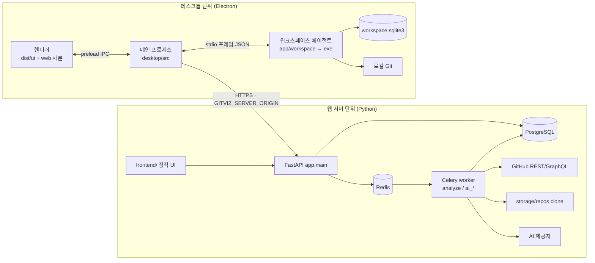
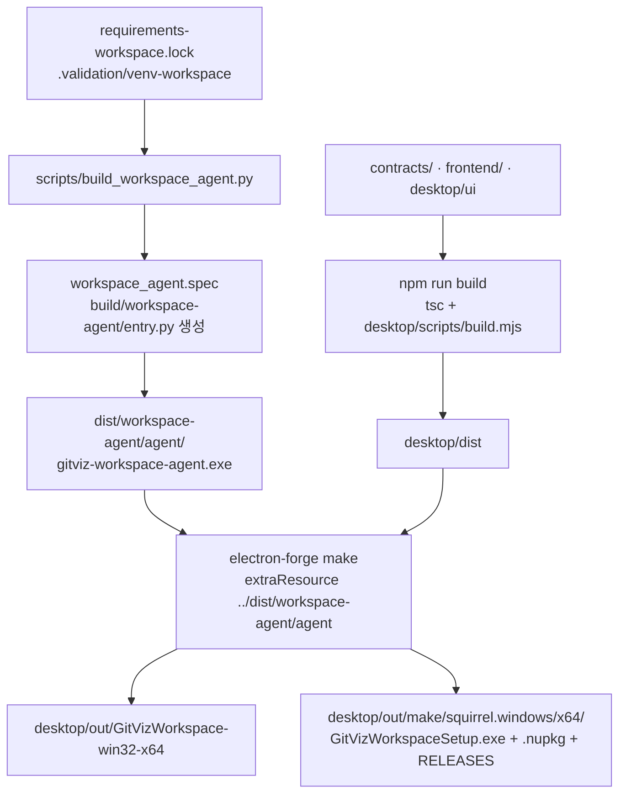

# 현재 아키텍처 (1차 · 읽기 전용)

작성일: 2026-10-30 · 기준 커밋: `65f1b62` · [문서 안내](../index.md)

다른 문서: [구조 감사](PROJECT_STRUCTURE_AUDIT.md) · [의존성 분석](DEPENDENCY_ANALYSIS.md) · [제안 아키텍처](PROPOSED_ARCHITECTURE.md) · [이동 후보](FILE_MIGRATION_CANDIDATES.md)

기존 [시스템 구조](system.md)와 [스냅샷 안내](repository-access-and-snapshots.md)(2026-10-23 기준)는 수정하지 않았다. 이 문서는 현재 코드에서 다시 확인한 구조를 서술하며, 두 문서와 겹치는 서버 분석 경로는 요약만 한다. 표기: **확인**은 코드·설정에서 직접 확인, **추정**은 근거에 기반한 판단.

## 1. 한눈에 보기: 세 개의 실행 단위

| 단위 | 소스 | 실행 방법 | 저장소 |
|---|---|---|---|
| 웹 서버 | `app/main.py` 외 | `python -m uvicorn app.main:app --host 127.0.0.1 --port 8000` | PostgreSQL |
| 분석·AI 워커 | `app/tasks/*`, `app/core/celery_app.py` | `python -m celery -A app.core.celery_app:celery worker …` (분석: 기본 큐, AI: `ai_prepare, ai_generate, ai_maintenance` 큐) | PostgreSQL, Redis, `storage/repos/` |
| 데스크톱 앱 | `desktop/src`, `desktop/ui`, `frontend/` 일부 | 설치 프로그램 → `%LOCALAPPDATA%\GitVizWorkspace` | `%APPDATA%\gitviz-workspace\` |
| 에이전트 | `app/workspace/` | 데스크톱이 자식 프로세스로 실행 (`resources\agent\gitviz-workspace-agent.exe`) | `…\gitviz-workspace\workspace\workspace.sqlite3` |

(확인) 설치된 데스크톱 앱은 서버 없이도 로컬 워크스페이스 기능(프로젝트, Git 상태, 변경 제안, 검증)을 쓴다. 서버 연결은 배포 시 환경변수 `GITVIZ_SERVER_ORIGIN`(HTTPS)이 있을 때만 켜진다(`desktop/src/main.ts`).

## 2. Python 서버

### 2.1 진입점과 시작 절차 (`app/main.py`, 93줄)

(확인) import 시점에 다음이 일어난다.

1. 모델(`repository`, `analysis_job`) 등록과 라우터 import.
2. `get_ai_settings().enabled`이면 `require_valid_ai_settings()`로 보안 설정을 검증한다(AI는 기본 꺼짐).
3. `SESSION_SECRET_KEY`가 없거나 `change-me-in-production`이면 **`RuntimeError`로 시작을 막는다.**
4. `DESKTOP_AUTH_ENABLED=1`이면 데스크톱 인증 설정을 검증한다.
5. `DesktopAuthMiddleware`, `SessionMiddleware`(쿠키 `gitviz_session`, 7일, `SESSION_COOKIE_SECURE`로 https_only) 등록.
6. 라우터 등록 → 마지막에 `StaticFiles(directory="frontend")`를 `/`에 마운트(`NoCacheStaticFiles`, 캐시 금지 헤더).

서버 시작 중 DDL은 실행하지 않는다. 스키마는 `python -m alembic upgrade head`로 먼저 준비한다(주석과 README).

### 2.2 계층 구성

| 계층 | 위치 | 규모 | 실제 역할 |
|---|---|---|---|
| API | `app/api/` (+ `app/routers/auth.py`) | 19+2개 파일, 2,929줄 | 라우터. 접두어: `/repositories/{id}/…`(분석·스냅샷), `/api/auth`, `/api/desktop/v1`, `/api/ai/v1/…`(10개 라우터) |
| 서비스 | `app/services/` | 40개, 5,934줄 | 비즈니스 규칙. AI 하위(`services/ai/`)가 24개 파일 + 프롬프트 9개 + 제공자 5개 |
| 수집기 | `app/collectors/` | 18개, 2,245줄 | Git 로컬 수집(`git/`), GitHub API 수집(`github/`), 작성자 식별(`identity/`) |
| 작업 | `app/tasks/` | 6개, 1,359줄 | Celery 작업. `analyze_repository.py`(1,042줄)가 핵심 |
| 모델 | `app/models/` | 25개, 1,210줄 | SQLAlchemy 모델 |
| 스키마 | `app/schemas/` | 4개, 1,053줄 | Pydantic. `ai.py`가 대부분 |
| 코어 | `app/core/` | 3개, 309줄 | 동기 DB(`database.py`), Celery(`celery_app.py`), AI 설정(`ai_settings.py`) |
| 유틸 | `app/utils/normalize.py` | 89줄 | 경로·해시 정규화 (수집기 3곳이 사용) |

(확인) 가장 큰 단일 파일은 `app/api/analytics.py`(1,316줄)다. 계산 로직이 API 계층에 있고, 서비스(`analysis_snapshots.py`, `ai/history_context.py`)가 이를 **지연 import**로 되가져온다(`_coupled_files_for`, `COUPLED_SORT_KEYS`). 즉 의존 방향이 `services → api`로 거꾸로 흐르는 곳이 있다.

### 2.3 데이터 접근

(확인) 엔진이 둘이다.

| 구분 | 파일 | URL 변수 | 방식 | 사용처 |
|---|---|---|---|---|
| 동기 | `app/core/database.py` | `DATABASE_URL` | `create_engine`, pool_size 3 + overflow 2, `pool_recycle=300`, `get_db()` | 분석·저장소·스냅샷 라우터, Celery 작업, 서비스, Alembic |
| 비동기 | `app/database.py` | `DATABASE_URL_ASYNC`(없으면 `DATABASE_URL`을 asyncpg로 변환) | `create_async_engine`, `NullPool`, prepared-statement 캐시 끔(pgbouncer transaction mode 대응) | 인증 라우터(`app/routers/auth.py`), `models/user.py` |

`Base`도 둘이다. 두 번째 `Base`가 관리하는 `users`는 동기 쪽 모델에서 FK 대상으로만 정의되고, Alembic `include_object`가 `users`를 비교 대상에서 제외한다. 원격 DB는 `DATABASE_SSL_CA`가 있으면 인증서·호스트명을 검증한다.

### 2.4 설정·예외·로깅·의존성 주입

- **설정(확인):** 중앙 설정 객체는 AI용 `app/core/ai_settings.py`뿐이다. 나머지는 `os.getenv`를 `app/`에서 48곳(AI 설정 제외) 직접 호출하고, `load_dotenv()`는 `celery_app`, 두 `database`, `routers/auth`, `migrations/env.py`, 스크립트 일부에서 각자 호출한다. `.env.example`은 61개 변수를 안내한다.
- **예외(확인):** AI 영역은 `AIError`와 전용 핸들러(`ai_error_response`, `ai_validation_error_response`)로 일관된 오류 응답을 만든다. 수집기는 `CollectionError` 계열(`app/collectors/ai_errors.py`). 분석 영역은 라우트마다 `HTTPException`을 직접 던진다.
- **로깅(확인):** 160개 `app` 파일 중 `logging`을 쓰는 파일은 5개이고 `print(`가 78회다. 서버 전역 로깅 구성은 찾지 못했다.
- **의존성 주입(확인):** FastAPI `Depends`가 77회 사용된다. 서비스 계층은 함수 호출이며 컨테이너나 인터페이스(프로토콜) 계층은 없다. 예외: AI 제공자는 `providers/base.py`와 `registry.py`로 교체 가능하다.
- **순환 참조(확인):** 모듈 수준 import 순환이 5개 있다(상세 [의존성 분석](DEPENDENCY_ANALYSIS.md) §4).

### 2.5 인증 두 갈래

(확인) 웹은 GitHub OAuth + 서명 쿠키 세션(`app/routers/auth.py`, `/api/auth/*`)이다. 데스크톱은 별도 경로(`app/api/desktop/auth.py`, `app/services/desktop_auth.py`, `DesktopAuthMiddleware`, `desktop_sessions` 테이블)이며 `DESKTOP_AUTH_ENABLED=1`일 때만 켜진다. 공유 헬퍼 `_get_session_user_id`가 `routers/auth.py`에 비공개 이름으로 있고 `api` 3곳 이상이 직접 import한다.

## 3. 프런트엔드

- (확인) 프레임워크 없음. ES 모듈 JS, 페이지 12개(`pages/*.html` 10 + `components` 2), `index.html`(로그인·진입), 벤더 라이브러리 로컬 보관(Chart.js 4.4.1, D3 7.8.5, Font Awesome 6.5.2).
- **라우팅:** 파일 기반(`pages/*.html`) + `js/routing.js`·`js/page-context.js`. 상태 관리 프레임워크는 없고 모듈 변수와 `localStorage`(`gitviz_*` 키)를 쓴다.
- **API 통신:** `js/api.js`(웹 same-origin fetch). 데스크톱에서는 `js/platform/transport.js`가 `isDesktop()`(= `globalThis.desktop?.remote?.request` 존재)를 보고 요청을 타입 있는 엔드포인트 데이터로 변환해 메인 프로세스로 넘긴다. 허용 헤더는 `accept`, `content-type`, `idempotency-key`, `x-csrf-token`뿐이다.
- **워크스페이스 화면:** `pages/workspace.html` + `js/workspace/*.js`(13개) + `js/ui/*`(셸·컴포넌트·테마). 데스크톱 전용 호스트 `window.workspace`(프로젝트·Git 상태·제안·영향·검증 호출).
- **빌드:** 없음(번들러 없음). 웹은 정적 서빙, 데스크톱은 `desktop/scripts/build.mjs`가 복사한다.

## 4. 데스크톱 앱

### 4.1 프로세스와 보안 경계

(확인) 메인 프로세스(`desktop/src/main.ts`)가 `gitviz://app` 커스텀 프로토콜로 `dist/ui`를 서빙(`app-protocol.ts`가 `assets.json` 매니페스트로 허용 경로를 제한)하고, **샌드박스된 렌더러**가 `contextBridge`로 노출된 `window.desktop`(원격 요청)·`window.workspace`(로컬 기능)만 호출한다. `window.workspace`는 `location`이 `gitviz://app/index.html`일 때만 노출된다(`preload.ts`). IPC 핸들러는 기능별 모듈(`projects`, `proposals`, `impact`, `validation`, `editor`, `notifications`, `diagnostics-ipc`, `remote-workspace-ipc`)에 있다.

### 4.2 에이전트 연결

(확인) `Agent`(`desktop/src/agent.ts`)가 고정 경로 `process.resourcesPath\agent\gitviz-workspace-agent.exe`를 `--data-dir`, `--parent-pid`와 함께 실행하고 stdin/stdout으로 **JSON 프레임**(`contracts.ts`의 `FrameReader`, 프레임당 최대 `MAX_FRAME` = 262,144 바이트)을 주고받는다. 요청·응답은 `contracts/workspace/v1/*.schema.json`으로 양쪽에서 검증한다(메인: Ajv, 에이전트: jsonschema). 에이전트는 시작 후 15초 안에 `bootstrap`이 `ready`가 되지 않으면 스스로 종료하고(`threading.Timer`), 부모 프로세스가 사라지면 `ProcessLifetime`으로 함께 종료한다. 메인은 창을 먼저 띄운 뒤 에이전트를 시작하므로 초기 상태는 비동기로 `ready`가 된다(`desktop/ui/status.js`가 폴링).

### 4.3 저장 위치

| 데이터 | 위치 | 생성자 |
|---|---|---|
| 워크스페이스 DB | `%APPDATA%\gitviz-workspace\workspace\workspace.sqlite3` (+ `-wal`, `-shm`, `writer.lock`) | 에이전트(`app/workspace/store.py`, 단일 소유자) |
| 마이그레이션 전 백업 | 같은 폴더 `pre-v{SCHEMA_VERSION}-{uuid}.sqlite3` | 에이전트(스키마 변경 직전 1회) |
| 암호화 키 | `…\workspace\key.dpapi` | Electron `safeStorage`(DPAPI) |
| 원격 세션 | `…\workspace\desktop-session.dpapi` | `SessionVault` |
| 창 상태 | `…\workspace\window.json` | `window.ts` |
| 설치 파일 | `%LOCALAPPDATA%\GitVizWorkspace\app-x.y.z\` | Squirrel |

(확인) 설치·제거 시 사용자 데이터(`%APPDATA%`)는 건드리지 않는다. 제거 후 설치 폴더 정리는 `desktop/src/squirrel.ts`가 일회성 예약 작업으로 처리한다(최근 커밋 `65f1b62`).

### 4.4 실행 파일 생성과 외부 런타임

(확인) Node 24.20, Electron 45, electron-forge 8.0.1 + maker-squirrel로 `GitVizWorkspaceSetup.exe`를 만든다(per-user, MSI 없음, 서명은 `GITVIZ_SIGN_PFX*` 환경변수가 있을 때만). 렌더러는 Chromium 내장이다. 에이전트는 PyInstaller onedir로 Python 런타임을 포함한다. 외부에 요구하는 것은 **로컬 Git 실행 파일**(`app/workspace/git_service.py`가 PATH와 `%LOCALAPPDATA%\Programs\Git\cmd\git.exe` 후보를 탐색)이고, 검증용 Python 탐색(`detection.py`)이 `%LOCALAPPDATA%\Programs\Python\Python3xx`를 본다.

## 5. 데이터베이스

| 항목 | 값 |
|---|---|
| 서버 DB | PostgreSQL 16 (compose `postgres:16`). 운영은 Supabase 풀러(주석과 `certs/supabase-root.crt`의 존재로 추정) |
| 연결 | 동기 psycopg2, 비동기 asyncpg (§2.3) |
| 모델 | 25개 파일 — 분석(`repository`, `commit`, `file`, `commit_file_change`, `pull_request`·`pr_commit`·`pr_review`·`pull_request_file`, `release`, `contributor`, `contributor_alias`), 작업(`analysis_job`, `analysis_snapshot`), 인증(`user`, `desktop_session`), AI(`ai_*` 9개) |
| Alembic | `alembic.ini` + `migrations/`, 리비전 18개, 헤드 `b7e1d9c3a502`, URL은 `.env`의 `DATABASE_URL` |
| 불변 스냅샷 | 분석 결과를 SHA-256과 함께 저장, DB 트리거가 UPDATE/DELETE 제한([스냅샷 안내](repository-access-and-snapshots.md)) |
| 로컬 DB | SQLite(에이전트 전용), 스키마 버전 자체 마이그레이션(`app/workspace/migrations.py`) |
| 백업·복구 | 로컬: 마이그레이션 직전 자동 백업 있음. 서버: **저장소 안에서는 백업 절차를 찾지 못했다**(compose 볼륨 `postgres_data`만 존재) |

## 6. 빌드와 배포 경로 (Setup.exe 생성 과정)

(확인) 단계별 입력과 제외:

- 에이전트: `contracts/workspace/v1`과 `app/services/ai/prompts/*.txt`를 데이터로 번들. `excludes`로 `app.main`, `app.database`, `app.core`, `app.api`, `app.models`, `celery`, `sqlalchemy`, `fastapi`, `dotenv`, `git`, `requests`, `httpx` 등을 차단한다.
- 데스크톱: `ignore` 함수가 `dist/`, `node_modules/`, `package.json`만 패키지에 포함한다. `asar: true`. `desktop/scripts/audit-bundle.mjs`가 ASAR 항목을 코드 실행·추출 없이 검사한다.
- CI의 `windows-release.yml`(수동 실행)이 같은 순서로 서명 없는 산출물을 만들고 아티팩트로만 올린다. 게시·서명은 의도적으로 없다.

**현재 확인된 배포 위험**

1. 암묵적 경로 계약: `desktop/forge.config.ts`가 `../dist/workspace-agent/agent`를 읽는다. 에이전트를 먼저 빌드하지 않으면 패키지에 에이전트가 빠지거나 실패한다(빌드 순서를 강제하는 장치는 `validate_workspace_windows.ps1`과 CI 순서뿐).
2. `frontend` 파일 목록이 `build.mjs`에 하드코딩: 워크스페이스 JS를 추가하고 목록에 넣지 않으면 데스크톱에서만 화면이 깨진다.
3. 검증용 패키지 변형(`GITVIZ_VERIFY_*`)이 같은 `forge.config.ts`에 섞여 있어 환경변수 설정 실수가 실제 설치 프로그램의 메인 진입점을 바꿀 수 있다(변형 시 `manifest.main`을 e2e 파일로 교체).
4. 서명 미적용(의도적): Smart App Control 강제 모드와 다운로드 표시(Mark-of-the-Web) 환경에서의 실행은 검증되지 않았다(이전 세션 기록).
5. 에이전트와 서버의 `cryptography` 버전이 다르다(48.0.0 / 50.0.2). 의도된 분리로 보이나 문서화되어 있지 않다(추정).
6. 서버 의존성(`requirements.txt`)에 `requests`만 버전이 고정되지 않았고 `httpx2`·`httpcore2` 같은 비표준 이름이 있다. 공급망 점검 대상.

## 7. 테스트와 코드 품질

| 영역 | 도구 | 위치 | 규모 | 비고 |
|---|---|---|---|---|
| 서버 단위·통합 | 스크립트형(`python scripts/test_x.py`) | `scripts/test_*.py` | 35개 | CI가 파일별로 호출. pytest·unittest 러너 아님 |
| 서버 프런트 보조 | Node 스크립트 | `scripts/test_*.cjs` | 4개 | 지표 표시, 시각화 모듈, AI 프런트, 워크스페이스 내비게이션 |
| 에이전트 | `unittest` | `tests/workspace/` | 40개 파일, 3,884줄 | `validate_workspace_windows.ps1`에서 실행 |
| 데스크톱 단위 | `node --test` | `desktop/tests/*.test.ts` | 17개 | 보안 브리지, 원격 계약, Squirrel 등 |
| 데스크톱 E2E | Electron 직접 실행 | `desktop/tests/*.e2e.ts` | 18개 | 실제 Electron 창, 단계별(phase) 시나리오 |
| 설치 프로그램 | PowerShell + Hyper-V VM | `desktop/tests/*.ps1`, `scripts/validate_*.ps1` | — | 클린 VM 설치·제거 |
| 문서 | `docs/audit/check_documents.py` | CI `docs` 작업 | — | 링크·기준선·도달 가능성 |

- **정적 분석(확인):** 에이전트만 ruff(`E4,E7,E9,F`, 줄 길이 120)와 pyright strict(`app/workspace`, `tests/workspace`, 빌드 스크립트)를 쓴다. 데스크톱은 ESLint 10 + TypeScript strict. **서버 코드(`app` 나머지)와 `frontend` JS에는 린터·타입 검사 설정이 없다.**
- **커버리지:** 측정 도구·설정이 없다(`pytest`, `coverage`, `pyproject.toml`, `c8` 모두 없음).
- **테스트가 없는 영역(확인):** 서버 `app/collectors/identity`는 이를 직접 import하는 테스트를 찾지 못했고, `app/tasks/analyze_repository.py` 전체 흐름은 일부 스크립트(`test_progress_reporter`, `test_pr_detail_collection`)만 다룬다. 또한 프런트 JS 대부분(`overview.js`, `timeline.js`, `network.js`, `drilldown.js` 등)은 단위 테스트가 없다. 서버 라우터의 전체 계약은 `test_desktop_api_compat.py`, `test_ai_*_api.py` 등이 일부 덮는다. 정확한 라인 커버리지는 알 수 없다.
- **테스트·운영 환경 차이:** CI는 Linux에서 Postgres 16·Redis를 서비스 컨테이너로 쓰고, 에이전트·데스크톱은 Windows 러너에서 고정 픽스처 프로파일로 검증한다. 운영(Supabase 풀러, TLS 검증, pgbouncer transaction mode)과의 차이는 `postgres` 작업이 대신 검증하지 못한다. 실제 AI 제공자 호출과 코드 서명은 CI 범위 밖이다.

## 8. 현재 구조의 장점과 문제점

**장점(확인)**

- 에이전트 경계가 테스트(`test_import_boundary.py`)와 PyInstaller `excludes`로 이중으로 보호된다.
- 스키마 계약(JSON Schema)이 데스크톱과 에이전트 양쪽에서 검증된다.
- 서버 시작 시 DDL을 하지 않고 비밀키 미설정을 시작 단계에서 차단한다.
- 불변 스냅샷과 마이그레이션 전 백업 등 데이터 보존 설계가 있다.
- 설치·제거까지 클린 VM에서 반복 검증하는 체계가 있다.

**문제점**

- 두 배포 단위와 팀별 흔적이 한 패키지에 섞여 있다(`app/routers` vs `app/api`, 동기/비동기 DB 이중화).
- 계층 역방향 의존과 순환 import(§2.2, [의존성 분석](DEPENDENCY_ANALYSIS.md)).
- 설정·로깅이 분산되어 운영 관측성이 약하다.
- `scripts/`가 테스트 러너와 운영 도구를 겸하고 CI가 경로에 묶여 있다.
- 서버·프런트 코드에 정적 분석과 커버리지가 없다.
- 데스크톱 빌드가 `frontend`와 `dist`에 하드코딩된 경로로 결합되어 있다.
