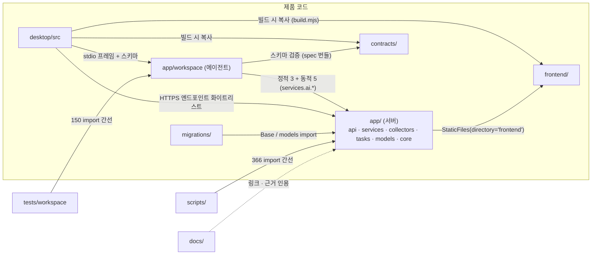
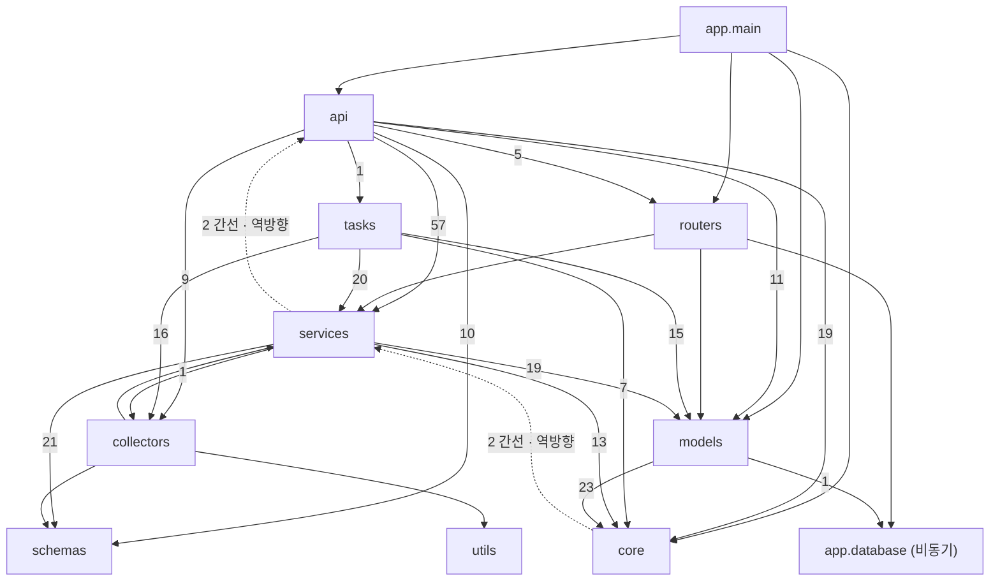

# 의존성 분석 (1차 · 읽기 전용)

작성일: 2026-10-30 · 기준 커밋: `65f1b62` · [문서 안내](../index.md)

다른 문서: [구조 감사](PROJECT_STRUCTURE_AUDIT.md) · [현재 아키텍처](CURRENT_ARCHITECTURE.md) · [제안 아키텍처](PROPOSED_ARCHITECTURE.md) · [이동 후보](FILE_MIGRATION_CANDIDATES.md)

## 1. 분석 방법과 한계

- **Python import:** Git이 추적하는 `*.py` 303개를 `ast`로 파싱해 모듈 간 import 그래프를 만들었다. 함수 안의 **지연 import도 포함**했다. 상대 import는 패키지 기준으로 해석했다. 실행하거나 import하지 않았고 읽기만 했다.
- **문자열 참조:** Celery `include=[…]`, PyInstaller `hiddenimports`/`excludes`, 경로 문자열은 import 그래프에 잡히지 않으므로 추적 파일 전체에서 이름을 검색해 따로 확인했다.
- **TypeScript/JS:** `desktop/scripts/build.mjs`, `forge.config.ts`, `desktop/src/main.ts`의 경로와 환경변수 참조를 직접 읽었다. 프런트 JS 모듈 간 import 그래프는 만들지 않았다(2차에서 확인할 항목).
- **한계:** 동적 import(`importlib`), 문자열로 조합한 경로, `docs/archive/` 안의 사본, 그리고 git이 추적하지 않는 파일은 대상이 아니다.

## 2. 최상위 영역 간 의존

| 출발 → 도착 | 종류 | 근거 |
|---|---|---|
| `scripts` → `app` | Python import 366 | 테스트·이관·점검 스크립트가 서버 모듈을 직접 사용 |
| `tests` → `app` | Python import 150 | 에이전트 테스트 (`app.workspace.*`) |
| `migrations` → `app` | Python import 2 | `env.py`가 `app.core.database.Base`, `app.models` |
| `app/workspace` → `app/services` | 정적 import 3(지연) + **`importlib` 동적 5** | 정적: `jobs.py:138`, `review.py:93·94·102`가 `token_budget`, `providers.base`. 동적: `adapters/ai_core.py:11–15`가 `content_policy`, `input_builder`, `validators`, `providers.registry`, `difftext`를 `importlib.import_module`로 로드(AST 분석에 잡히지 않아 PyInstaller `hiddenimports`에 수동 등록됨) |
| `app/*`(서버) → `app/workspace` | **0** | 서버는 에이전트를 import하지 않는다 |
| `frontend` → 다른 영역 | JS는 HTTP만 사용 | `fetch('/…')` 또는 `window.desktop`/`window.workspace` |
| `desktop` → `frontend`, `contracts`, `dist/workspace-agent` | 빌드 시 파일 복사/참조 | §5 |

(확인) `app/workspace`와 서버 사이의 방향은 한쪽(에이전트 → 서버의 AI 공용 모듈)이다. 공유하는 서버 모듈은 7개(`token_budget`, `providers.base`, `providers.registry`, `content_policy`, `input_builder`, `validators`, `difftext`)와 프롬프트 텍스트(`services/ai/prompts/*.txt`, spec `datas`)다. 동적 import 5개는 import 그래프에 보이지 않으므로 **공유 코드의 실제 목록은 `adapters/ai_core.py`와 `workspace_agent.spec`의 `hiddenimports`가 가장 정확한 기록**이다. 이 모듈들이 서버 전용 모듈(`app.core`, `sqlalchemy` 등)을 import하기 시작하면 에이전트 경계가 깨지고, 이는 `test_import_boundary.py`가 잡는다.

## 3. `app` 내부 패키지 의존 (서버)

모듈 간선을 `app.<패키지>` 단위로 합산한 결과(출발 → 도착 : 간선 수, 지연 import 포함).

정상 흐름은 `main → api → services → models → core`이고, 점선이 계층 역방향이다.

## 4. 순환 참조와 계층 위반

SCC(강연결 요소) 5개를 찾았다. 대부분은 **함수 내부 지연 import로 런타임 순환을 피하고 있다.** 즉 지금 동작은 정상이지만 설계상 양방향 의존이다.

| # | 모듈 | 순환을 끊는 지점 | 해석 |
|---|---|---|---|
| 1 | `core/ai_settings` ↔ `services/ai/providers/{registry, anthropic_provider}` | `ai_settings.py:182·195·208`가 함수 안에서 `registry`/`json_provider`를 import | 설정 모듈이 제공자 레지스트리를 알아야 검증할 수 있다. **core → services 역방향** |
| 2 | `services/ai/{consent, credentials, job_service}` | `job_service.py:25`가 함수 안에서 `consent.PinnedConfig` import | 같은 하위 도메인 안의 상호 참조 |
| 3 | `api/ai/dependencies` ↔ `routers/auth` | `routers/auth.py:167`이 함수 안에서 `issue_csrf_token` import. 반대 방향은 `dependencies.py:12`의 **최상위** import | 인증과 AI 의존성이 서로를 참조. 비공개 이름 `_get_session_user_id`를 계층 밖에서 사용 |
| 4 | `api/analytics` ↔ `api/snapshot_route` ↔ `services/analysis_snapshots` | `analysis_snapshots.py:207·358`이 함수 안에서 `app.api.analytics`를 import | 계산 함수(`_coupled_files_for`, `COUPLED_SORT_KEYS`)가 API 모듈에 있어서 생긴 **services → api 역방향** |
| 5 | `workspace/cloud_transport` ↔ `workspace/review_transport` | `review_transport.py:35`가 함수 안에서 `cloud_transport.body` import | 에이전트 내부, 작은 범위 |

추가로 확인한 계층 위반:

- `app/api/ai/dependencies.py:12`, `app/api/desktop/repositories.py:7`, `app/api/repositories.py:19`, `app/api/snapshot_route.py:15`가 `app.routers.auth`의 **비공개 함수** `_get_session_user_id`를 직접 가져다 쓴다.
- `app/models/user.py:7`만 `app.database`(비동기 `Base`)를 사용하고, 나머지 모델은 `app.core.database`를 사용한다. `app/models/ai_base.py`가 이 이중 `Base` 때문에 `users` 테이블을 별도 `Table`로 정의한다.
- `app/main.py`가 서비스(`app.services.ai.access.AIError`)와 `desktop_auth_middleware`를 직접 import한다. 앱 조립(composition root)이 모듈 최상단에서 환경변수 검증과 섞여 있다.

## 5. 파일 시스템 경로 의존 (이동 시 깨질 수 있는 지점)

### 5.1 서버

| 위치 | 참조 | 기준 경로 |
|---|---|---|
| `app/main.py` | `StaticFiles(directory="frontend")` | **프로세스 작업 디렉터리**(루트에서 실행해야 함) |
| `app/core/celery_app.py` | `include=["app.tasks.…"]` 5개 | 패키지 이름 `app` |
| `alembic.ini` | `script_location = %(here)s/migrations`, `prepend_sys_path = .` | 파일 위치 |
| `migrations/env.py` | `from app.core.database import Base`, `from app.models import *` | 패키지 이름 `app` |
| `docker-compose.yml` | `.:/app` 마운트, `celery -A app.core.celery_app.celery …`, `env_file: .env` | 루트 |
| `app/collectors/git/clone_manager.py` | `storage/repos/<id>` | 작업 디렉터리 상대 |
| `app/services/ai/prompts/*.txt` | 코드와 같은 폴더에서 로드 | 패키지 상대 (spec이 `datas`로 번들) |

### 5.2 에이전트 빌드

| 위치 | 참조 |
|---|---|
| `workspace_agent.spec` | `SPECPATH`(루트) 기준 `build/workspace-agent/entry.py` 생성, `contracts/workspace/v1`, `app/services/ai/prompts`; `pathex=[루트]`; `hiddenimports`, `excludes` 문자열 |
| `scripts/build_workspace_agent.py` | `--distpath <루트>/dist/workspace-agent`, `--workpath <루트>/build/workspace-agent`, `<루트>/workspace_agent.spec`; 루트는 `Path(__file__).parents[1]` → **`scripts/`가 루트 바로 아래에 있다는 가정** |
| `pyright-workspace.json` | `include`: `app/workspace`, `tests/workspace`, `scripts/build_workspace_agent.py`; `venvPath: .validation`, `venv: venv-workspace` |
| `ruff-workspace.toml` + `validate_workspace_windows.ps1` | 대상 경로 3개를 명령줄에 직접 기재 |

### 5.3 데스크톱 빌드 (`desktop/scripts/build.mjs`, `forge.config.ts`)

| 소스(루트 기준) | 대상 | 비고 |
|---|---|---|
| `contracts/workspace/v1/` | `desktop/dist/schema/` | 폴더 통째로 |
| `contracts/desktop/v1/ai-bodies.json` | `dist/schema/ai-bodies.json` | |
| `frontend/pages/workspace.html` | `dist/ui/index.html` | 이름 변경 |
| `frontend/js/workspace/{projects,status,desktop-auth}.js` | `dist/ui/{projects, git-status, desktop-auth}.js` | `status.js`는 `git-status.js`로 이름 변경 |
| `frontend/js/workspace/{proposal,diff,impact,validation,comparison,inbox,navigation,layout,review,changes}.js` | `dist/ui/<이름>.js` | **이름을 코드에 나열** |
| `frontend/` 전체(단 `workspace.html` 제외) | `dist/ui/web/` | 웹 UI 전체 사본, 확장자 기반 MIME 매니페스트(`assets.json`) 생성 |
| `desktop/dist/src/remote-contracts.js`의 `endpoints` | `dist/ui/desktop-endpoints.json` | 빌드 중 JS를 `require` |
| `../dist/workspace-agent/agent` | 패키지 `resources\agent` | `forge.config.ts`의 `extraResource` |
| `../pyright-workspace.json` | `npm run typecheck:agent` | |

### 5.4 CI 워크플로

- `backend-validation.yml`: `docs/audit/check_documents.py`, `docs/audit/test_check_documents.py`, `scripts/test_*.py`·`.cjs` 약 36개를 **경로로 직접 실행**. `requirements.txt`.
- `windows-desktop.yml`: 경로 필터(`desktop/**`, `app/workspace/**`, `app/services/ai/**`, `frontend/**`, `contracts/**`, `tests/workspace/**`, `requirements-workspace*`, `scripts/validate_workspace_windows.ps1`, `scripts/test_workspace_navigation.cjs`), 설치: `requirements-workspace.lock`, `npm --prefix desktop ci`.
- `windows-release.yml`: 위와 동일한 검증 후 `npm --prefix desktop run make`, 산출물 경로 `desktop/out/make/squirrel.windows/x64`, `desktop/out/GitVizWorkspace-win32-x64`.

## 6. 환경변수 참조

값은 읽지 않았고(`.env` 미열람) 이름만 코드·`.env.example`에서 확인했다.

| 범주 | 변수(발췌) | 읽는 곳 |
|---|---|---|
| DB | `DATABASE_URL`, `DATABASE_URL_ASYNC`, `DATABASE_SSL_CA` | `app/core/database.py`, `app/database.py`, `migrations/env.py` |
| 세션·인증 | `SESSION_SECRET_KEY`, `SESSION_COOKIE_SECURE`, `GITHUB_CLIENT_ID/SECRET`, `FRONTEND_URL`, `TOKEN_ENCRYPTION_KEY`, `GITHUB_TOKEN` | `app/main.py`, `app/routers/auth.py`, 수집기 |
| 데스크톱 인증 | `DESKTOP_AUTH_ENABLED`, `DESKTOP_PUBLIC_ORIGIN`, `DESKTOP_AUTH_RESPONSE_KEY` | `app/main.py`, `app/services/desktop_auth.py` |
| 큐 | `REDIS_URL` | `app/core/celery_app.py` |
| AI | `AI_ENABLED`, `AI_PROVIDER_PROFILE`, `AI_*_ENCRYPTION_KEYS`, `AI_*_KEY_VERSION`, `AI_OLLAMA_*`, `AI_LMSTUDIO_*`, `AI_KOBOLDCPP_*`, `AI_*_BUDGET`, 한도·보관 설정 | `app/core/ai_settings.py`(중앙) 외 일부 직접 |
| 수집 튜닝 | `PR_HEAD_FETCH_LIMIT`, `PR_DETAILS_BATCH`, `LARGE_CHANGE_*`, `INCREMENTAL_BUFFER_DAYS`, `IDENTITY_*`, `GRAPHQL_THROTTLE_*`, `FORCE_FULL_RECOLLECT` | 수집기·작업 |
| 데스크톱 | `GITVIZ_SERVER_ORIGIN`(HTTPS 원점), `GITVIZ_SIGN_PFX`·`GITVIZ_SIGN_PFX_PASSWORD`(서명, 빌드), `GITVIZ_VERIFY_*`(검증 패키지 변형, 빌드), `LOCALAPPDATA` | `desktop/src/main.ts`, `forge.config.ts`, `squirrel.ts` |
| 에이전트 | `LOCALAPPDATA`(Git·Python 탐색) | `app/workspace/git_service.py`, `detection.py` |

(확인) 에이전트는 `.env`를 읽지 않는다(`__main__.py` 주석, `test_import_boundary.py`가 `dotenv` 로드 금지를 검사). `load_dotenv()`는 `app`·`migrations`의 5곳(`celery_app`, `core/database`, `database`, `routers/auth`, `migrations/env`)과 스크립트 2곳(`ai_ops`, `check_connections`)에서 각자 호출한다.

## 7. API 엔드포인트와 프런트엔드 ↔ 백엔드 통신

- 서버 라우트 데코레이터 67개. 접두어: `/repositories`·`/repositories/{id}/analytics`·`/repositories/{id}/snapshots`, `/api/auth`, `/api/desktop/v1`(7개: 인증 트랜잭션, authorize, exchange, session 조회·삭제, 저장소 identity), `/api/ai/v1`(라우터 9개), `/api/ai/v1/shared`(1개).
- **웹:** same-origin `fetch`. 세션 쿠키 `gitviz_session`.
- **데스크톱:** 렌더러가 임의 URL로 호출하지 못한다. `desktop/src/remote-contracts.ts`의 `endpoints`(메서드·경로 템플릿·경로/쿼리 타입 규칙·본문 스키마 이름)가 **허용 목록**이고, `contracts/desktop/v1/ai-bodies.json`이 AI 요청 본문 스키마다. 서버에 라우트를 추가하고 데스크톱에서도 쓰려면 이 목록을 손으로 맞춰야 한다(자동 생성 아님 — **서버 라우트와 허용 목록 사이의 불일치는 테스트가 일부만 잡는다**: `scripts/test_desktop_api_compat.py`).
- **에이전트:** HTTP를 쓰지 않는다. 메인 프로세스와 stdio 프레임만 사용한다. 클라우드 리뷰는 메인 프로세스가 서버로 중계한다(`cloud-http.ts`, `cloud-review.ts`).

## 8. 데이터베이스 연결 의존

| 소비자 | 엔진 | 비고 |
|---|---|---|
| 분석·저장소·스냅샷 라우터, `repository_access`, `analysis_snapshots`, 모든 Celery 작업 | `app.core.database.SessionLocal` (동기) | `pool_size=3`, overflow 2 — 웹 서버와 워커가 각각 자기 프로세스 풀을 가진다 |
| 인증 라우터 `app/routers/auth.py`, `User` 모델 | `app.database.AsyncSessionLocal` (비동기) | `NullPool` |
| Alembic | 동기 `DATABASE_URL` | `users` 제외 |
| 에이전트 | 서버 DB를 사용하지 않음. 로컬 SQLite | 코드상 `sqlalchemy` import 금지 |

## 9. 설치 프로그램 관련 참조

- `forge.config.ts`: `name`/`executableName` `GitVizWorkspace`, Squirrel `setupExe: GitVizWorkspaceSetup.exe`, `noMsi: true`. 제거 후 정리용 `desktop/src/squirrel.ts`는 설치 경로 이름 `GitVizWorkspace`를 상수로 사용하므로 앱 이름을 바꾸면 정리 로직의 안전 검사도 함께 바꿔야 한다.
- 업데이트: `desktop/src/update.ts`는 `DISABLED_UPDATE_POLICY`로 비활성(Q01 결정).
- 스크립트: `desktop/tests/run-clean-vm.ps1`, `install-update.ps1`, `self-signed-update.ps1`, `scripts/test_installer_vm.ps1`이 설치 경로를 문자열로 알고 있다.

## 10. 발견 요약

1. 서버 내부 의존은 큰 줄기는 정상이지만 계층 역방향이 있다(`services → api` 지연 import 3줄, `core → services` 지연 import 3줄). 순환 5개가 지연 import로 가려져 있다.
2. 에이전트 ↔ 서버 경계는 한 방향이고 `spec`·테스트로 지켜진다. 공유 코드는 `app/services/ai` 일부다.
3. 영역 간 의존은 대부분 **파일 경로 문자열**이다. 특히 `desktop/scripts/build.mjs`와 `forge.config.ts`, `scripts/build_workspace_agent.py`, CI 경로 목록이 구조 변경 시 함께 바뀌어야 한다.
4. 데스크톱의 서버 엔드포인트 허용 목록은 수동 유지다.
5. `.gitignore`에는 파일이 존재하지 않는 항목이 있다(`app/api/iot.py`, `arduino/`, `.frontend_vite_backup.zip`). 오래된 설정으로 보인다(추정).
6. 2차 분석 필요: 프런트 JS 모듈 import 그래프, 서버 라우트 ↔ 데스크톱 허용 목록 대조, `app/api/analytics.py`(1,316줄)의 계산 로직 분리 가능성.
