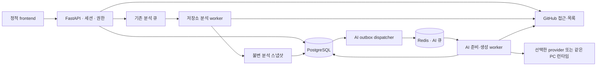

# 시스템 구조와 데이터 경계

검토일: 2026-10-23 · 코드 기준: `a8351f0` · [문서 안내](../index.md)

## 확인한 처리 경로

근거: [앱·router 등록](../../app/main.py), [Celery routing](../../app/core/celery_app.py), [dispatcher](../../app/tasks/ai_dispatch.py), [생성 서비스](../../app/services/ai/generation_service.py).

기존 저장소 분석과 AI 작업은 서로 다른 모델·수명주기를 사용한다. AI 큐는 `ai_prepare`, `ai_generate`, `ai_maintenance`로 나뉜다. AI 작업·멱등 키·outbox의 원자적 저장과 lease로 중복 배송·오래된 worker 완료를 처리한다. 이 구조 설명은 정확히 한 번의 외부 모델 호출을 보장한다는 주장이 아니다.

## 저장·권한 경계

| 자료 | 확인한 경계 | 근거 |
|---|---|---|
| 분석 스냅샷 | SHA·기간·계산 버전·payload 해시, 기존 결과 수정 제한 | [현재 안내](repository-access-and-snapshots.md), [서비스](../../app/services/analysis_snapshots.py), [모델](../../app/models/analysis_snapshot.py) |
| AI 입력 | 원문 암호화, 고정 manifest·hash, 코드 보관 기한 | [입력 저장](../../app/services/ai/input_store.py) |
| AI 결과 | 원본과 피드백 분리, 결과와 job 완료 확정 | [결과 저장](../../app/services/ai/result_store.py), [피드백](../../app/services/ai/feedback_service.py) |
| 개인 API | owner와 현재 저장소 접근 확인. 본인 삭제·취소의 예외는 별도 계약 | [AI API](../contracts/ai-api.md) |
| 공유 GET | 현재 저장소 접근을 확인하고 다른 owner의 결과·메모 반환. 입력 원문은 열지 않음 | [공유 조회](../../app/services/ai/shared_views.py) |
| 과거 S12·S13 | 모델·migration 보존은 실행 API 제공을 뜻하지 않음 | [현재 범위](../product/current-scope.md) |

서버 import/startup의 스키마 설치 대신 Alembic을 먼저 적용한다. 정적 migration 그래프의 단일 head는 `a9d2f4c6e8b0`이다. 운영 DB가 이 revision인지 이번에 조회하지 않았다.

추정: 상세 DB·API 제안 전체를 현재 아키텍처에 복사하지 않고, 실제 등록·저장 경계와 과거 설계를 연결하는 방식을 유지한다.

미확정: 실제 배포 프로세스·동시성·DB 상태·성능은 [현재 검증 상태](../validation/current-status.md)의 미실행 범위다. 공유 정책의 적합성은 [D01](../decisions/index.md#d01)에서 별도 판단한다.
