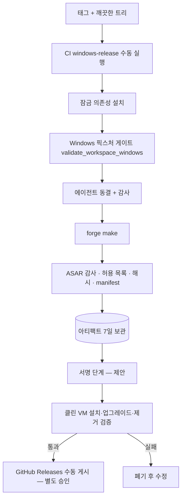

# 빌드와 릴리스 (2차 · 설계)

작성일: 2026-10-30 · 기준 커밋: `65f1b62` · [문서 안내](../index.md)

설계 배경: [환경 분리 아키텍처](../architecture/ENVIRONMENT_ARCHITECTURE.md). 짝 문서: [개발 환경 설정](../development/DEVELOPMENT_SETUP.md) · [설치 안내](INSTALLATION_GUIDE.md) · [데이터 저장 정책](DATA_STORAGE_POLICY.md)

읽기만 해서 작성했다. 빌드·서명·설치 프로그램 생성·게시를 실행하지 않았다. 표기: **[현재]** 확인된 동작, **[제안]** 미구현 설계.

## 1. 목표

1. **재현 가능:** 같은 커밋과 같은 잠금 파일에서 같은 입력으로 빌드한다. 개발 PC에 우연히 설치된 패키지·환경변수에 의존하지 않는다.
2. **격리:** 개발·검증용 패키지와 배포용 패키지를 구분한다. 배포 패키지에는 운영에 필요한 파일만 들어간다.
3. **검증 가능:** 산출물의 구성과 해시를 기록하고, 클린 VM에서 설치·실행·제거까지 확인한 뒤에만 배포 후보로 승격한다.
4. **비밀 분리:** 서명 인증서와 운영 비밀은 빌드 환경 시크릿에만 있고 산출물과 저장소에 들어가지 않는다.

## 2. 빌드 환경

### 2.1 입력과 고정(pin) 현황

| 입력 | 고정 방법 | 상태 |
|---|---|---|
| Python | CI `setup-python` 3.12.10 | [현재] 로컬은 임의 버전 가능 |
| Python 의존성(에이전트) | `requirements-workspace.lock`(해시), CI `pip install --require-hashes --only-binary=:all:` | [현재] 로컬 설치는 해시 강제 여부가 사람에 달림 |
| PyInstaller, ruff | `requirements-workspace-build.txt` (`pyinstaller==6.22.3`, `ruff==0.17.2`) | [현재] |
| Node.js | `engines: >=24.20.0 <25`, CI 24.20.0 | [현재] |
| Node 의존성 | `desktop/package-lock.json`, `npm ci` | [현재] |
| Electron / forge | `electron 45.0.0`, `@electron-forge/* 8.0.1` | [현재] |
| 소스 | 커밋 | [제안] 릴리스 태그 + 깨끗한 작업 트리 요구 |

### 2.2 재현성 허점 (확인)

1. `scripts/build_workspace_agent.py`는 `sys.executable`로 PyInstaller를 실행한다. 어떤 Python이든 실행되고, 그 환경이 잠금 파일과 일치하는지 검사하지 않는다.
2. `desktop/forge.config.ts`는 `../dist/workspace-agent/agent`를 **언제 만들어졌든** 읽는다. 에이전트를 다시 빌드하지 않고 `make`를 하면 오래된 에이전트가 설치 프로그램에 들어간다. (현재 `dist`의 에이전트는 번들 대상 소스보다 새롭다 — 확인했으나 이를 강제하는 장치는 없다.)
3. 빌드 입력 일부가 환경변수(`GITVIZ_VERIFY_*`, `GITVIZ_SIGN_PFX*`)로 바뀐다. 셸에 남은 값이 결과를 바꿀 수 있다.
4. 빌드가 저장소 폴더 안에 쓴다(`build/`, `dist/`, `desktop/dist`, `desktop/out`). 이전 산출물이 남아 새 산출물과 섞인다(`desktop/out`에 이전 빌드 폴더 4개와 검증용 패키지 7개가 공존).
5. 서버 의존성(`requirements.txt`)과 에이전트 의존성이 분리되어 있는 것은 좋지만, 같은 라이브러리(`cryptography`)가 다른 버전(48.0.0 / 50.0.2)이다. 의도라면 기록해야 한다.

### 2.3 [제안] 기준 빌드 환경

- **기준 빌드는 CI(`windows-release.yml`, 수동 실행)로 한다.** 이 워크플로는 이미 잠금 의존성 설치 → Windows 고정 픽스처 게이트 → `make` → 압축·해시·`manifest.json` 생성 → 아티팩트 업로드 순서를 갖고 있다. 개발 PC 빌드는 "검증용"으로 취급하고 결과 폴더에 `local` 표시를 남긴다.
- 로컬 빌드 전용 가상환경을 개발용과 분리한다(`venv-build-agent`, 저장소 밖 권장). 빌드 스크립트가 시작할 때 `pip freeze`가 잠금 파일과 일치하는지, `sys.prefix`가 지정한 환경인지 확인하고 아니면 중단한다.
- 빌드 시작 시 검사: 작업 트리 깨끗함(또는 명시적 `--allow-dirty`), 현재 커밋·태그, Node/Python 버전, 환경변수 `GITVIZ_VERIFY_*`가 비어 있음.
- 모든 산출물을 `build-output/<버전>/` 한 곳에 쓰고, 그 폴더는 새로 만든다(기존 폴더 재사용 금지).

## 3. 빌드 파이프라인

### 3.1 [현재] 순서

```powershell
# 0) 에이전트 가상환경 (CI와 동일 위치)
python -m venv .validation\venv-workspace
.\.validation\venv-workspace\Scripts\python.exe -m pip install --require-hashes --only-binary=:all: -r requirements-workspace.lock
.\.validation\venv-workspace\Scripts\python.exe -m pip install -r requirements-workspace-build.txt

# 1) 에이전트 동결 (onedir)  →  dist\workspace-agent\agent
.\.validation\venv-workspace\Scripts\python.exe -X utf8 -B scripts\build_workspace_agent.py

# 2) 에이전트 감사 (금지 모듈·필수 모듈·SHA-256 목록)
.\.validation\venv-workspace\Scripts\python.exe scripts\audit_workspace_agent.py --directory dist\workspace-agent\agent --output <새 파일>

# 3) 데스크톱
npm --prefix desktop ci --ignore-scripts --no-audit --no-fund
node desktop\node_modules\electron\install.js
npm --prefix desktop run build           # tsc + scripts/build.mjs  →  desktop\dist
npm --prefix desktop run make            # electron-forge → desktop\out\...

# 4) ASAR 검사
node desktop\scripts\audit-bundle.mjs desktop\out\GitVizWorkspace-win32-x64\resources\app.asar <새 보고서 파일>
```

CI는 `--ignore-scripts`로 설치하므로 `electron-winstaller`의 7-Zip 선택 스크립트가 돌지 않아 `vendor\7z-x64.exe`/`.dll`을 `7z.exe`/`.dll`로 수동 복사한다(`windows-release.yml`). 로컬에서 스크립트를 켜고 설치하면 필요 없다.

### 3.2 각 단계가 포함하는 것

| 단계 | 입력 | 포함 | 제외 |
|---|---|---|---|
| 에이전트 | `app/workspace/**`, 공유 AI 모듈 7개(`token_budget`, `providers.base`, `providers.registry`, `content_policy`, `input_builder`, `validators`, `difftext`), `contracts/workspace/v1`, `services/ai/prompts/*.txt`, Python 런타임, VC/UCRT DLL | 합계 42 MB(onedir) | `app.main/database/core/api/models`, `celery`, `sqlalchemy`, `fastapi`, `dotenv`, `git`, `requests`, `httpx` 등 `excludes` 목록 |
| 렌더러 자산 | `frontend/pages/workspace.html` 외 워크스페이스 JS 16개, 웹 UI 전체 사본(`dist/ui/web`), `desktop/ui` | `assets.json` 매니페스트 | — |
| 계약 | `contracts/workspace/v1`, `contracts/desktop/v1/ai-bodies.json` | `dist/schema` | — |
| 패키지 | `ignore` 함수가 `dist/`, `node_modules/`, `package.json`만 허용 | 에이전트는 `extraResource`로 `resources\agent` | 소스 `.ts`, 설정 파일, `tests` 폴더 원본 |
| 설치 프로그램 | 패키지 | `GitVizWorkspaceSetup.exe`, `*-full.nupkg`, `RELEASES` | — |

## 4. 개발용 패키지와 배포용 패키지의 구분

### 4.1 [현재] 혼합된 설정

`forge.config.ts` 하나가 환경변수로 **검증용 변형 8개**를 만든다: `GITVIZ_VERIFY_PACKAGE/P03/P04/P05/P06/P07/P08B`. 각 변형은 앱 이름을 `GitVizWorkspace…Verify`로 바꾸고, `afterCopy`에서 `package.json`의 `main`을 `dist/tests/*.e2e.js`로 교체하며 `name`을 `gitviz-workspace-verification`으로 바꾼다. 같은 파일이 제품 설정도 정의하므로 **제품 빌드에서도 `dist/tests`가 패키지에 들어간다**(확인: 현재 제품 패키지 `app.asar`에 `dist/tests` 38개 항목).

### 4.2 [제안] 분리

| 항목 | 개발·검증 패키지 | 배포 패키지 |
|---|---|---|
| 설정 파일 | `forge.verify.config.ts` (별도) | `forge.config.ts` (제품만) |
| 앱 이름 / userData | `GitVizWorkspace…Verify`, 임시 프로필 | `GitVizWorkspace`, 제품 경로 |
| `main` | `dist/tests/*.e2e.js` | `dist/src/main.js` |
| `dist/tests` | 포함 | **제외** (`ignore`에 추가) |
| `typescript` | — | `devDependencies`로 이동해 **제외** (현재 `dependencies`라 `app.asar`에 156개 항목·디스크 24 MB가 포함됨) |
| 환경변수 분기 | 허용 | 코드에서 제거 |
| 채널 설정(접속 원점) | 스테이징 원점 | 운영 원점(내장) |
| 서명 | 없음 | 있음(인증서 확보 후) |

변경 시 확인: `typescript`가 런타임에 쓰이는지(코드에서 `require('typescript')`가 없는지 검색), `ajv`는 런타임 의존성이므로 유지.

### 4.3 [제안] 포함 파일 허용 목록 검사

`audit-bundle.mjs`를 확장해 `app.asar`의 최상위 경로를 허용 목록과 비교한다. 허용: `package.json`, `dist/src`, `dist/preload`, `dist/contracts`, `dist/schema`, `dist/ui`, `node_modules/{ajv,fast-uri,fast-deep-equal,json-schema-traverse,require-from-string}`. 목록 밖 경로가 있으면 실패. 에이전트는 `audit_workspace_agent.py`의 `FORBIDDEN`/`REQUIRED` 목록이 같은 역할을 한다.

## 5. 버전 관리

| 대상 | 현재 소스 | 비고 |
|---|---|---|
| 데스크톱 앱 | `desktop/package.json` `version` (`0.7.0`) → Squirrel `.nupkg`·`RELEASES`·`manifest.json` | semver 3자리만 허용(`update.ts`의 정규식) |
| 서버 | `app/main.py`의 `FastAPI(version="0.1.0")` | 데스크톱과 독립, 불일치 |
| 에이전트 | 별도 버전 문자열 없음. `SCHEMA_VERSION = 8`(로컬 DB 스키마), 프로토콜 `protocolVersion: 1` | PyInstaller 버전 리소스 미설정 |
| 계약 | `contracts/workspace/v1` | 경로가 버전 |
| 서버 DB | Alembic 헤드 `b7e1d9c3a502` | 리비전 18개, 선형 |

**[제안]** 릴리스 버전의 단일 소스는 `desktop/package.json`으로 유지한다(Squirrel이 사용). 빌드 시 `build-output/<버전>/build-info.json`에 커밋 SHA, 태그, 도구 버전, 에이전트 SHA-256, `SCHEMA_VERSION`, 서버 호환 범위를 기록한다. 서버와의 호환은 숫자 하나로 합치지 않고 "클라이언트 `protocolVersion` / 서버 지원 범위"로 협상한다(기존 `localSchemaRange` 방식을 따른다).

## 6. 코드 서명

- **[현재]** 서명 없음. `forge.config.ts`는 `GITVIZ_SIGN_PFX`와 `GITVIZ_SIGN_PFX_PASSWORD`가 **둘 다** 있을 때만 maker-squirrel의 `certificateFile`·`certificatePassword`를 설정한다. `update.ts`의 `publisher`는 인증서가 정해질 때까지 비워져 있고, 이 경우 설치 프로그램은 "서명 확인 불가(unsigned-not-trusted)"로 취급된다.
- **미검증:** (1) maker-squirrel 서명이 Setup.exe뿐 아니라 앱 exe·`Update.exe`·에이전트 exe까지 서명하는지, (2) Smart App Control 강제 모드와 다운로드 표시(MOTW) 환경에서의 설치·실행.
- **[제안]** 인증서·비밀번호는 CI 시크릿에만 둔다. 개발 PC 빌드는 서명하지 않는다. 서명 후 `Get-AuthenticodeSignature`로 Setup.exe와 설치된 모든 exe를 확인하는 단계를 파이프라인에 넣는다. 에이전트 exe는 별도로 서명해야 할 수 있다.

## 7. 산출물 검증

배포 후보로 승격하기 전 모든 항목이 통과해야 한다.

| # | 검사 | 방법 | 상태 |
|---|---|---|---|
| 1 | 에이전트 신선도 | 에이전트 exe 시각 ≥ 번들 대상 소스 최신 시각, 또는 빌드 정보의 소스 해시 일치 | [제안] |
| 2 | 에이전트 구성 | `audit_workspace_agent.py`: 금지 모듈 없음, 필수 모듈 있음, 비밀 파일 없음 | [현재] |
| 3 | 패키지 구성 | `audit-bundle.mjs`(ASAR) + 허용 목록 | [현재] + [제안] |
| 4 | 해시 | Setup.exe·nupkg·RELEASES SHA-256을 `SHA256SUMS`에 기록, `manifest.json`(`update.ts`가 파싱하는 형태) | [현재] CI |
| 5 | 서명 | Authenticode 검증 | [제안] |
| 6 | 클린 VM 설치 | 일반 사용자, 설치→실행→제거, 사용자 데이터 보존, 잔여물 정리(대화형 세션) | [현재] 수동 실행 기록 있음 |
| 7 | 업그레이드 | N-1 설치 → N 설치, 데이터 유지·스키마 이전·백업 생성 | **미실시** |
| 8 | 다운로드 표시/SAC | 인터넷에서 받은 파일 표시가 있는 Setup.exe 실행 | **미실시** |
| 9 | 비밀 스캔 | 산출물에서 `.env`, `*.pfx`, 키 파일, 토큰 패턴 검색 | [제안] |

## 8. 릴리스 흐름



- **[현재]** `windows-release.yml`은 의도적으로 게시·서명·외부 호출을 하지 않는다(워크플로 주석). GitHub Releases 업로드는 별도 승인 사항이다.
- **[제안]** 릴리스마다 `docs/` 또는 릴리스 노트에 "호환 서버 범위, 스키마 버전 변경 여부, 사용자 데이터 이전 여부"를 적는다. 데이터 이전이 있는 릴리스는 N-1 업그레이드 검증을 필수로 한다.

## 9. 위치 이전 계획과의 관계

[환경 분리 아키텍처](../architecture/ENVIRONMENT_ARCHITECTURE.md) §4.3의 `build-output/` 통합은 이 문서의 모든 경로를 바꾼다. 이전 순서는 (1) 스크립트가 출력 위치를 인자·설정으로 받게 하고 (2) 기본값을 바꾸며 (3) spec·forge·CI·`.gitignore`·검증 스크립트를 같은 커밋에서 갱신하는 것이다. 이 문서의 명령은 3차에서 위치가 확정되면 함께 갱신한다.

## 10. 위험

1. 오래된 에이전트 포함: 현재 장치 없음(§2.2-2). 가장 값싼 개선은 빌드 정보의 해시 비교.
2. 검증 변형 분리 시 E2E 패키지 변형이 깨질 수 있음(§4.2).
3. 서명 범위 불확실(§6): 서명 도입 후 업데이트 검증 정책(`publisher`)을 같이 활성화해야 함.
4. `--ignore-scripts` 우회(7-Zip 수동 복사)는 forge 업그레이드 시 깨질 수 있음.
5. 로컬 빌드가 "배포 빌드"로 오인될 수 있음. 빌드 정보의 `local` 표시와 서명 유무로 구분.
