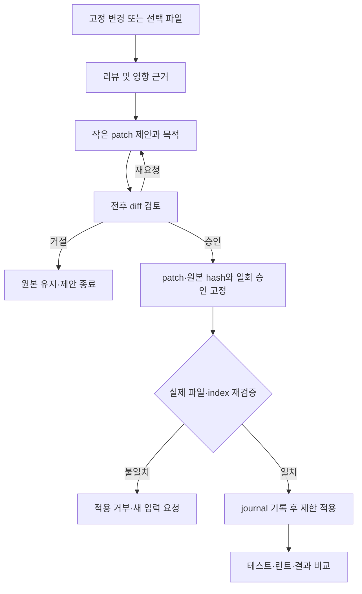

# 출시 범위와 사용자 흐름

목적: 전체 제품 범위를 축소하지 않고 단계별 사용 흐름을 연결한다. 근거: [01 O04~O18](01-repository-analysis.md), 사용자 확정 N01~N08. 관련: [02 추적표](02-requirements-analysis.md), [05 명세](05-functional-specification.md), [10 복구](10-edge-cases-and-security.md). OS·배포·오프라인은 Q01~Q03이며 아래 기본 동작은 설계 제안이다.

## 범위

전체 출시에는 E01~E10과 N01~N08 모두 포함한다. P01/P02 단계의 read-only 앱은 내부 검증본이다. 기존 웹 기능은 서버 연결이 필요하고 local Git·에디터·설치된 검증 도구는 로컬에서 동작하도록 설계한다. 로컬 AI는 설치된 런타임·모델이 있어야 한다. 완전 오프라인의 GitHub 분석 동등성·원격 자료 캐시는 확정되지 않았다.

새 정보 구조: 프로젝트 선택기, 현재 상태/통합 알림, 변경·리뷰·제안·검증의 연결 화면, 기존 분석 탭(타임라인/네트워크/파일/이력). 화면 수 자체를 목표로 하지 않는다. 모든 route는 projectId, 선택 snapshotId/reviewId/proposalId/runId를 명시하며 다른 프로젝트 ID 조합을 거부한다.

## U01 최초 실행·로그인·복원

1. 표준 사용자로 single-instance 실행 → local DB version 검사·필요한 백업/복구 → 마지막 창 위치 복원. 보이지 않는 monitor의 bounds는 현재 display로 보정한다.
2. Git/agent 확인 실패는 해당 기능만 제한하고 오류·설치 경로 안내를 제공한다. 테스트·린트나 모델 설치를 자동 실행하지 않는다.
3. 사용자는 로그인 없이 로컬 폴더를 등록할 수 있다. 원격 기능은 main의 시스템 브라우저 로그인으로 별도 연결한다. 완료 후 서버 계정과 연결 대상 표시.
4. 복원된 프로젝트는 경로·볼륨·Git identity를 재검사한다. 경로가 없어지면 '다시 연결' 상태이며 비슷한 이름의 폴더를 자동 선택하지 않는다.

## U02 프로젝트 연결·전환·분석

폴더 dialog → Git root 검사 → 외부 worktree metadata가 있으면 범위 설명·명시 승인 → 프로젝트 등록 → 브랜치/변경/최근 커밋. 프로젝트를 바꾸면 이전 요청을 취소하고 late response를 버린다. 원격 연결은 사용자가 URL과 GitHub numeric identity를 확인한 후 설정한다. 기본 ID 1이나 첫 remote로 자동 연결하지 않는다.

분석 탭에서는 기존 서버 snapshot을 그 SHA·기간·품질과 함께 연다. 로컬 HEAD와 다르면 차이를 표시한다. 등록 프로젝트 전체 알림에서 클릭할 때 먼저 대상 project를 확정하고 이어서 리뷰/파일/run을 연다. 삭제·권한 만료 대상은 존재를 추정하지 않고 유효하지 않음으로 안내한다.

## U03 변경 리뷰

staged와 unstaged를 별도 선택한다. 같은 파일이 두 목록에 있으면 비교 기준을 각각 표시한다. untracked는 내용 읽기 전 제외 정책과 사용자 선택을 적용한다. 고정된 변경 입력을 만들고 선택·제외·크기·provider 실행 위치·전송 목적을 미리 보여준다. 사용자가 동의하면 review를 실행하고 범위·severity/priority·근거 위치·영향·제안·검증 여부를 표시한다. 지적 0건은 결함 없음이 아니다.

## U04 제안·영향·승인

선택 파일의 작업 트리 쓰기만 지원한다. staged-only 제안은 index 버전과 작업 파일이 같지 않으면 적용을 거부하고 작업 트리 기반 재요청으로 유도한다. index staging/unstaging·커밋은 자동 수행하지 않는다. 코드 참조·이력 통계·AI 추론은 서로 다른 근거 영역에 표시한다.

## U05 외부 에디터·검증

파일 위치 열기 → 검증된 editor adapter → 실행 성공/실패 원인. 실패 시 파일 위치 복사 또는 다른 에디터 설정을 제시한다. 외부 편집은 즉시 앱 적용 승인으로 간주하지 않으며 재조회 시 snapshot이 달라졌음을 표시한다.

manifest·기존 설정 탐지 → 후보 명령·cwd·실제 script 내용·허용 위험 표시 → 명시 승인 → 실행/취소 → stdout/stderr/종료 코드 → 구조화 diagnostic을 같은 project·snapshot·파일에 연결. 종료 코드 0도 skip된 테스트를 성공 건수로 생성하지 않는다.

## U06 결과·알림·커밋 결정

변경 전후 입력·명령·도구·환경이 일치하는지 확인한 후 diff, 테스트/린트, 변경 범위와 지원되는 실측 지표를 비교한다. 목적·실제 결과·잔여 위험·미검증 범위를 요약한다. 사용자가 외부 Git 도구에서 커밋 여부를 결정한다. 앱은 승인 없는 커밋/푸시를 하지 않는다. 리뷰 완료·검증 실패·위험 근거·분석 완료 이벤트는 N08 규칙으로 inbox에 연결한다.

## 네트워크·계정·종료

연결 끊김과 로그아웃은 구분한다. 로컬 작업은 유지하고 원격 동작은 offline/auth_required 상태로 표시한다. 미전송 코드는 복구 후 자동 송신하지 않는다. 전송 결과 불명은 자동 재호출하지 않는다. 다른 계정 로그인 시 이전 계정의 remote cache·토큰을 숨기고 연결 권한을 재확인한다.

종료 시 진행 작업과 검증 프로세스를 표시하고 정상 취소 후 종료한다. 강제 종료 후 apply journal은 자동 덮어쓰기 없이 복구 화면으로 진입하고, 실행 중 검증은 interrupted, 외부 호출 결과 불명은 uncertain으로 복원한다. 로그아웃은 desktop 토큰 폐기·메모리 제거·계정 캐시 정리이며 GitHub 전체 권한 철회와 다름을 안내한다.
