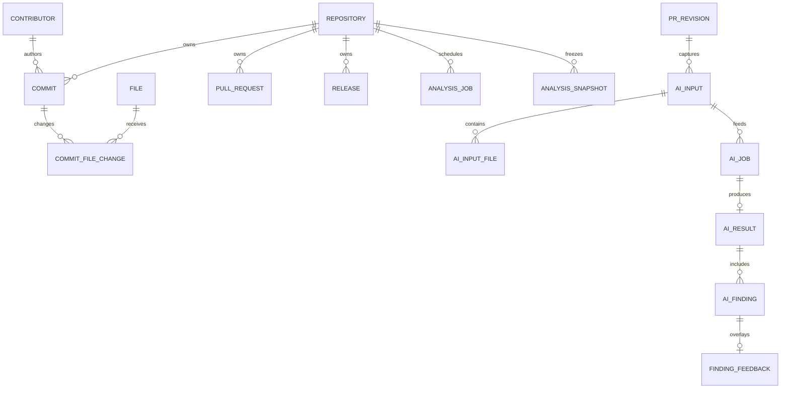
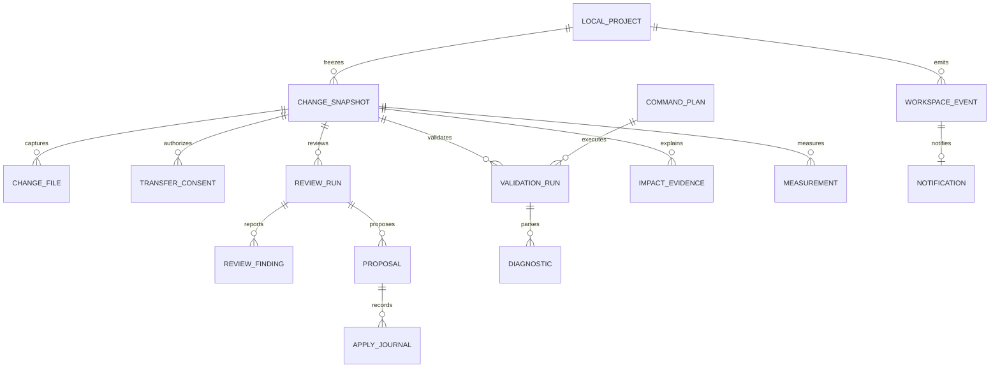

# 데이터 모델과 무결성

목적: 서버 데이터 보존과 신규 로컬 상태를 분리한다. 근거: [01 O08~O13](01-repository-analysis.md), [현 snapshot 구조](../architecture/repository-access-and-snapshots.md). 관련: N01~N08·P02/P03/P07, [05 명세](05-functional-specification.md), [07 계약](07-api-design.md). 아래 신규 표·컬럼·ERD는 **예정 설계**이며 migration은 실행하지 않았다. 로컬 보존기간·공유·전송 정책은 Q04/Q05/Q08이다.

## 기존 모델의 관계와 보존

그림은 주요 관계만 나타낸다. User는 별도 async Base이고 RepositoryAccess는 user UUID와 repository를 연결한다. 기존 FK의 전체 정의는 실제 모델을 기준으로 한다. Commit은 UNIQUE(repository_id,sha), CommitFileChange는 UNIQUE(commit_id,file_id), PR은 UNIQUE(repository_id,pr_number)를 사용한다. AI는 owner/repository를 포함한 복합 FK, JSONB·hash·trigger·lease·outbox를 사용한다. 로컬 미커밋 변경은 기존 PRRevision에 넣지 않는다.

## 로컬 공통 타입

SQLite DB는 Windows current-user의 app data 아래에 둔다. agent만 writer이며 foreign_keys=ON, WAL·busy timeout을 명시한다. ID는 UUID 문자열, 시각은 UTC RFC3339(표시는 사용자 지역), hash는 알고리즘을 명시한 SHA-256(hex64), Git OID는 objectFormat과 전체 OID(40/64자리)를 사용한다. bool은 0/1 CHECK, enum은 CHECK, version은 정수>=1, 필수 열은 NOT NULL이다. 아래 `?`는 nullable, `JSON`은 유효성을 검사하는 UTF-8 TEXT, `BLOB`은 암호화한 내용이다. 암호화 BLOB은 keyVersion·nonce·ciphertext·인증 tag를 담은 AEAD envelope이며 projectId/resourceId/schemaVersion을 AAD로 검증한다. 업무 행에 created_at과 필요한 updated_at을 둔다.

## STEP-P01 저장 범위

전체 표는 단계별 최종 설계다. P01 schema v1에는 `schema_meta(version, applied_at, app_version)`만 만들며 프로젝트·리뷰·제안·서버 인증 표를 미리 만들지 않는다. 중복 instance/writer 방지는 OS lock과 단일 agent 소유권으로 강제한다. 이후 업무 표는 해당 단계에서 schema version을 올린다.

DB·WAL·backup과 key 파일을 current-user data 아래 고정된 앱 경로에 두고 ACL을 검사한다. renderer는 data 경로를 지정하지 못한다. 암호화 검증에는 생성한 시험 자료만 사용한다. AES-256-GCM, 난수 12-byte nonce, 16-byte tag, keyVersion 및 resource/schema 식별 AAD를 쓰며 nonce 재사용·변조·다른 AAD를 거부한다. P01 시험 자료에는 project가 없으므로 고정된 system 범위 AAD를 사용하고 사용자 자료와 혼용하지 않는다.

main이 OS 보호 key 저장을 소유하고 agent에는 [07의 내부 bootstrap](07-api-design.md)으로 필요한 key만 전달한다. 암호화 불가·key 소실·ACL 실패 시 새 key로 기존 자료를 덮어쓰지 않고 unavailable로 표시한다. SQLite backup API·transaction migration·미지원 schema 쓰기 차단을 실제 임시 DB로 검증한다. 디스크 부족/잠금 실패에도 원본과 정합 backup을 보존한다. P01에 사용자 코드 적용·복원 기능은 없다.

## 신규 로컬 테이블 예정

| 테이블 | 주요 컬럼과 키 | 제약·인덱스 |
|---|---|---|
| local_project | id PK, canonical_root, root_identity, git_dir, common_dir, metadata_grant JSON, display_name, access_state, remote_repository_id?, remote_github_id?, remote_url?, remote_account_id?, version | Windows 정규화 키 canonical_root UNIQUE, remote ID는 외부 참조값이며 로컬 FK가 아님. root 변경 시 identity 재확인 |
| project_setting | project_id FK, key, value JSON, version | PK(project_id,key), CAS 갱신, key allowlist |
| change_snapshot | id PK, project_id FK, head_oid?, object_format, index_hash, input_hash, scope JSON, captured_at, coverage JSON, expires_at | UNIQUE(project_id,id), INDEX(project_id,captured_at,id), 확정 후 내용 불변 |
| change_file | id PK, project_id, snapshot_id, path, old_path?, facet, before_hash?, after_hash?, payload BLOB?, key_version?, line_map JSON, content_state, exclusion_reason? | 복합 FK(snapshot_id,project_id), UNIQUE(snapshot_id,path,facet), facet=staged/unstaged/untracked/selected, read 상태는 hash 필수 |
| transfer_consent | id PK, project_id, snapshot_id, manifest_hash, preview_hash, provider, profile_fingerprint, credential_ref?, credential_version?, purpose_hash, destination, execution_location, policy_version, max_estimated_cost, acknowledged_at, expires_at | snapshot 복합 FK, 변경 불가. key 원문 없음, local runtime이면 credential null, consent는 코드 적용 권한이 아님 |
| review_run | id PK, project_id, snapshot_id, consent_id, kind, profile JSON, prompt_version, schema_version, fingerprint, generation, status, attempt_count, budget_reserved, outcome_uncertain, result BLOB?, error_code?, version | kind=review/refactor, 복합 FK로 같은 project, INDEX(project_id,created_at,id), running/terminal 일관성 CHECK, UNIQUE(fingerprint,generation) |
| review_attempt | id PK, run_id FK, attempt_no, provider_request_id?, status, usage JSON?, reserved_cost, started_at, finished_at? | UNIQUE(run_id,attempt_no), uncertain 예약은 자동 해제하지 않음 |
| local_usage_ledger | id PK, run_id, attempt_no, provider, period_start, reserved_cost, actual_cost?, estimate, outcome_uncertain, settled_at? | UNIQUE(run_id,attempt_no), 결과 TTL 삭제와 별도 보관, 진행/uncertain 예약을 유지. 개인정보 payload를 보관하지 않는 비용 감사 자료 |
| review_finding | id PK, project_id, review_run_id, ordinal, category, priority, severity, severity_reason BLOB, file_id, side, start_line, end_line, payload BLOB | UNIQUE(review_run_id,ordinal), 같은 project/run/file을 서비스와 복합 FK로 검증, line>0/end>=start |
| review_feedback | finding_id PK/FK, verdict, note BLOB?, version | 원본 불변, verdict CHECK, CAS |
| proposal | id PK, project_id, snapshot_id, review_run_id, previous_proposal_id?, version, status, patch BLOB, patch_hash, purpose BLOB, expected_effects BLOB, preconditions JSON | 같은 project 복합 FK, UNIQUE(review_run_id), 재생성은 새 ID, status=pending/approved/rejected/superseded/applying/applied/partial/recovery_required |
| approval | id PK, project_id, target_type, target_id, target_hash, preconditions_hash, approved_at, expires_at, consumed_at?, revoked_at?, capability_hash | target_type=proposal/command/recovery, 대상 존재·같은 project를 transaction 내 검사, capability 원문은 메모리에만 보관 |
| apply_journal | id PK, project_id, proposal_id FK, relative_path, preimage_hash, target_hash, backup BLOB, state, file_identity | UNIQUE(proposal_id,relative_path), state=prepared/replaced/verified/recovery_required/restored, 실제 교체 전에 durable 기록 |
| command_plan | id PK, project_id FK, executable, argv JSON, cwd_relative, config_hash, env_allowlist JSON, timeout_ms, output_limit, risk, plan_hash | immutable, hash 변경은 새 ID, cwd는 project 아래 |
| validation_run | id PK, project_id, snapshot_id, plan_id, approval_id FK, status, exit_code?, stdout BLOB, stderr BLOB, truncated, environment_hash, parser_version?, started_at, finished_at? | project 복합 FK, INDEX(project_id,started_at,id), succeeded면 exit_code=0, interrupted 등은 nullable |
| diagnostic | id PK, project_id, validation_run_id, path?, line?, tool, severity, message BLOB, parse_state | 같은 project/run FK, 위치 미해결은 null, parser version은 run에 기록 |
| impact_evidence | id PK, project_id, snapshot_id, kind, path, location JSON?, source_ref JSON, tool_version?, observed, payload JSON | kind별 CHECK, 정적/이력/AI를 섞지 않음, INDEX(snapshot_id,kind) |
| measurement | id PK, project_id, snapshot_id, metric, value?, unit, tool_version, config_hash, environment_hash, scope JSON, unavailable_reason? | value=null이면 이유 필수, UNIQUE(snapshot_id,metric,tool_version,config_hash,environment_hash) |
| comparison | id PK, project_id, before_snapshot_id, after_snapshot_id, proposal_id?, validation_pairs JSON, metric_pairs JSON, comparability JSON | 두 snapshot은 같은 project, 비교 조건·근거 보관, 원본 측정값 불변 |
| workspace_event | id PK, project_id FK, source_type, source_id, source_revision, type, severity, cause_code, occurred_at, received_at, target JSON | source별 검증, event/notification을 같은 transaction에서 upsert |
| notification | id PK, event_id FK, project_id FK, dedupe_key, count, read_at?, last_seen_at, version | UNIQUE(project_id,dedupe_key), INDEX(project_id,read_at,severity,created_at,id) |
| local_operation | idempotency_key, operation, project_scope, body_hash, status, resource_id?, result JSON?, expires_at | PK(project_scope,operation,idempotency_key), 같은 key 다른 body=CONFLICT, 취소/삭제 후에도 기한까지 tombstone 보관 |
| schema_meta | version PK, applied_at, app_version | agent 계약의 schema 범위와 대조 |

프로젝트 간 FK 혼선을 막기 위해 부모에 UNIQUE(project_id,id), 자식에 대응하는 복합 FK를 둔다. 표의 단순 FK 표기는 같은 project 검사 생략을 허용하는 뜻이 아니다. 외부 HTTP ID나 Windows file identity를 SQLite FK로 위장하지 않는다. review_run fingerprint에는 projectId·inputHash·kind·purposeHash·profileFingerprint·prompt/schema/policyVersion을 포함한다. 비용 ledger는 실행 결과 삭제 후에도 중복 사용/미정산 추적을 보존하며 보존기간은 Q08에서 정한다.

review_run status는 queued/running/retry_wait/cancel_requested/succeeded/failed/cancelled/uncertain이다. validation_run은 queued/running/cancel_requested/succeeded/failed/cancelled/timed_out/interrupted다. provider 결과 불명은 uncertain이지 failed 재실행 허용이 아니다. proposal 재요청 시 기존 proposal은 superseded로 전환하고 미소비 approval을 revoke하며 이전 payload·행 이력은 보존한다. 같은 proposal에 동시 승인/거절/적용은 version과 project lock으로 순서를 정한다.

## 서버에 추가 예정인 인증 모델

기존 분석·AI 테이블은 변경하지 않는다. P03에서 아래 인증 테이블만 추가한다. PostgreSQL Alembic revision은 구현 시점 head를 확인하고 새 ID를 정하며, 지금 가상의 revision을 기존 파일로 취급하지 않는다.

| 테이블 | 컬럼·무결성 |
|---|---|
| desktop_auth_transaction | id UUID PK, challenge hex64, poll_secret_hash hex64, display_code, user_id? FK users, browser_session_binding_hash?, state(pending/authorized/exchanged/expired/denied), expires_at, exchange_key_hash?, issuance_response_ciphertext?, response_expires_at?; INDEX(expires_at,state), 한 번 인가·짧은 발급 응답 재조회만 허용 |
| desktop_session | id UUID PK, user_id FK users, token_hash UNIQUE, device_label, capabilities JSON, created_at, expires_at, revoked_at?, last_used_at; INDEX(user_id,revoked_at), 만료되는 bearer이며 GitHub token과 다름 |

인증 flow 5분, 발급 응답 재조회 60초, desktop session 8시간(refresh 없이 만료 후 재로그인)을 설계 초깃값으로 제안한다. refresh token·백그라운드 영구 로그인은 기능에 추가하지 않으며 필요성은 Q10에서 결정한다. 발급 응답 암호화용 서버 key는 기존 GitHub/AI key를 재사용하지 않고 향후 설정 추가로 명시한다.

## transaction·동시 실행·보관

- agent는 단일 writer와 project별 apply/runner lock을 사용한다. 외부 Git/editor는 이 lock을 따르지 않으므로 precondition 재검증이 필수다. 네트워크 호출 중 SQLite/PG transaction을 유지하지 않는다.
- job 접수·operation key·예약·event를 같은 transaction으로 확정한다. terminal 결과·event도 함께 확정한다. 재송신은 같은 key/result를 사용하고 다른 body는 거부한다. 외부 모델 exactly-once는 보장하지 않는다.
- 승인은 목적·대상 hash·일회 capability에 묶는다. requestId를 approval로 취급하지 않으며 hash가 다르면 미사용 승인도 쓸 수 없다.
- DB·WAL·backup ACL은 current user로 제한한다. payload·patch·진단·stdout/stderr·메모·복구 원본은 암호화하고 key는 main의 OS SecretStore에 둔다. root/path 메타데이터도 기밀이지만 OS ACL을 기본으로 하며 전체 DB 암호화 필요성은 Q08에서 결정한다. 파일명 검사만으로 비밀 검사를 끝내지 않는다.
- 초깃값 제안: source snapshot/patch/출력 7일, 리뷰 결과/알림 30일, project 설정은 등록 해제까지. pending proposal·미해결 journal은 자동 삭제하지 않고 만료를 알린다. 최종 정책은 Q08 결정 후 UI에 설명하며 기존 server TTL과 별도 설정한다.

## migration·삭제·rollback

신규 local schema는 agent 시작 시 exclusive lock → SQLite backup API로 정합 backup → transaction migration → schema 검사 → 기동 순서로 처리한다. 실패 시 원 DB를 보존하고 read-only 진단을 제공한다. 구 binary는 미지원 schema에 쓰지 않으며 backup을 별도 경로에 복원한 뒤 명시적으로 전환한다. WAL 파일의 단순 복사나 사용자 코드 자동 원복은 하지 않는다.

서버는 expand-first: 새 테이블/endpoint → 기존 web/신규 desktop 동시 검증 → 기능 공개 순서다. rollback은 desktop 발급 중지·session revoke·기존 web 유지로 수행하며 새 표를 보존하고 파괴적 downgrade를 하지 않는다. project 등록 해제로 원본 폴더를 삭제하지 않는다. 실행 중 job/복구 journal이 있으면 데이터 삭제를 보류하고 종료/복구·명시 확인 후 관련 local 행을 transaction 삭제한다. key 소실 시 암호화 자료를 읽을 수 없다고 설명하고 원본 프로젝트에 쓰기를 시도하지 않는다.

## P07 local schema6 보충

validation_approval은 project/plan/confirmationHash/capabilityHash/expiry/consumed를, validation_run은 project/plan/status와 암호화된 입력·환경 증거·출력·diagnostic을 보관한다. comparison은 같은 project의 before/after snapshot·선택 proposal/run 복합 FK와 암호화 측정 결과를 보관한다. project_setting은 recentLimit를 보존하고 editorId(vscode/cursor)를 CAS로 추가한다. migration은 동일한 pre-v6 backup·transaction rollback·foreign_key_check를 사용한다. 기존 payload AAD는 변경하지 않고 새 실행/비교 payload만 schema6 AAD로 보관한다. 원문·출력·목적/추론 텍스트는 operation ledger에 평문으로 넣지 않는다.

## schema 7 실제 구현 — 2026-10-28

- `workspace_event`에 전역 `sequence`와 요약 `summary`(수치·enum만)를 추가했다. 갱신은 trigger로 금지한다.
- `notification`은 `created_at`을 가지며, 심각도와 유형은 event에서 읽는다.
- 두 표 모두 `local_project` FK가 cascade가 아니다. 원격 연결 사건(P08b)은 아직 기록하지 않는다. [P08a 기록](validation/p08a-2026-10-28.md)
