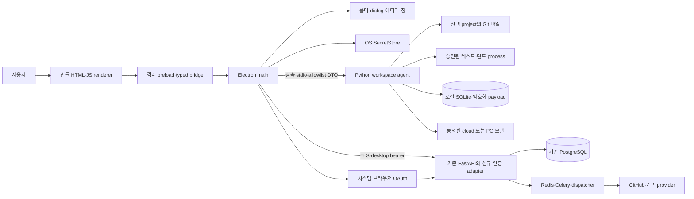

# 시스템 구조와 책임 경계

목적: 기존 서버와 Windows 앱을 하나의 시스템으로 설계한다. 근거: [01 O01~O18](01-repository-analysis.md), [기존 구조](../architecture/system.md). 관련: E01~E10·N01~N08·P01~P08, [03 ADR](03-migration-strategy.md), [07 계약](07-api-design.md), [13 단계](13-implementation-plan.md). 아래 desktop/agent 모듈은 모두 예정이다. 배포·OS 조건은 Q01/Q02, 오프라인은 Q03이다.



## 프로세스별 소유권

| 구성 | 소유 책임 | 금지 |
|---|---|---|
| renderer | 화면·선택·결과 표현·URL context | fs/process/DB/토큰·raw ipcRenderer |
| preload | operation별 API와 event 해제 함수 | generic invoke·arbitrary URL·native 객체 |
| main | app origin 검증·창·dialog·SecretStore·remote auth/API·agent/검증 자식 수명 관리 | 선택되지 않은 root 등록·원격 콘텐츠에 bridge 부여 |
| agent | ProjectRegistry·ScopedFile·LocalGit·Review/Proposal/Impact·Runner·SQLite·typed events | 전체 FastAPI 서버 부팅·서버 DB 연결·임의 shell dispatcher |
| 기존 서버 | OAuth secret·GitHub 권한·수집·분석 snapshot·기존 AI job/credential/result | 로컬 root 추측·로컬 실행 명령 수신 |

agent는 별도 프로세스이지 악성 코드를 막는 OS sandbox가 아니다. 테스트 subprocess도 같은 사용자 권한이다. 실행 승인·프로젝트 신뢰·제한은 노출면을 줄이지만 원본 repo 외 접근을 완전 차단하지 못한다. 더 강한 격리는 별도 결정(Q10)이며 이번 범위에 컨테이너 설치를 강제하지 않는다.

## 모듈 의존성

UI → typed contract → main policy → workspace service → port → adapter 순서다. core는 FastAPI·Electron·SQLAlchemy session을 import하지 않는다. LocalGit은 clone_manager에 의존하지 않는다. EditorAdapter는 main의 OS adapter이고 ReviewService는 editor 존재를 요구하지 않는다. ValidationService는 ProposalService와 독립 실행 가능하며 공통 snapshot/diagnostic ID로 연결한다.

AI core 분리는 기존 provider의 DB/config 의존성을 실제 import 테스트로 확인한 뒤 최소 seam만 만든다. 서버의 consent·budget·lease를 local 실행에서 자동 충족했다고 가정하지 않는다. local job adapter가 별도 동의/예약/attempt 상태를 구현한다. refactor는 신규 WorkspaceKind/WorkspaceProfile로 명시 prompt/schema를 고정하며 기존 서버 JobKind(summary/review/prepare)나 ProviderProfile의 dispatch 의미를 변경하지 않는다. 서버 공용 secret·사용자 server credential DB를 agent가 읽지 않는다.

## 계획된 디렉터리와 책임

```text
desktop/                          [신규]
  package.json, package-lock.json  Windows 빌드와 dev 의존성 고정
  tsconfig.json, forge.config.ts   host 타입·패키징 설정
  src/main.ts                     single instance·window lifecycle
  src/preload.ts                  최소 operation별 bridge
  src/ipc.ts, src/agent.ts         입력/sender 검사·stdio·재시작
  src/remote.ts, src/auth.ts       서버 allowlist·인증 handoff
  src/secrets.ts, src/editor.ts    OS 비밀 저장·외부 에디터
  src/update.ts                   검증된 업데이트·종료 조정
  contracts/workspace.ts          renderer/main RPC DTO
  tests/                          host 단위·security·installer test

app/workspace/                    [신규; 서버 app.main과 독립 entry]
  __main__.py                     stdio 진입·protocol handshake
  contracts.py, dispatcher.py     엄격 DTO·operation allowlist
  projects.py, scoped_files.py    선택 grant·파일 경계
  git_service.py, snapshots.py    읽기 Git·고정 변경
  store.py, migrations.py         로컬 DB·schema backup
  jobs.py, review.py              로컬 job·동의·예약·provider orchestration
  proposals.py, apply.py          제안·승인·journal 적용
  detection.py, validation.py     manifest 탐지·실행 계획
  runner.py, diagnostics.py       process tree·stdout/stderr·위치 해석
  impact.py, comparisons.py       증거·실측 비교
  events.py, notifications.py     durable event·중복 inbox
  adapters/ai_core.py             기존 정책/provider/validator 경계

frontend/pages/workspace.html     [신규]
frontend/js/platform/transport.js [신규; 웹/앱 transport]
frontend/js/workspace/            [신규; project/change/review/diff/validation/inbox]
app/api/desktop/auth.py           [신규; 서버 handoff/session]
app/services/desktop_auth.py      [신규; 서버 세션·expiry·revocation]
app/models/desktop_session.py     [신규; 서버 auth 표]
tests/workspace/                 [신규; 실제 Git·파일·SQLite fixture]
scripts/build_workspace_agent.py [신규; Windows agent 묶음]
.github/workflows/windows-desktop.yml [신규; 계획만]
```

기존 `app/api`, `app/collectors`, `app/models`, `app/services/ai`, `frontend/pages`와 JS는 유지한다. 서버 인증 middleware와 UI transport seam 등 수정 예정 실파일은 [13](13-implementation-plan.md)에 단계별로 구분한다. 기존 루트 requirements에 desktop-only 도구를 무조건 추가하지 않고 별도 agent 빌드 의존성 manifest를 둔다.

## 기동·종료·버전

main은 번들 agent만 고정 경로로 실행하고 arbitrary binary 경로를 renderer에서 받지 않는다. 환경은 최소 allowlist, 프로젝트 `.env`·서버 DATABASE_URL·OAuth secret를 상속하지 않는다. stdio는 상속 pipe로 통신하며 TCP port를 열지 않는다. handshake는 appVersion·protocolVersion·localSchemaRange·capabilities. 불일치면 쓰기 차단·복구 안내. 초기화 전에 write RPC를 받지 않는다.

서비스 장애는 typed status로 전파한다. agent crash 후 read는 사용자 재조회 가능, 미확정 write/provider 호출은 상태부터 복구한다. main이 종료되면 agent/runner 자식도 종료하도록 Windows Job Object(또는 동일 보장을 검증한 고정 helper)를 사용한다. 파일 잠금으로 지연되면 강제 overwrite하지 않는다.

## 로그·관측

requestId·operation·project의 비식별 ID·resourceId·status·duration·errorCode·version만 구조화 로그로 남긴다. source·patch·prompt·API key·토큰·절대 root·test stdout/stderr는 일반 로그에서 제외한다. 사용자 동의로 내보내는 진단은 비식별 preview를 제공한다. 자동 원격 telemetry/diagnostic upload는 범위에 추가하지 않는다.

현재 print/console 로깅은 기존 동작이며 이 구조가 이미 적용된 것으로 설명하지 않는다. remote request와 local run은 traceId를 연결할 수 있으나 local path·본문을 서버 로그에 넣지 않는다.

## STEP-P01 기반 앱의 범위

P01은 `desktop/ui/`의 상태 전용 빈 UI와 bundled agent를 사용한다. 기존 frontend/API 연결은 P03에서 수행한다. preload는 sandbox를 유지하는 CommonJS 단일 산출물이며 runtime 외부 모듈 import 없이 operation별 함수만 노출한다. main의 app origin handler는 고정 자산 allowlist·정규화 경로를 검사하고 CSP·navigation·window.open 제한을 적용한다.

수명은 예정 `app/workspace/windows.py`의 ctypes 기반 Windows Job Object·부모 process handle 감시로 구현·검증한다. 자식 생성 전에 Job 연결을 확인하고 실패하면 ready를 금지한다. 부모 감시 초기화 실패·부모 소멸도 종료 사유다. 부모 PID 재사용과 초기화 중 parent exit race를 fixture에 포함한다. 실제 kill/잔존 프로세스 시험 전 완전한 종료를 보장한다고 주장하지 않는다. 같은 보장을 위해 native helper가 필요해지면 새 의존성·파일 범위를 별도 검토한다.

SecretStore는 main의 async OS 보호 API, payload 암호화는 agent의 AEAD 어댑터가 담당한다. key bootstrap·실패 동작은 [07](07-api-design.md), P01 schema 최소 범위는 [06](06-data-model.md), 전체 파일/의존성 목록은 [13](13-implementation-plan.md)을 따른다. P01 package는 Python agent를 포함한 Windows 실행 디렉터리까지이며 installer·서명·update feed는 P10 범위다.

## 구현 상태 주석 — 2026-10-28

서두의 "모두 예정"은 설계 시점 표현이다. 위 파일 구성 중 `events.py`, `notifications.py`, inbox UI, `src/update.ts`, `.github/workflows/windows-desktop.yml`만 아직 없다. preload의 workspace 브리지는 `gitviz://app/index.html` 문서에만 노출되고, main의 workspace 핸들러도 같은 문서의 sender만 허용한다(D-03). 다른 앱 문서에는 `window.desktop`(auth·remote)만 남는다.
