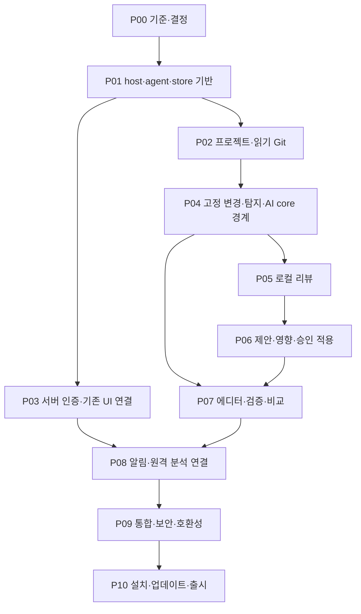

# 단계별 구현 계획

목적: 기술적 의존성과 위험을 기준으로 후속 개발 작업을 나눈다. 근거: [01 조사](01-repository-analysis.md). 관련: E01~E10·N01~N08·P01~P08, [02 추적표](02-requirements-analysis.md), [05 명세](05-functional-specification.md), [07 계약](07-api-design.md), [12 테스트](12-testing-strategy.md), [14 결정](14-decisions-and-open-questions.md). **2026-10-24 승인된 P01 기반 범위를 구현·검증 완료했다. 후속 단계는 미래 계획이며 실제 결과는 [P01 기록](validation/p01-2026-10-24.md)과 구분한다.** 실파일만 링크하고 신규 경로는 백틱으로 구분한다.

## 의존성·공통 게이트

P02와 P03은 P01 계약 이후 독립 진행 가능하다. P07의 editor/detector/runner는 P04 뒤 P05/P06과 병행할 수 있으나 전후 비교의 최종 인수는 P06 후다. 문서의 병행 가능성은 이번 작업에서 subagent 실행을 뜻하지 않는다. P08의 event/store 기반은 P04 뒤 준비 가능하나 전체 통합은 P03/P07 후다.

각 단계는 해당 T 테스트와 host lint/typecheck·agent lint/type 기준(P00 확정)·관련 package build를 통과하고 실제 실행 명령·환경·결과·미실행 범위를 문서화해야 종료한다. 기존 서버를 건드린 단계는 기존 회귀도 실행한다. 경고·보안 실패를 다음 단계로 숨기지 않는다. 사용자 source 수정·commit·push·provider 호출은 승인 규칙을 항상 따른다.

## P00 조사 기준·계약·결정 고정

- **목표/선행:** 이번 문서를 출발점으로 실제 구현 시작 HEAD·dirty 변경을 다시 확인한다. 선행 단계 없음. Q01/Q02/Q04/Q05/Q06/Q07/Q08/Q10 중 해당 구현을 막는 결정을 분리한다.
- **문서 반영 범위:** [03](03-migration-strategy.md), [06](06-data-model.md), [07](07-api-design.md), [08](08-system-architecture.md), [12](12-testing-strategy.md), [13](13-implementation-plan.md), [14](14-decisions-and-open-questions.md). ADR·RPC·schema·파일·검증 기준을 책임 문서에 함께 반영. application 변경 없음.
- **신규 기록:** [implementation-baseline](validation/implementation-baseline.md)(비밀 없는 기준·검증 기록), 제품 코드는 없음.
- **인터페이스:** [07](07-api-design.md)의 RPC v1·ProjectRef·snapshot/approval·session 계약을 설계 검토로 고정. 지원 Electron/Python/Git·host test/type/lint 도구 버전·배포 기준을 기록한다.
- **구현 사항:** 기존 기능 E 전수 시나리오·표준 fixture·최소 지원 언어/editor·privacy gate 정의. 성능 목표는 실측 가능한 수치/환경으로 정한다.
- **테스트/완료:** 문서 검사 명령·E/N/P/C/T coverage 검토, D01/D02 제품 담당 결정, OS/배포 전제가 확인되어 다음 단계 범위가 객관적으로 정해짐.
- **리스크/롤백:** 정책 미정은 해당 외부 전송/공유·출시만 막고 read-only 개발은 진행 가능. 결정 문서 이전판 보존, 코드/DB rollback 없음.

## P01 데스크톱·agent·저장 기반

- **목표/선행:** P00의 RPC·버전 계약을 이용해 격리 창·stdio handshake·local DB·SecretStore가 동작하는 빈 앱을 만든다.
- **수정 예정 실파일:** 없음. [requirements](../../requirements.txt)·[compose](../../docker-compose.yml)·기존 진입점을 desktop 때문에 변경하지 않는다.
- **신규 예정 파일:** 아래 P01 manifest로 한정한다. 기존 서버 requirements·compose·진입점·frontend는 수정하지 않는다.

| 신규 파일 묶음 | 책임 |
|---|---|
| `desktop/{.gitignore,package.json,package-lock.json,tsconfig.json,tsconfig.preload.json,eslint.config.mjs,forge.config.ts}` | 의존성·컴파일·lint·package |
| `desktop/contracts/workspace.ts` | host DTO·operation 타입 |
| `desktop/src/{main,window,app-protocol,preload,ipc,contracts,agent,secrets}.ts` | 창·자산 origin·엄격 브리지·agent·SecretStore |
| `desktop/ui/{index.html,status.js,styles.css}`, `desktop/scripts/build.mjs` | 상태 전용 빈 UI·빌드 자산 |
| `desktop/tests/{contracts,agent,bridge-security,secrets}.test.ts`, `desktop/tests/foundation.e2e.ts` | host unit·실제 Electron 기반 인수 |
| `contracts/workspace/v1/{request,response,bootstrap}.schema.json`, `contracts/workspace/v1/fixtures.json` | 공통 Draft-07 schema·정상/거부 fixture |
| `app/workspace/{__init__,__main__,contracts,dispatcher,store,migrations,crypto,windows}.py` | 독립 stdio agent·SQLite·암호화·Windows 수명 |
| `tests/workspace/{test_contracts,test_dispatcher,test_import_boundary,test_recovery,test_crypto,test_windows}.py` | 계약·DB/복구·import·OS 검사 |
| `requirements-workspace.txt`, `requirements-workspace-build.txt`, `requirements-workspace.lock` | 별도 agent runtime/build·hash lock |
| `pyright-workspace.json`, `ruff-workspace.toml` | 신규 agent 검사만 적용 |
| `scripts/build_workspace_agent.py`, `workspace_agent.spec` | freeze·서버 코드 포함 차단 |

- **인터페이스:** [07](07-api-design.md)의 system.handshake/health/shutdown·내부 bootstrap·typed error, main 전용 SecretStore. renderer는 getHealth()만 사용한다. 폴더·프로젝트·Git·AI·파일 쓰기 API는 P01 capability에 포함하지 않는다.
- **구현 사항:** sandbox/context isolation·Node 금지·single instance·고정 app origin·CSP·agent 환경 allowlist·schema_meta만 갖는 local schema v1·backup·AEAD·ACL·Job Object/부모 감시. 상세는 [06](06-data-model.md), [08](08-system-architecture.md).
- **직접 의존성:** host runtime `electron`, `ajv`; 개발 도구 `@electron-forge/cli`, `@electron-forge/shared-types`, `typescript`, `@types/node`, `eslint`, `@eslint/js`, `typescript-eslint`, `pyright`. agent runtime `jsonschema`, `cryptography==50.0.2`; build/lint `pyinstaller`, `ruff`. Node node:test·Python unittest·sqlite3·ctypes를 사용하며 P01 전용 UI framework/bundler/test framework는 추가하지 않는다.
- **버전 상태:** 개발 도구 관찰값 Node24.20.0/npm11.19.0/Python3.12.10/Git2.53.0.windows.2. Electron45.0.0·Forge8.0.1은 검토 후보이며 조합 검증 완료값이 아니다. 나머지 exact version·전이 dependency·hash·라이선스/SBOM·취약점·Windows wheel/DLL·빌드 도구 호환성은 설치 전 검토표로 확정한다. 자동 latest/caret 범위로 승인 범위를 대체하지 않는다. 별도 venv `.validation/venv-workspace`를 사용하고 기존 venv·서버 의존성을 업그레이드하지 않는다.
- **테스트/명령:** T10/T12의 P01 부분과 [12의 고정 기준](12-testing-strategy.md). host lint/type/unit/foundation/build, agent Ruff/Pyright/unittest, agent freeze·Forge package, Python 없는 Windows11 x64 표준 사용자 clean VM 인수. 설치·빌드 명령은 영향/복구안과 exact package 검토 후 별도 승인으로 실행한다.
- **완료:** 공통 fixture TS/Python 동일 판정·실제 renderer 경계·기동/종료·부모 kill/잔존 자식0·SecretStore 재시작/실패·DB backup/실패·미지원schema 차단·패키지 기동 증거가 모두 필요하다. clean VM 미실행은 환경 제약으로 검증 불가이며 단계 완료가 아니다.
- **비목표:** P02~P10 업무 기능, 기존 UI transport, 서버 인증/DB, installer/maker·서명·업데이트·배포. package는 agent 포함 실행 디렉터리까지다. feature 제외가 아니라 후속 단계 책임이다.
- **리스크/롤백:** DLL/AV/OS secret/Job 실패는 unavailable로 표시. desktop 실행 중지·정합 backup·진단 보존으로 기존 웹 유지. 사용자 원본/서버 DB는 복구 대상이 아니다. native helper 등 목록 밖 파일/의존성이 필요하면 범위 변경을 보고한다.
- **승인·현재 상태:** 사용자가 P01 착수·격리 설치/테스트/빌드·workspace 전용 cryptography50.0.2 교체를 각각 승인했다. P01 기반 범위는 clean VM·22개 중단 경계·실제 NTFS 용량 고갈 인수까지 구현·검증 완료했다. 후속 단계 승인이 아니다. [P01 기록](validation/p01-2026-10-24.md)에 실제 버전·파일·검증을 남긴다.

## P02 프로젝트·읽기 전용 Git

- **목표/선행:** P01 뒤 N01·S01/S02 충족. 가장 먼저 독립 구현할 작은 단위는 LocalGit 상태 조회와 임시 repo fixture다.
- **수정 예정 실파일:** 없음. 특히 [clone_manager](../../app/collectors/git/clone_manager.py)를 local root에 연결하지 않는다.
- **신규 예정:** `app/workspace/{projects,scoped_files,git_service}.py`, `frontend/pages/workspace.html`, `frontend/js/workspace/{projects,status}.js`, `tests/workspace/{test_scoped_files,test_git_status}.py`.
- **인터페이스:** `projects.selectAndRegister/list/get/updateSettings/unregister`, `git.status`의 ProjectRef/RepositoryState, native selection grant.
- **구현 사항:** canonical root·metadata grant·identity·중복·worktree·staged/unstaged·최근 log·설정 CAS. 폴더 등록과 분석 서버 등록 분리.
- **테스트/명령:** T01/T02와 Windows 실제 junction·한글/공백/CRLF·Git 없음·conflict/unborn/detached·외부 git-dir. unittest + host build/type/lint.
- **완료:** C01, 조회 전후 project 바이트/index가 그대로이며 project 전환 late response·경계 이탈 0.
- **리스크/롤백:** 경로 이동은 재연결만, 자동 탐색/clone/reset 금지. 신규 local 행 삭제/기능 off로 rollback, 원본 폴더는 그대로.

## P03 desktop 인증·기존 기능 transport

- **목표/선행:** P01 뒤 E01~E10을 앱 UI와 연결. Q05 공유 정책·Q10 인증/배포 서버 전제 확인. P02와 독립 개발 가능.
- **수정 예정 실파일:** [app.main](../../app/main.py)(middleware/router 추가), [auth router](../../app/routers/auth.py)(desktop flow 분기·principal 조회), [모델 등록](../../app/models/__init__.py)(신규 auth 모델 metadata 등록), [AI dependencies](../../app/api/ai/dependencies.py)(검증된 bearer만 CSRF 분기), [frontend api](../../frontend/js/api.js), [AI client](../../frontend/js/ai-api.js), [login](../../frontend/js/login.js)(transport/auth 주입), [비동기 DB](../../app/database.py)(원격 TLS 인증서 검증 필수), [보안 검사](../../scripts/test_ai_security.py)(TLS 기대값·CA 실패 fixture만), [CI](../../.github/workflows/backend-validation.yml)(서버 인증 회귀), [환경 예시](../../.env.example)(추가 auth key·CA 설정 안내). 차트 HTML의 CDN asset 경로·inline handler는 필요한 파일만 국소 변경.
- **신규 예정:** `app/api/desktop/{__init__,auth}.py`, `app/services/desktop_auth.py`, `app/models/desktop_session.py`, `app/desktop_auth_middleware.py`, `migrations/versions/<새 revision>_desktop_sessions.py`, `desktop/src/{auth,remote}.ts`, `frontend/js/platform/transport.js`, `frontend/vendor/`(허가된 자산), `scripts/test_desktop_auth.py`, `scripts/test_desktop_api_compat.py`, `desktop/tests/{auth,remote-compat}.e2e.ts`.
- **인터페이스:** [07](07-api-design.md)의 desktop auth HTTP와 endpointKey remote transport. 기존 cookie·AI v1 요청/응답의 의미는 유지.
- **구현 사항:** browser state binding·challenge·발급/재송신·session revoke·allowlist·계정/캐시 분리·기존 pages 모두 연결. 새로운 desktop auth만 additive PG migration. 기존 분석/AI 테이블 변경 없음.
- **테스트/명령:** T11/T14/T15, 기존 AI contracts/frontend·metric/viz·격리 PG 회귀. fixture OAuth→staging 실제 browser OAuth는 구분. 실제 secret/key 없는 테스트·깨진 응답·401/429/네트워크·mixed cookie/bearer 포함.
- **완료:** E01~E10 화면·URL snapshot·권한·coverage 보존, 기존 웹/앱 동시 사용, 앱에 OAuth secret 없고 만료/취소/재로그인 정상.
- **리스크/롤백:** authentication bypass·공유 노출·CSP 회귀가 핵심. 원격 DB CA는 코드 전환 전에 배포하고 공개 CA는 시스템 trust, 사설 CA는 명시 trust로 검사하며 검증 해제로 되돌리지 않는다. 연결 실패 시 기능 공개를 보류한다. desktop 발급/경로 off·세션 revoke·기존 web 유지. 새 auth 표 보존, destructive downgrade 금지.

## P04 고정 변경·탐지·AI core 경계

- **목표/선행:** P02 뒤 변경 입력/프로젝트 도구의 사실 기준 확보. source를 외부로 보내지 않고 core import 경계를 먼저 검증.
- **수정 예정 실파일:** [AI input_builder](../../app/services/ai/input_builder.py), [provider registry](../../app/services/ai/providers/registry.py), [validators](../../app/services/ai/validators.py)는 필요한 dependency-injection seam만 추가하며 기존 profile/prompt 의미는 불변. seam이 불필요하면 수정하지 않는다.
- **신규 예정:** `app/workspace/{snapshots,detection}.py`, `app/workspace/adapters/ai_core.py`, `tests/workspace/{test_snapshots,test_detection,test_ai_core}.py`, `frontend/js/workspace/changes.js`.
- **인터페이스:** `changes.capture`, `files.preview`, `validation.detect/plan`, `ChangeSnapshot`, `CommandPlan`, DB 없는 provider/input policy port.
- **구현 사항:** HEAD/index/worktree facet·pre/post hash·line map·coverage·제외 정책, manifest는 parse만, local AI 원문 정책 재사용. local/remote ID 혼합 금지.
- **테스트/명령:** T02/T03/T06의 캡처·계약 부분, 기존 contracts/provider/validator fixture 동등성. agent import가 `app.main`·DB engine·Celery를 로드하지 않는지 확인. lint/type/build.
- **완료:** 고정 bytes 재현·중간 변경 감지, 비밀·생성물 제외, 기존 PR/commit 출력 동등, manifest 읽기만으로 실행 없음.
- **리스크/롤백:** 공통화로 서버 회귀가 나면 seam 제거·adapter 격리. 고정 local 입력만 만료 정리, 사용자 원본은 건드리지 않음.

## P05 로컬 커밋 전 리뷰

- **목표/선행:** P04 뒤 N02 완성. Q04/Q06/Q08 정책·provider 지원 범위가 정해진 기능만 송신. 정책 미정이면 cloud private/unknown 차단.
- **수정 예정 실파일:** 없음. 기존 PR review prompt를 덮어쓰지 않는다.
- **신규 예정:** `app/workspace/{jobs,review}.py`, `app/services/ai/prompts/workspace_review_v1.txt`, `frontend/js/workspace/review.js`, `tests/workspace/test_review.py`.
- **인터페이스:** preview/start/get/list/cancel/feedback, transfer consent·schema·severity/priority·attempt·local_operation 계약.
- **구현 사항:** local BYOK/PC 모델·scope 동의·예산 예약·uncertain·결과 검증·feedback, 서버 AI 기록과 별도 저장. local model과 server-host model 위치를 구별.
- **테스트/명령:** T03·T12, fake provider 전체·failure injection. 실제 model smoke/품질은 명시 budget·사람 평가 후 별도. host/agent checks/build.
- **완료:** C02, 무동의 전송 0·중복 요청 재과금 방지 상태·불명 결과 보존·심각도/근거/영향/제안 및 검증 한계 표시.
- **리스크/롤백:** schema/비밀 탐지/비용 문제는 새 generation 중지·키 사용 중단·원문 TTL 정리. 기존 remote review는 독립 유지.

## P06 리팩토링·영향·안전 적용

- **목표/선행:** P05 뒤 N03/N06, 원격 이력 보강은 P03 연결 후 사용. 정적 분석 지원 언어 Q06 확정.
- **수정 예정 실파일:** [history_context](../../app/services/ai/history_context.py)는 필요할 때 검증된 evidence builder seam만 분리, 원격 S11 판정·공유 계약 유지.
- **신규 예정:** `app/workspace/{proposals,apply,impact}.py`, `app/services/ai/prompts/workspace_refactor_v1.txt`, `frontend/js/workspace/{proposal,diff,impact}.js`, `tests/workspace/{test_apply,test_impact}.py`.
- **인터페이스:** proposal create/get/reject/requestRevision/approve/apply/recover, impact.analyze, approval capability·journal·EvidenceKind.
- **구현 사항:** 작은 patch·목적/효과·검증 제안·별도 schema·staged 불일치 차단·project lock·preimage/target hash·durable journal·부분복구, static/historical/AI 분리.
- **테스트/명령:** T04/T07/T12·실제 Windows locked/reparse file·각 kill point·승인 위조·재요청/거절·정적 위치 fixture. 기존 S11 회귀+build/lint/type.
- **완료:** C03/C06. 승인 없는 쓰기 0, 외부 변경 보존, 실제 위치 근거·미해결 범위 표시, 모든 partial apply 복구 안내.
- **리스크/롤백:** multi-file 원자성 없음. write 기능 off·journal 보존·사용자 승인/현재hash 일치 시 원복, Git reset 사용 금지.

## P07 에디터·검증 실행·전후 비교

- **목표/선행:** detector/runner는 P04 뒤 독립 준비, 전체 N04/N05/N07은 P06 뒤 검증. 에디터·언어 Q06/Q07 확정.
- **수정 예정 실파일:** 없음. 원격 analytics 산식을 코드 품질 점수로 전용하지 않는다.
- **신규 예정:** `desktop/src/editor.ts`, `app/workspace/{validation,runner,diagnostics,comparisons}.py`, `frontend/js/workspace/{validation,comparison}.js`, `tests/workspace/{test_runner,test_comparison}.py`, `desktop/tests/editor.test.ts`.
- **인터페이스:** editors.*, validation.*·CommandPlan/RunResult/Diagnostic·comparisons.*·Measurement. native runner helper가 필요하면 검증 후 `desktop/native/` 예정 경로에 한정.
- **구현 사항:** preference adapter·명령 검토/신뢰·config hash 재확인·자식 트리 종료·출력·위치 연결·동일 조건 측정·null/not_comparable. lint --fix/의존성 자동 설치 없음.
- **테스트/명령:** T05/T06/T08, 실제 Windows editor 실행·공백/한글 argv·timeout/grandchild/flood·baseline 없음/다른 환경. host checks/agent unit/package.
- **완료:** C04/C05/C07, 계획 그대로 실행·취소 후 자식 없음·원문 출력/위치·실측 비교, 없는 개선 주장 0.
- **리스크/롤백:** 테스트 코드는 사용자 권한으로 동작하므로 신뢰 게이트. runner off·진행 프로세스 정리·기록 보존, 명령이 남긴 외부 side effect를 자동 복구한다고 약속하지 않음.

## P08 통합 알림·기존 분석과 연결

- **목표/선행:** P03/P07 뒤 N08·E 기능 간 target 연결. remote 완료는 알려진 job 조회로 감지.
- **수정 예정 실파일:** [navbar 컴포넌트](../../frontend/pages/components/navbar.html)는 workspace/inbox 진입점만 추가, [page context](../../frontend/js/page-context.js)는 명시 project/remote mapping 표시 seam만. 기존 분석 URL 의미 유지.
- **신규 예정:** `app/workspace/{events,notifications}.py`, `frontend/js/workspace/{inbox,navigation}.js`, `tests/workspace/test_notifications.py`.
- **인터페이스:** WorkspaceEvent·target·notifications.list/markRead·cursor·events.subscribe. OS toast는 Q09 승인 시 별도 adapter로만 추가.
- **구현 사항:** transaction event/outbox-equivalent·dedupe·여러 project 필터·읽음 CAS·대상 유효성·review/test/lint/risk/analysis 완료 통합.
- **테스트/명령:** T09/T14·재전달/재시작·순서 역전·다른project ID·삭제 target·offline gap. E 분석 화면 기존 회귀와 build.
- **완료:** C08, 알려진 작업의 통합 사건에서 원인/시각/대상/읽음 일관성, 알림 클릭은 탐색만 수행.
- **리스크/롤백:** 중복·오래된 target·권한 상실. inbox adapter off·원본 event 보존, 기존 프로젝트/분석 진입점 유지.

## P09 전체 통합·보안·호환성 인수

- **목표/선행:** P08 및 E/N 기능 전부 완성. D01/D02·Q04/Q05/Q06/Q08/Q10의 출시 차단 결정 확인.
- **수정 예정 실파일:** [기존 CI](../../.github/workflows/backend-validation.yml)는 필요한 서버 회귀만 추가; [검증 문서](12-testing-strategy.md)와 [현재 검증 상태](../validation/current-status.md)에 실행 증거 링크. 제품 코드 수정은 발견된 결함의 최소 파일만 새 범위로 기록.
- **신규 예정:** `desktop/tests/workspace.e2e.ts`, `desktop/tests/remote-compat.e2e.ts`, `.github/workflows/windows-desktop.yml`, `docs/migration/validation/<run-id>.md`.
- **인터페이스:** E/N/P 추적 전수, old/new server capability·protocol/schema compatibility.
- **구현 사항:** 실제 Windows clean VM·실제 renderer·web 동시 사용·강제 종료·기밀 로그·공개/비공개·계정 전환·정적/AI 근거 검증. profile smoke와 실제 품질 평가는 구조 테스트와 분리.
- **테스트/명령:** T01~T15 중 설치를 제외한 전체, 기존 서버 PG/Redis·UI 회귀, npm test:e2e·build/type/lint·agent checks. SLO·memory는 P00 기준 fixture로 측정.
- **완료:** E01~E10·C01~C08·S01~S07 통과, 미해결 치명/높음 보안 결함 0, 미확인 품질은 명확한 출시 판단 기록.
- **리스크/롤백:** 실패한 기능을 조용히 제외하고 출시하지 않음. 통합 후보판 배포 중지·기존 웹과 읽기 전용 내부판 유지.

## P10 Windows 설치·업데이트·배포

- **목표/선행:** P09, Q01/Q02/Q08/Q10 확정·서명/배포 자격 준비. 모든 N 기능의 출시 전 마지막 게이트.
- **수정 예정 실파일:** [README](../../README.md)는 기존 서버 실행을 유지하면서 앱 설치 안내 링크 추가, [운영 setup](../operations/setup.md)은 앱/서버 책임 구분만 추가.
- **신규 예정:** `desktop/src/update.ts`, `desktop/tests/install-update.ps1`, `docs/operations/windows-desktop.md`, `.github/workflows/windows-release.yml`. P01의 예정 `forge.config.ts`는 이 시점에는 존재할 파일이며 서명/배포 설정을 구체화.
- **인터페이스:** installer/update manifest·publisher/hash/version·app/agent/schema range·diagnostic export·uninstall data choice.
- **구현 사항:** current-user 설치·서명/타임스탬프·release feed·쓰기/검증 중 설치 보류·DB backup·network interruption recovery·제거 후 source 보존.
- **테스트/명령:** T13/T12/T15, clean Windows VM·Python/Node/Docker 없음·위조/다른publisher·full disk·migration fail·강제종료·이전/신규 버전 교차. 릴리스 package build와 lint/type/security checks.
- **완료:** 서명된 설치/업데이트/제거 증거와 복구 시나리오, E/N 전수 인수 기록, 배포·장애 대응 안내·미결 정책 해소. 자동 업데이트 정책이 미정이면 릴리스 완료 선언 불가.
- **리스크/롤백:** feed 중단·악성 artifact·신규 schema. 배포 중지·서명된 호환 이전 binary 제공·DB backup 명시 복원. 사용자의 project 파일 rollback은 journal 승인 규칙만 적용.

## P01 잔여 검증 갱신 — 2026-10-24

[잔여 검증 기록](validation/p01-remaining-2026-10-24.md)에22개 중단 경계·SQLite FULL·실제 Electron 복구·clean VM·실제 NTFS 용량 고갈 인수를 기록했다. Python/Node 없는 P01Tester 표준 계정에서8개 앱 검사군과 EXE/ASAR/agent 해시 일치, 별도64MiB 가상 디스크의 여유0바이트·ENOSPC·WAL 롤백·원본/백업 보존·공간 확보 후 복구를 확인했다. 승인된 P01 기반 범위는 구현·검증 완료다. P02 이후·installer/서명/배포·전체 제품 검증은 포함하지 않는다.

## P02 완료 기록 — 2026-10-24

사용자가 P02 착수·계속 진행과 재빌드·실제 Electron 검증·검증용 패키징을 승인했다. [P02 실행 기록](validation/p02-2026-10-24.md)에 프로젝트·schema2·명명형 bridge·read-only Git·Windows 경계 구현과30개 Python/13개 host 단위·기존 회귀 결과를 기록했다. 실제 Electron에서 프로젝트 전환 지연 응답·text 렌더링·CAS/replay/unregister·원본/index 보존을 확인했고 foundation 회귀와 검증 패키지의 번들 실행8개 검사군도 통과했다. 승인된 P02 C01 범위는 완료다. 패키지 실행은 development-host-only이며 P01 clean VM 증거와 구분한다. 실제 사용자 DB migration·installer·서명·배포 및 P03 이후는 수행하지 않았다.

## P03 구현·검증 기록 — 2026-10-25

사용자가 P03, 기존 웹 shared GET 권한 유지, flow5분/session8시간/refresh 없음, 동일 CDN 버전 자산 번들링·격리 PostgreSQL 검증·독립 검증 패키징/실행을 승인했다. [P03 실행 기록](validation/p03-2026-10-25.md)에 신규 서버 인증2표·검증 bearer middleware·main SecretStore/allowlist·기존 UI transport·CSP 자산/이벤트 전환을 기록한다. 코드 구현과 로컬·격리 검증은 완료했다. 확대 검증193개·host18개·AI frontend39개·실제 Electron 인증/기존7화면/P02 회귀·제한 PATH의 독립 패키지 실행이 통과했다. 실제 서버 배포/OAuth·웹/앱 동시 인수가 남아 P03 전체 또는 제품 출시 완료로 선언하지 않는다.

## P04 착수 승인 — 2026-10-25

사용자는 **P03의 실제 서버 OAuth·웹/앱 동시 사용 인수가 남아 있음을 명시한 채 P04 진행**을 승인했다. P03 잔여 인수는 계속 별도 gate이며 완료로 변경하지 않는다. [P04 기록](validation/p04-2026-10-25.md)에 JS/TS·Python 우선 탐지, 격리 Pydantic 추가 승인, 고정 변경·계획·AI core 경계 구현과 실제 검증을 기록한다.

## P04 승인 범위 완료 — 2026-10-25

고정 변경 캡처·고정 preview·JS/TS/Python manifest 탐지·불변 명령 계획·AI core 경계의 구현과 승인된 검증을 완료했다. workspace 43개, 기존 AI 계약 회귀, 실제 Electron 5개 시나리오와 독립 P04 패키지 실행이 통과했다. [검증 기록](validation/p04-2026-10-25.md)에 범위·실패 이력·산출물 hash를 남겼다. P03 실제 서버 OAuth·웹/앱 동시 사용 인수는 계속 미완료이며 P05는 별도 착수 대상이다.

## P05 착수 — 2026-10-26

사용자가 P05 착수와 Q04 기본 보안 정책 구현을 승인했다. 고정 입력·PC 모델 전송 동의·작업/예약/uncertain·출력/위치 검증·feedback 및 제한 RPC/UI를 작성했다. 별도 승인 후 임시 DB migration·전체 workspace60개·source/frozen agent와 fake provider 실제 Electron 검증·host18개·독립 검증 패키지가 통과했다. [P05 추적 기록](validation/p05-2026-10-26.md)을 따른다. P05 완료나 실제 모델 품질·cloud BYOK 활성화·P03 실제 서버 인수 완료를 뜻하지 않는다.

## P05 PC 로컬 경로 검증 완료 — 2026-10-26

후속 사용자 승인으로 agent freeze·실제 Electron 6개 회귀·독립 P05 검증 패키지 실행까지 통과했다. workspace60개·host18개, 동의 요청 본문 hash 일치, fake loopback provider 결과 저장과 실제 agent 강제 종료/재시작의 uncertain·자동 재송신 방지를 확인했다. P04 패키지는 기존 세 hash를 유지한다. [최종 P05 기록](validation/p05-2026-10-26.md)에 실패·수정·산출물 hash를 보존했다. 현재 정책에 따른 PC 로컬 리뷰 경로의 승인 범위는 완료지만 cloud BYOK/공개 매핑·다른 runtime·실제 모델 품질은 완료로 취급하지 않는다. P03 실제 서버 인수와 Q08도 계속 남아 있고 P06은 미착수다.

P06의 구현·승인 예외·격리 검증 증거와 잔여 패키징 gate는 [P06 검증 기록](validation/p06-2026-10-26.md)을 따른다. P07은 사용자 지시에 따라 P06 검증 후 착수한다.

[P07 구현 추적](validation/p07-2026-10-27.md): 사용자 승인한 VS Code·Cursor, runner·실측 비교 범위를 따른다.

## P07 현재 인수 상태 — 2026-10-27

[P07 기록](validation/p07-2026-10-27.md)의 구현·단위97개·host22개·Electron 회귀6종·승인한 독립 패키지 fixture가 통과했다. 사용자 요청으로 실제 VS Code/Cursor 줄·열 화면 인수는 나중으로 연기했다. P03 실제 서버 OAuth/웹·앱 동시 사용과 제품 출시 게이트는 계속 별도다. P08 착수나 installer/서명/배포를 자동 승인한 것으로 해석하지 않는다.

## QA 단계 D 반영과 P08 준비 — 2026-10-28

P07 이후 독립 QA(단계 A~D)가 결함 10건(D-01~D-10)을 수정·재검증했다. 결과와 D-07 사후 승인은 [Stage D 기록](validation/stage-d-2026-10-28.md), 요구사항별 상태는 [통합 추적표](validation/traceability-2026-10-28.md)를 따른다.

P08은 두 부분으로 나눈다. 위 의존성 절의 "event/store 기반은 P04 뒤 준비 가능, 전체 통합은 P03/P07 후"를 따른 분할이다.

- **P08a 로컬 inbox:** review·validation·proposal 사건을 같은 SQLite transaction에서 event/notification으로 기록하고, `workspace.notifications.list/markRead`, `workspace.events.subscribe/unsubscribe`, 앱 내 inbox를 제공한다. schema 7. 선행 P05~P07.
- **P08b 원격 연결:** `workspace.projects.connectRemote`, 알려진 원격 분석 job의 terminal 전환 감지, navbar·page-context 진입점. 선행 P03 실제 서버 인수 또는 그에 준하는 승인.

작업 브랜치는 `feat/p08-workspace-inbox`다. P08a 착수 자체와 이벤트 발생 모듈 수정 범위는 별도 승인 대상이다.

## P08a 구현·검증 — 2026-10-28

사용자가 승인한 P08a 전체 범위를 구현했다(커밋 `5eb990b`). schema 7 이벤트·알림, 같은 transaction 기록, `notifications.list/markRead`·`events.read`, main relay, 앱 내 inbox를 포함한다. 호스트 Windows에서 18단계(정적·빌드·host 30·workspace 120·Electron e2e 10종)가 통과했다. 승인 목록 밖의 연결·기대값 수정, 실패 이력, 설계와의 차이는 [P08a 기록](validation/p08a-2026-10-28.md)에 있다. P08b와 패키지 clean VM 인수는 별도 승인 대상이다.
